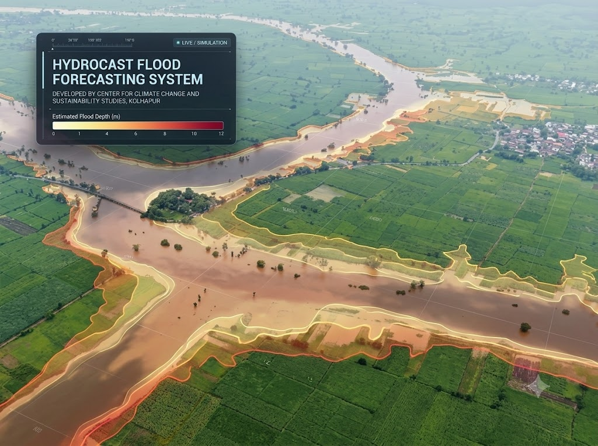
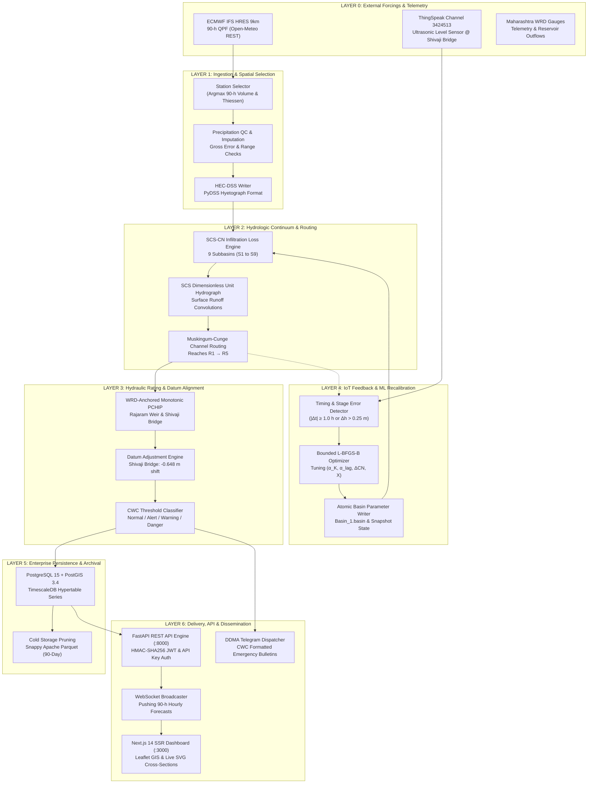

<p align="center">
  
</p>

# HydroCast — Master System Architecture & Engineering Reference

> **Panchganga River Basin** · Kolhapur District, Maharashtra, India  
> **Operational Hydrologic Continuum · Monotonic Hydraulics · Adaptive IoT Calibration · 90-Hour Predictive Lead Time**

---

<p align="center">
  <a href="https://satwikcccss-crypto.github.io/CCCSS-SUK-Panchganga_Hydrocast/">
    
  </a>
  <a href="https://github.com/satwikcccss-crypto/CCCSS-SUK-Panchganga_Hydrocast/actions/workflows/tests.yml">
    
  </a>
  <a href="https://github.com/satwikcccss-crypto/CCCSS-SUK-Panchganga_Hydrocast/actions/workflows/pipeline.yml">
    
  </a>
  <a href="https://github.com/satwikcccss-crypto/CCCSS-SUK-Panchganga_Hydrocast/blob/main/LICENSE">
    
  </a>
</p>

---

## Master Index: 17 Interactive Archify Consoles

The complete system architecture, data pipelines, state machines, and mathematical solvers are documented in **17 standalone, interactive HTML simulators** powered by **Archify**. Each console includes dark/light themes, real-time node inspection, pan/zoom canvas controls, and vector SVG/image export:

| Console | Title | Architectural Domain | Web Link (GitHub Pages) | Local Source File |
| :---: | :--- | :---: | :---: | :---: |
| **01** | **End-to-End System Architecture** | Core System Topology | [Open Console 01 ↗](https://satwikcccss-crypto.github.io/CCCSS-SUK-Panchganga_Hydrocast/diagrams/01-architecture.html) | [`01-architecture.html`](docs/diagrams/01-architecture.html) |
| **02** | **Precipitation & Telemetry Flow** | Ingestion & Telemetry | [Open Console 02 ↗](https://satwikcccss-crypto.github.io/CCCSS-SUK-Panchganga_Hydrocast/diagrams/02-dataflow.html) | [`02-dataflow.html`](docs/diagrams/02-dataflow.html) |
| **03** | **Forecast Cycle Workflow** | 12-Step Conductor | [Open Console 03 ↗](https://satwikcccss-crypto.github.io/CCCSS-SUK-Panchganga_Hydrocast/diagrams/03-forecast-workflow.html) | [`03-forecast-workflow.html`](docs/diagrams/03-forecast-workflow.html) |
| **04** | **API Gateway & Auth Sequence** | Security & Auth | [Open Console 04 ↗](https://satwikcccss-crypto.github.io/CCCSS-SUK-Panchganga_Hydrocast/diagrams/04-sequence-auth-api.html) | [`04-sequence-auth-api.html`](docs/diagrams/04-sequence-auth-api.html) |
| **05** | **Simulation Run Lifecycle** | Run State Machine | [Open Console 05 ↗](https://satwikcccss-crypto.github.io/CCCSS-SUK-Panchganga_Hydrocast/diagrams/05-lifecycle-runs.html) | [`05-lifecycle-runs.html`](docs/diagrams/05-lifecycle-runs.html) |
| **06** | **Hybrid OS Deployment (Docker/Win)** | Multi-OS Deployment | [Open Console 06 ↗](https://satwikcccss-crypto.github.io/CCCSS-SUK-Panchganga_Hydrocast/diagrams/06-deployment-docker-os.html) | [`06-deployment-docker-os.html`](docs/diagrams/06-deployment-docker-os.html) |
| **07** | **HydroSim 2D Handoff & Boundary Inflow**| Hydrodynamics | [Open Console 07 ↗](https://satwikcccss-crypto.github.io/CCCSS-SUK-Panchganga_Hydrocast/diagrams/07-workflow-hydrosim-handoff.html) | [`07-workflow-hydrosim-handoff.html`](docs/diagrams/07-workflow-hydrosim-handoff.html) |
| **08** | **Hydraulic Rating & PCHIP Splines** | Monotonic Hydraulics | [Open Console 08 ↗](https://satwikcccss-crypto.github.io/CCCSS-SUK-Panchganga_Hydrocast/diagrams/08-rating-curve-hydraulics.html) | [`08-rating-curve-hydraulics.html`](docs/diagrams/08-rating-curve-hydraulics.html) |
| **09** | **Rain Gauge Selection & Thiessen Flow** | Spatial Precipitation | [Open Console 09 ↗](https://satwikcccss-crypto.github.io/CCCSS-SUK-Panchganga_Hydrocast/diagrams/09-raingauge-selection-flowchart.html) | [`09-raingauge-selection-flowchart.html`](docs/diagrams/09-raingauge-selection-flowchart.html) |
| **10** | **Catchment Hydrology Solver** | Runoff & Routing | [Open Console 10 ↗](https://satwikcccss-crypto.github.io/CCCSS-SUK-Panchganga_Hydrocast/diagrams/10-catchment-hydrology-solver.html) | [`10-catchment-hydrology-solver.html`](docs/diagrams/10-catchment-hydrology-solver.html) |
| **11** | **Backend API Architecture & Routes** | FastAPI Service | [Open Console 11 ↗](https://satwikcccss-crypto.github.io/CCCSS-SUK-Panchganga_Hydrocast/diagrams/11-backend-api.html) | [`11-backend-api.html`](docs/diagrams/11-backend-api.html) |
| **12** | **Frontend Emergency Dashboard UI** | Next.js 14 Frontend | [Open Console 12 ↗](https://satwikcccss-crypto.github.io/CCCSS-SUK-Panchganga_Hydrocast/diagrams/12-frontend-dashboard.html) | [`12-frontend-dashboard.html`](docs/diagrams/12-frontend-dashboard.html) |
| **13** | **Relational Schema & Database ERD** | PostGIS Data Model | [Open Console 13 ↗](https://satwikcccss-crypto.github.io/CCCSS-SUK-Panchganga_Hydrocast/diagrams/13-database-schema.html) | [`13-database-schema.html`](docs/diagrams/13-database-schema.html) |
| **14** | **HEC-HMS Engine & Python Emulator** | Hydrology Solver | [Open Console 14 ↗](https://satwikcccss-crypto.github.io/CCCSS-SUK-Panchganga_Hydrocast/diagrams/14-hec-hms-engine.html) | [`14-hec-hms-engine.html`](docs/diagrams/14-hec-hms-engine.html) |
| **15** | **Adaptive ML Recalibration Loop** | Feedback Optimizer | [Open Console 15 ↗](https://satwikcccss-crypto.github.io/CCCSS-SUK-Panchganga_Hydrocast/diagrams/15-ml-calibration.html) | [`15-ml-calibration.html`](docs/diagrams/15-ml-calibration.html) |
| **16** | **Navigable Repository Tree & Assets** | Code Structure | [Open Console 16 ↗](https://satwikcccss-crypto.github.io/CCCSS-SUK-Panchganga_Hydrocast/diagrams/16-repository-tree.html) | [`16-repository-tree.html`](docs/diagrams/16-repository-tree.html) |
| **17** | **90-Hour Cycle Waterfall Timeline** | Pipeline Timings | [Open Console 17 ↗](https://satwikcccss-crypto.github.io/CCCSS-SUK-Panchganga_Hydrocast/diagrams/17-cycle-waterfall.html) | [`17-cycle-waterfall.html`](docs/diagrams/17-cycle-waterfall.html) |

---

## 1. Architectural Philosophy & Core Tenets

HydroCast is designed as a mission-critical, operational flood early warning system engineered to provide **48 to 72 hours of validated predictive lead time** for the **1,837.213 km² Panchganga River Basin**. The system adheres to four core engineering principles:

1. **Operational Determinism**: Every forecast cycle is reproducible, idempotent, and tracked in a cryptographic run ledger (`simulation_runs`). Missing rainfall or telemetry data triggers fallback interpolation rather than pipeline crashes.
2. **Strict Physical Monotonicity**: Stage-discharge conversions must strictly satisfy $\frac{dQ}{dh} > 0$ across the full domain ($530.18\text{ m}$ to $546.00\text{ m MSL}$). Non-physical oscillations from standard cubic splines are strictly prohibited via Piecewise Cubic Hermite Interpolating Polynomials (PCHIP).
3. **Headless Execution & Zero GUI Dependency**: While fully compatible with US Army Corps of Engineers HEC-HMS 4.x project files (`Basin_1.basin`), HydroCast contains a vectorized, pure-Python hydrologic emulator (`src/hms/runner.py`) capable of running in lightweight headless Linux containers.
4. **Closed-Loop Adaptive Recalibration**: Rather than relying on static empirical parameters, discrepancies between modeled hydrographs and live IoT ultrasonic stage telemetry trigger an automatic bounded optimization routine ($L\text{-BFGS-B}$) that recalibrates basin storage and lag times.

---

## 2. End-to-End System Topology (6-Layer Architecture)

The system is decomposed into six decoupled layers spanning data acquisition, mathematical modeling, persistence, and real-time dissemination:

> 🎮 **Interactive Archify Visualizations for System Topology & Dataflow**:  
> • [Launch Diagram 01: End-to-End System Architecture ↗](https://satwikcccss-crypto.github.io/CCCSS-SUK-Panchganga_Hydrocast/diagrams/01-architecture.html) · [Local File](docs/diagrams/01-architecture.html)  
> • [Launch Diagram 02: Precipitation & Telemetry Dataflow ↗](https://satwikcccss-crypto.github.io/CCCSS-SUK-Panchganga_Hydrocast/diagrams/02-dataflow.html) · [Local File](docs/diagrams/02-dataflow.html)



---

## 3. The 12-Step Automated Forecast Cycle

The operational conductor [`src/orchestrator.py`](src/orchestrator.py) executes a strictly ordered 12-step deterministic pipeline every 6 hours (00z, 06z, 12z, 18z):

> 🎮 **Interactive Archify Visualizations for Workflow & Lifecycles**:  
> • [Launch Diagram 03: Forecast Cycle Workflow ↗](https://satwikcccss-crypto.github.io/CCCSS-SUK-Panchganga_Hydrocast/diagrams/03-forecast-workflow.html) · [Local File](docs/diagrams/03-forecast-workflow.html)  
> • [Launch Diagram 17: 90-Hour Cycle Execution Waterfall ↗](https://satwikcccss-crypto.github.io/CCCSS-SUK-Panchganga_Hydrocast/diagrams/17-cycle-waterfall.html) · [Local File](docs/diagrams/17-cycle-waterfall.html)

| Step # | Process Name | Source Module | Primary Inputs | Generated Artifacts / Outputs | Failure & Retry Policy |
| :---: | :--- | :--- | :--- | :--- | :--- |
| **01** | `fetch_rainfall` | `src.ecmwf.open_meteo` | Open-Meteo REST API, Station Registry | `data/openmeteo_dss/*.json` | 3 retries, exponential backoff (2s, 4s, 8s) + jitter |
| **02** | `select_stations` | `src.processing.station_selector` | 90-h station hyetographs | `subbasin_station_selection.csv` | Falls back to static primary station registry |
| **03** | `generate_hyetographs` | `src.processing.hyetograph` | Spatial weights, hourly rainfall | 9 subbasin hyetographs | Non-negative clipping; conservation of mass check |
| **04** | `write_hec_dss` | `src.dss.writer` | Subbasin hyetographs | `hec_dss_rainfall_table.csv` | Validates timestamp monotonicity and DSS paths |
| **05** | `execute_hms` | `src.hms.runner` | `Basin_1.basin`, rainfall tables | 90-h flow hydrographs ($m^3/s$) | Auto-fallback to pure-Python vectorized solver |
| **06** | `extract_hydrographs` | `src.hms.runner` | Outlet sink & intermediate junctions | `data/runs/CYC_*.json` | Peak volume and arrival time verification |
| **07** | `hydraulic_rating` | `src.hydrology.stage_converter` | Discharge series $Q(t)$, WRD tables | Stage series $h(t)$ in meters MSL | Strictly monotonic PCHIP verification ($dQ/dh > 0$) |
| **08** | `fetch_telemetry` | `src.sensors.thingspeak` | ThingSpeak API (Channel 3424513) | `thingspeak_hourly_cache.json` | 3 retries; cached fallback if sensor offline |
| **09** | `ml_recalibration` | `src.hydrology.ml_calibration` | Modeled vs observed stage/time | `ml_calibration_state.json` | Skipped if discrepancy below tolerance ($<1.0\text{ h}$) |
| **10** | `persist_database` | `src.db.store_results` | Hydrographs, stage, calibration | PostgreSQL tables (`simulation_runs`, etc.) | Rollback on error; saves local emergency JSON |
| **11** | `evaluate_alerts` | `src.alerts.evaluator` | Forecast stage vs CWC limits | `alert_events` table, Alert Level | Deterministic threshold check against CWC datums |
| **12** | `dispatch_notifications`| `src.alerts.telegram_bot` | Evaluated alert events, hydrograph | Telegram messages, agency webhooks | Async fire-and-forget with delivery logging |

---

## 4. Hydrologic Continuum & Catchment Physics

The hydrological continuum models runoff generation across **nine subbasins** covering the $1,837.213\text{ km}^2$ Panchganga catchment.

> 🎮 **Interactive Archify Visualizations for Hydrology & HEC-HMS**:  
> • [Launch Diagram 10: Catchment Hydrology Solver ↗](https://satwikcccss-crypto.github.io/CCCSS-SUK-Panchganga_Hydrocast/diagrams/10-catchment-hydrology-solver.html) · [Local File](docs/diagrams/10-catchment-hydrology-solver.html)  
> • [Launch Diagram 14: HEC-HMS Engine & Python Emulator ↗](https://satwikcccss-crypto.github.io/CCCSS-SUK-Panchganga_Hydrocast/diagrams/14-hec-hms-engine.html) · [Local File](docs/diagrams/14-hec-hms-engine.html)

```
       [S9: Radhanagari] (366.97 km²)
               │
               ▼
       [S7: Garivade] (195.39 km²)
               │
               ▼
       [S5: Padasali] (106.39 km²) ───▶ [Reach R3] ──┐
                                                      ▼
[S6: Gaganbawda] (227.72 km²) ──▶ [Reach R1] ──▶ [Reach R2] ──▶ [Shivaji Bridge Sink]
                                                                        │
[S4: Karanjphen] (262.00 km²) ──▶ [Reach R4] ──┐                        │
[S3: Kotoli]     (261.32 km²) ─────────────────┼──▶ [Reach R5] ─────────┘
[S2: Sangarul]   (153.77 km²) ─────────────────┘        │
[S8: Beed]       (177.44 km²) ──────────────────────────┤
[S1: Karveer]    (86.21 km²)  ──────────────────────────▼
                                              [Rajaram Weir / Outlet Sink]
```

### 4.1. Infiltration Loss (SCS Curve Number)
Precipitation excess $P_e(t)$ is derived from cumulative rainfall $P(t)$ using the standard Soil Conservation Service (SCS) Curve Number method:

$$S = 25.4 \times \left( \frac{1000}{CN} - 10 \right) \quad (\text{mm})$$

$$I_a = 0.2 \times S \quad (\text{Initial abstraction, mm})$$

$$P_e = \begin{cases} 0 & \text{for } P \le I_a \\ \frac{(P - I_a)^2}{P - I_a + S} & \text{for } P > I_a \end{cases}$$

### 4.2. Surface Runoff Transformation (SCS Dimensionless Unit Hydrograph)
Subbasin runoff is transformed via the standard curvilinear unit hydrograph defined by peak discharge $Q_p$ and time-to-peak $T_p$:

$$T_p = \frac{\Delta t}{2} + t_{\text{lag}}$$

$$Q_p = \frac{2.08 \times A}{T_p} \quad \left(A \text{ in km}^2, T_p \text{ in hours}, Q_p \text{ in m}^3/\text{s}\right)$$

### 4.3. Channel Routing (Muskingum-Cunge Method)
Flood wave propagation through river reaches $R1$ through $R5$ is governed by the Muskingum routing equations:

$$Q_{j+1} = C_1 I_{j+1} + C_2 I_j + C_3 Q_j$$

where the routing coefficients satisfy $C_1 + C_2 + C_3 = 1$:

$$C_1 = \frac{\Delta t - 2KX}{2K(1-X) + \Delta t}, \quad C_2 = \frac{\Delta t + 2KX}{2K(1-X) + \Delta t}, \quad C_3 = \frac{2K(1-X) - \Delta t}{2K(1-X) + \Delta t}$$

#### Subbasin & Channel Parameter Registry
| Subbasin | Area ($km^2$) | Initial $CN$ | Lag Time ($min$) | Channel Reach | Travel Time $K$ ($hr$) | Weighting Factor $X$ |
| :---: | :---: | :---: | :---: | :---: | :---: | :---: |
| **S1** (Karveer) | 86.21 | 74.85 | 2,151.96 | **R1** | 2.899 | 0.20 |
| **S2** (Sangarul) | 153.77 | 65.74 | 3,154.25 | **R2** | 11.827 | 0.20 |
| **S3** (Kotoli) | 261.32 | 64.82 | 3,997.70 | **R3** | 3.829 | 0.20 |
| **S4** (Karanjphen) | 262.00 | 61.89 | 3,115.51 | **R4** | 1.224 | 0.20 |
| **S5** (Padasali) | 106.39 | 60.97 | 2,117.09 | **R5** | 4.619 | 0.20 |
| **S6** (Gaganbawda) | 227.72 | 61.78 | 3,318.07 | — | — | — |
| **S7** (Garivade) | 195.39 | 61.28 | 3,362.27 | — | — | — |
| **S8** (Beed) | 177.44 | 65.76 | 3,387.15 | — | — | — |
| **S9** (Radhanagari) | 366.97 | 64.31 | 5,199.04 | — | — | — |

---

## 5. Hydraulic Rating & Datum Shift Engine

Discharge hydrographs $Q(t)$ are converted to river stage elevations $h(t)$ (in meters above Mean Sea Level, m MSL) using official Maharashtra Water Resources Department (WRD) cross-sectional surveys.

> 🎮 **Interactive Archify Visualizations for Hydraulics & Hydrodynamics**:  
> • [Launch Diagram 08: Hydraulic Rating & PCHIP Splines ↗](https://satwikcccss-crypto.github.io/CCCSS-SUK-Panchganga_Hydrocast/diagrams/08-rating-curve-hydraulics.html) · [Local File](docs/diagrams/08-rating-curve-hydraulics.html)  
> • [Launch Diagram 07: HydroSim 2D Handoff & Boundary Inflow ↗](https://satwikcccss-crypto.github.io/CCCSS-SUK-Panchganga_Hydrocast/diagrams/07-workflow-hydrosim-handoff.html) · [Local File](docs/diagrams/07-workflow-hydrosim-handoff.html)

### 5.1. Monotonic PCHIP Formulation
Standard natural cubic splines suffer from Runge's phenomenon and overshoot, which can cause spurious negative derivatives ($\frac{dQ}{dh} < 0$). HydroCast enforces strict monotonicity using **Piecewise Cubic Hermite Interpolating Polynomials (PCHIP)**:

For intervals $[h_k, h_{k+1}]$ with secant slopes $\Delta_k = \frac{Q_{k+1} - Q_k}{h_{k+1} - h_k}$:
1. If $\Delta_k$ and $\Delta_{k-1}$ have opposite signs, set $d_k = 0$.
2. Otherwise, use weighted harmonic mean:
   $$d_k = \frac{w_1 + w_2}{\frac{w_1}{\Delta_{k-1}} + \frac{w_2}{\Delta_k}}$$
This guarantees that $Q(h)$ is continuously differentiable ($C^1$) and strictly monotonic:

$$\frac{dQ}{dh} > 0 \quad \forall h \in [530.18, 546.00]$$

### 5.2. Gauge Datum Calibration & Shift
- **Rajaram Weir**: Used verbatim as anchored by WRD survey datum.
- **Shivaji Bridge**: Hydrologic and topographic survey analysis established an exact datum shift:
  $$\text{Datum}_{\text{Shivaji}} = \text{Datum}_{\text{Rajaram}} - 0.648\text{ m}$$

### 5.3. CWC Emergency Alert Thresholds
| Alert Classification | Rajaram Weir Stage (m MSL) | Shivaji Bridge Stage (m MSL) | Operational Civic Action |
| :--- | :---: | :---: | :--- |
| **NORMAL** | $< 541.50$ | $< 540.85$ | Standard monitoring; normal sluice operations |
| **ALERT** | $541.50 - 542.70$ | $540.85 - 542.05$ | Internal advisory to irrigation engineers |
| **WARNING** | $542.70 - 543.30$ | $542.05 - 542.65$ | Floodplain evacuation notices issued |
| **DANGER** | $543.30 - 545.33$ | $542.65 - 544.68$ | Mandatory evacuation; NDRF/SDRF deployment |
| **HISTORIC PEAK (HFL)** | $\ge 545.33$ | $\ge 544.68$ | Extreme disaster protocols (2019/2021 flood level) |

---

## 6. Closed-Loop Adaptive ML Recalibration

When live telemetry is received from the Shivaji Bridge ultrasonic sensor (ThingSpeak Channel 3424513), [`src/hydrology/ml_calibration.py`](src/hydrology/ml_calibration.py) compares the simulated stage $h_{\text{sim}}(t)$ against observed stage $h_{\text{obs}}(t)$:

> 🎮 **Interactive Archify Visualizations for Telemetry & Machine Learning**:  
> • [Launch Diagram 15: Adaptive ML Recalibration Loop ↗](https://satwikcccss-crypto.github.io/CCCSS-SUK-Panchganga_Hydrocast/diagrams/15-ml-calibration.html) · [Local File](docs/diagrams/15-ml-calibration.html)  
> • [Launch Diagram 09: Rain Gauge Selection & Thiessen Flowchart ↗](https://satwikcccss-crypto.github.io/CCCSS-SUK-Panchganga_Hydrocast/diagrams/09-raingauge-selection-flowchart.html) · [Local File](docs/diagrams/09-raingauge-selection-flowchart.html)

```
           Simulated Hydrograph Q_sim(t) ──▶ PCHIP ──▶ h_sim(t)
                                                           │
                                                           ▼
Live IoT Telemetry ──▶ ThingSpeak API ──────▶ h_obs(t) ─▶ Residual Audit
                                                           │
                                             ┌─────────────┴─────────────┐
                                             ▼                           ▼
                                      |Δt| < 1.0 h               |Δt| ≥ 1.0 h or
                                      |Δh| < 0.25 m               |Δh| ≥ 0.25 m
                                             │                           │
                                             ▼                           ▼
                                      Keep Baseline              Trigger L-BFGS-B
                                      Parameters                 Optimization
                                                                         │
                                                                         ▼
                                                                Update Basin_1.basin
                                                                Atomic Write-back
```

### 6.1. Objective Function
The calibrator minimizes a composite regularized loss function:

$$\min_{\boldsymbol{\theta}} \mathcal{L}(\boldsymbol{\theta}) = w_1 \cdot \text{RMSE}(h_{\text{sim}}, h_{\text{obs}}) + w_2 \cdot |\Delta t_{\text{peak}}| + w_3 \cdot \mathcal{R}(\boldsymbol{\theta})$$

where parameter vector $\boldsymbol{\theta} = [\alpha_K, \alpha_{\text{lag}}, \Delta CN, X]^T$ is strictly bounded:
- Reach storage factor: $\alpha_K \in [0.70, 1.40]$
- Basin lag multiplier: $\alpha_{\text{lag}} \in [0.60, 1.50]$
- Curve Number adjustment: $\Delta CN \in [-8.0, +8.0]$
- Muskingum weighting: $X \in [0.10, 0.35]$

The baseline snapshot [`data/telemetry/calibration_baseline.json`](data/telemetry/calibration_baseline.json) ensures the system never drifts into non-physical parameter spaces.

---

## 7. Enterprise Persistence & Database Architecture

HydroCast utilizes a hybrid persistence architecture combining an ACID-compliant relational spatial engine with columnar cold-storage:

> 🎮 **Interactive Archify Visualizations for Database & Simulation Lifecycle**:  
> • [Launch Diagram 13: Relational Schema & Database ERD ↗](https://satwikcccss-crypto.github.io/CCCSS-SUK-Panchganga_Hydrocast/diagrams/13-database-schema.html) · [Local File](docs/diagrams/13-database-schema.html)  
> • [Launch Diagram 05: Simulation Run Lifecycle State Machine ↗](https://satwikcccss-crypto.github.io/CCCSS-SUK-Panchganga_Hydrocast/diagrams/05-lifecycle-runs.html) · [Local File](docs/diagrams/05-lifecycle-runs.html)

### 7.1. Relational Schema (`PostgreSQL 15 + PostGIS 3.4`)
```sql
-- Core execution ledger
CREATE TABLE simulation_runs (
    run_id VARCHAR(64) PRIMARY KEY,
    cycle_time TIMESTAMPTZ NOT NULL,
    forecast_horizon_hours INT DEFAULT 90,
    peak_discharge_m3s DOUBLE PRECISION,
    peak_stage_m DOUBLE PRECISION,
    peak_time TIMESTAMPTZ,
    status VARCHAR(32) NOT NULL,
    created_at TIMESTAMPTZ DEFAULT NOW()
);

-- Full 90-hour hydrograph time-series
CREATE TABLE hydrograph_results (
    id BIGSERIAL PRIMARY KEY,
    run_id VARCHAR(64) REFERENCES simulation_runs(run_id) ON DELETE CASCADE,
    timestep_hour INT NOT NULL,
    timestamp TIMESTAMPTZ NOT NULL,
    subbasin_id VARCHAR(16),
    discharge_m3s DOUBLE PRECISION NOT NULL,
    stage_m DOUBLE PRECISION,
    alert_level VARCHAR(16)
);

-- Detailed audit trail for pipeline execution
CREATE TABLE pipeline_step_log (
    id BIGSERIAL PRIMARY KEY,
    run_id VARCHAR(64) REFERENCES simulation_runs(run_id) ON DELETE CASCADE,
    step_number INT NOT NULL,
    step_name VARCHAR(64) NOT NULL,
    status VARCHAR(16) NOT NULL,
    duration_seconds DOUBLE PRECISION,
    executed_at TIMESTAMPTZ DEFAULT NOW()
);
```

### 7.2. Cold-Storage Pruning (`src/db/archive_runs.py`)
To prevent unbounded table bloat on production servers, simulation runs older than **90 days** are automatically extracted, serialized into Snappy-compressed Apache Parquet format partitioned by `year=YYYY/month=MM`, and removed from live PostgreSQL tables.

---

## 8. Security, Authentication & Rate Limiting

HydroCast implements defense-in-depth across the API and ingestion layers:

> 🎮 **Interactive Archify Visualizations for API, Security & Dashboard UI**:  
> • [Launch Diagram 11: Backend API Architecture & Middleware Routes ↗](https://satwikcccss-crypto.github.io/CCCSS-SUK-Panchganga_Hydrocast/diagrams/11-backend-api.html) · [Local File](docs/diagrams/11-backend-api.html)  
> • [Launch Diagram 04: API Gateway & Auth Sequence ↗](https://satwikcccss-crypto.github.io/CCCSS-SUK-Panchganga_Hydrocast/diagrams/04-sequence-auth-api.html) · [Local File](docs/diagrams/04-sequence-auth-api.html)  
> • [Launch Diagram 12: Frontend Emergency Dashboard UI ↗](https://satwikcccss-crypto.github.io/CCCSS-SUK-Panchganga_Hydrocast/diagrams/12-frontend-dashboard.html) · [Local File](docs/diagrams/12-frontend-dashboard.html)

1. **Dual-Tier Authentication**:
   - **Interactive Frontend / Web**: HMAC-SHA256 JWT tokens with 24-hour expiration, signed via secret server key.
   - **Automated Headless Orchestration / CLI**: Mandatory `X-API-Key` header verified against cryptographically secure hashed master keys.
2. **Rate Limiting**: Integrated `slowapi` sliding-window limiter enforcing **100 requests per minute** per client IP, preventing denial-of-service on analytical and forecasting endpoints.
3. **CORS & Origin Isolation**: Strict whitelisting of frontend domains, preventing unauthorized third-party embedding.

---

## 9. Deployment Topology & Environments

HydroCast supports two primary operating environments:

> 🎮 **Interactive Archify Visualizations for Deployment & Codebase Structure**:  
> • [Launch Diagram 06: Hybrid OS Deployment (Docker Linux vs Windows Host) ↗](https://satwikcccss-crypto.github.io/CCCSS-SUK-Panchganga_Hydrocast/diagrams/06-deployment-docker-os.html) · [Local File](docs/diagrams/06-deployment-docker-os.html)  
> • [Launch Diagram 16: Navigable Repository Tree & Architecture Atlas ↗](https://satwikcccss-crypto.github.io/CCCSS-SUK-Panchganga_Hydrocast/diagrams/16-repository-tree.html) · [Local File](docs/diagrams/16-repository-tree.html)

### 9.1. Containerized Linux (Primary Production)
```
                      [ Host Network ]
                             │
            ┌────────────────┴────────────────┐
            │ :8000                    :3000  │
            ▼                                 ▼
   [ hydrocast-backend ]             [ hydrocast-frontend ]
   FastAPI, Python 3.12              Next.js 14 SSR, Node 18
   Vectorized Python HMS             React, Tailwind, Leaflet
            │                                 │
            └────────────────┬────────────────┘
                             │
                             ▼
                    [ hydrocast-db ]
                 PostgreSQL 15 + PostGIS
```

### 9.2. Native Windows Server (HEC-HMS Desktop Integration)
For municipal or departmental servers running native Windows, HydroCast provides native setup scripts in [`windows/install_postgres.ps1`](windows/install_postgres.ps1) and [`windows/storage_setup.sql`](windows/storage_setup.sql) allowing direct automation of the HEC-HMS 4.x GUI executable via Jython batch commands.

---

## 10. Verification & Test Suite

The system architecture is validated by **154 automated unit and integration tests** spanning all six layers:

```bash
pytest tests -q
# Output: 154 passed in 7.47s
```

- Hydrology calculations: `tests/test_hydrology.py`, `tests/test_runner_emulator.py`
- Hydraulic rating curves: `tests/test_low_flow_stage_bias.py`, `tests/test_cross_section_survey.py`
- Ingestion & QC: `tests/test_realtime_validator.py`, `tests/test_station_selector.py`
- ML calibration: `tests/test_ml_calibration.py`
- API & Auth: `tests/test_rate_limiting_and_auth.py`, `tests/test_db_connection.py`
