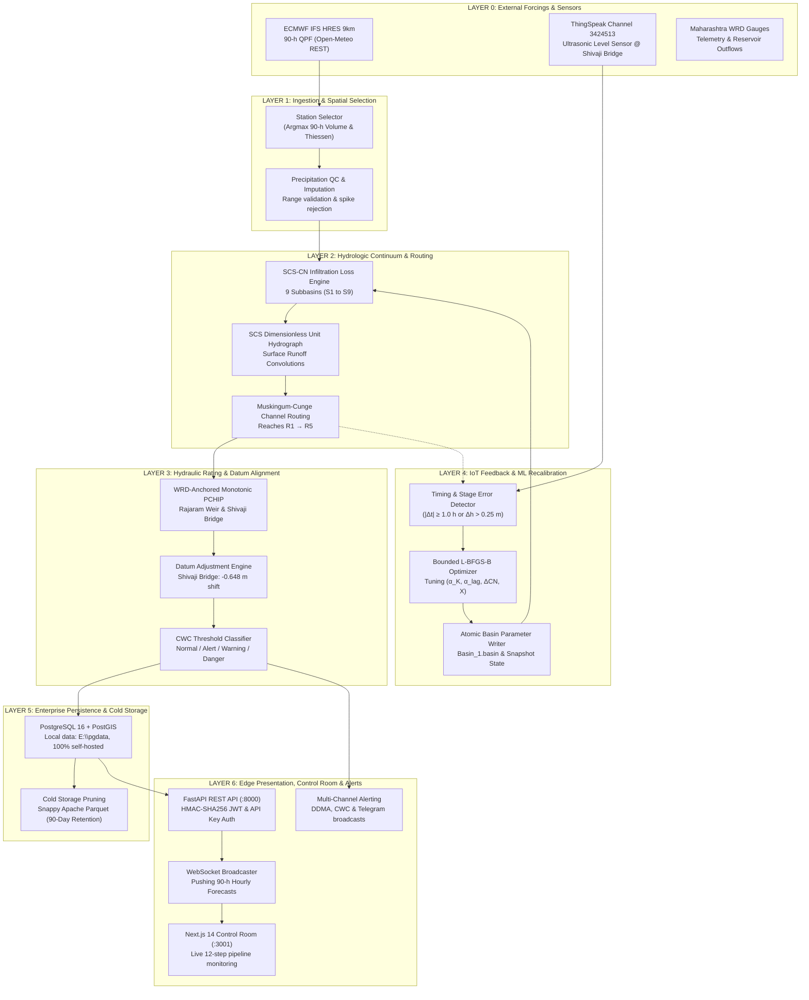

# HydroCast — Master System Architecture & Engineering Reference

> **Panchganga River Basin** · Kolhapur District, Maharashtra, India  
> **Operational Hydrologic Continuum · Monotonic Hydraulics · Adaptive IoT Calibration · 90-Hour Predictive Lead Time**  
> **Deployment: Windows Server Standard (Self-Hosted, On-Premises)**

---

## Master Index: 17 Interactive Archify Consoles

The complete system architecture, data pipelines, state machines, and mathematical solvers are documented in **17 standalone, interactive HTML simulators** powered by **Archify**. Each console includes dark/light themes, real-time node inspection, pan/zoom canvas controls, and vector SVG/image export:

| Console | Title | Focus Area | Local Source File |
| :---: | :--- | :--- | :---: |
| **01** | **End-to-End System Architecture** | Core System Topology | [`01-architecture.html`](docs/diagrams/01-architecture.html) |
| **02** | **Precipitation & Telemetry Flow** | Ingestion & Telemetry | [`02-dataflow.html`](docs/diagrams/02-dataflow.html) |
| **03** | **12-Step Forecast State Machine** | Workflow | [`03-forecast-workflow.html`](docs/diagrams/03-forecast-workflow.html) |
| **04** | **API Gateway & Auth Sequence** | Security & Auth | [`04-sequence-auth-api.html`](docs/diagrams/04-sequence-auth-api.html) |
| **05** | **Simulation Run Lifecycle** | State Machine | [`05-lifecycle-runs.html`](docs/diagrams/05-lifecycle-runs.html) |
| **06** | **Windows Server Deployment** | Native Windows Installation | [`06-deployment-docker-os.html`](docs/diagrams/06-deployment-docker-os.html) |
| **07** | **HydroSim 2D Handoff & Boundary Inflow**| Hydrodynamics | [`07-workflow-hydrosim-handoff.html`](docs/diagrams/07-workflow-hydrosim-handoff.html) |
| **08** | **Hydraulic Rating & PCHIP Splines** | Hydraulics | [`08-rating-curve-hydraulics.html`](docs/diagrams/08-rating-curve-hydraulics.html) |
| **09** | **Rain Gauge Selection & Thiessen Flow** | Spatial Precipitation | [`09-raingauge-selection-flowchart.html`](docs/diagrams/09-raingauge-selection-flowchart.html) |
| **10** | **Catchment Hydrology Solver** | Runoff & Routing | [`10-catchment-hydrology-solver.html`](docs/diagrams/10-catchment-hydrology-solver.html) |
| **11** | **Backend API Architecture & Routes** | FastAPI Service | [`11-backend-api.html`](docs/diagrams/11-backend-api.html) |
| **12** | **Frontend Emergency Dashboard UI** | Next.js 14 Frontend | [`12-frontend-dashboard.html`](docs/diagrams/12-frontend-dashboard.html) |
| **13** | **Relational Schema & Database ERD** | PostGIS Data Model | [`13-database-schema.html`](docs/diagrams/13-database-schema.html) |
| **14** | **HEC-HMS Engine & Python Digital Twin** | Hydrology Solver | [`14-hec-hms-engine.html`](docs/diagrams/14-hec-hms-engine.html) |
| **15** | **Adaptive ML Recalibration Loop** | Machine Learning| [`15-ml-calibration.html`](docs/diagrams/15-ml-calibration.html) |
| **16** | **Navigable Repository Tree & Assets** | Code Structure | [`16-repository-tree.html`](docs/diagrams/16-repository-tree.html) |
| **17** | **90-Hour Cycle Waterfall Timeline** | Pipeline Timings | [`17-cycle-waterfall.html`](docs/diagrams/17-cycle-waterfall.html) |

---

## 1. Architectural Philosophy & Core Tenets

HydroCast is designed as a mission-critical, operational flood early warning system engineered to provide **48 to 72 hours of validated predictive lead time** for the **1,837.213 km² Panchganga River Basin**. The system operates on **Windows Server Standard** at Shivaji University, Kolhapur — **100% self-hosted**, with no cloud dependency (no Vercel, no Supabase). The system adheres to four core engineering principles:

1. **Operational Determinism**: Every forecast cycle is reproducible, idempotent, and tracked in a cryptographic run ledger (`simulation_runs`). Missing rainfall or telemetry data triggers fallback interpolation rather than pipeline crashes.
2. **Strict Physical Monotonicity**: Stage-discharge conversions must strictly satisfy $\frac{dQ}{dh} > 0$ across the full domain ($530.18\text{ m}$ to $546.00\text{ m MSL}$). Non-physical oscillations from standard cubic splines are strictly prohibited via Piecewise Cubic Hermite Interpolating Polynomials (PCHIP).
3. **Headless Execution & Zero GUI Dependency**: While compatible with US Army Corps of Engineers HEC-HMS 4.x project files (`Basin_1.basin`), HydroCast contains a vectorized, pure-Python hydrologic emulator capable of running in lightweight headless environments. The native Windows path uses Jython batch execution of HEC-HMS 4.13.
4. **Closed-Loop Adaptive Recalibration**: Rather than relying on static empirical parameters, discrepancies between modeled hydrographs and live IoT ultrasonic stage telemetry trigger an automatic bounded optimization routine ($L\text{-BFGS-B}$) that recalibrates basin storage and lag times.

---

## 2. End-to-End System Topology (6-Layer Architecture)

The system is decomposed into six decoupled layers spanning data acquisition, mathematical modeling, persistence, and real-time dissemination on Windows Server:

> 🎮 **Interactive Archify Visualizations for System Topology & Dataflow**:  
> • [Launch Diagram 01: End-to-End System Architecture ↗](docs/diagrams/01-architecture.html) · [Local File](docs/diagrams/01-architecture.html)  
> • [Launch Diagram 02: Precipitation & Telemetry Dataflow ↗](docs/diagrams/02-dataflow.html) · [Local File](docs/diagrams/02-dataflow.html)



--- 

## 3. The 12-Step Automated Forecast Cycle

The orchestrator executes a strictly ordered 12-step deterministic pipeline every 6 hours (00z, 06z, 12z, 18z). This is the **Windows Server native path** — HEC-HMS executed via Jython batch, supervised by the HydroCast-Scheduler Windows Service:

> 🎮 **Interactive Archify Visualizations for Workflow & Lifecycles**:  
> • [Launch Diagram 03: Forecast Cycle Workflow ↗](docs/diagrams/03-forecast-workflow.html) · [Local File](docs/diagrams/03-forecast-workflow.html)  
> • [Launch Diagram 17: 90-Hour Cycle Execution Waterfall ↗](docs/diagrams/17-cycle-waterfall.html) · [Local File](docs/diagrams/17-cycle-waterfall.html)

| Step # | Process Name | Module (backend/) | Primary Inputs | Generated Artifacts / Outputs | Failure & Retry Policy |
| :---: | :--- | :--- | :--- | :--- | :--- |
| **01** | `fetch_rainfall` | `ecmwf/open_meteo.py` | Open-Meteo REST API, Station Registry | `ecmwf_90h_raw.json` | 3 retries, exponential backoff (2s, 4s, 8s) + jitter |
| **02** | `select_stations` | `ecmwf/station_selector.py` | 90-h station hyetographs | `subbasin_station_selection.csv` | Falls back to static primary station registry |
| **03** | `ingest_thingspeak` | `sensors/thingspeak.py` | ThingSpeak API (Channel 3424513) | `thingspeak_stage.json` | 3 retries; cached fallback if sensor offline |
| **04** | `qc_sensor_data` | `sensors/validator.py` | Raw sensor pings | `sensor_qc_report.json` | Range validation, spike rejection & noise filtering |
| **05** | `build_hyetographs` | `hydrology/hyetograph.py` | Spatial weights, hourly rainfall | 9 subbasin hyetographs | Non-negative clipping; conservation of mass check |
| **06** | `populate_dss` | `dss/writer.py` | Subbasin hyetographs | `boundary_forcing.dss` | Validates timestamp monotonicity and DSS paths |
| **07** | `execute_hms` | `hms/runner.py` | `Basin_1.basin`, rainfall tables | 90-h flow hydrographs ($m^3/s$) | Auto-fallback to pure-Python vectorized solver if HEC-HMS unavailable |
| **08** | `hydraulic_rating` | `hydrology/stage_converter.py` | Discharge series $Q(t)$, WRD tables | Stage series $h(t)$ in meters MSL | Strictly monotonic PCHIP verification ($dQ/dh > 0$) |
| **09** | `ml_recalibration` | `hydrology/ml_calibration.py` | Modeled vs observed stage/time | `ml_calibration_state.json` | Skipped if discrepancy below tolerance ($<1.0\text{ h}$) |
| **10** | `persist_database` | `db/store_results.py` | Hydrographs, stage, calibration | PostgreSQL tables (`simulation_runs`, etc.) | Rollback on error; saves local emergency JSON |
| **11** | `evaluate_alerts` | `alerts/evaluator.py` | Forecast stage vs CWC limits | `alert_events` table, Alert Level | Deterministic threshold check against CWC datums |
| **12** | `dispatch_notifications`| `alerts/telegram_bot.py` | Evaluated alert events, hydrograph | Telegram messages, agency webhooks | Async fire-and-forget with delivery logging |

> **Scheduling on Windows Server**: The 6-hourly forecast cycles are driven by the `HydroCast-Scheduler` Windows Service (installed via NSSM). Service triggers `python -m backend.orchestrator` at 00:30, 06:30, 12:30, 18:30 local time. The scheduler service heartbeat is monitored by `HydroCast-Watchdog` (15s probe interval).

---

## 4. Hydrologic Continuum & Catchment Physics

The hydrological continuum models runoff generation across **nine subbasins** covering the $1,837.213\text{ km}^2$ Panchganga catchment.

> 🎮 **Interactive Archify Visualizations for Hydrology & HEC-HMS**:  
> • [Launch Diagram 10: Catchment Hydrology Solver ↗](docs/diagrams/10-catchment-hydrology-solver.html) · [Local File](docs/diagrams/10-catchment-hydrology-solver.html)  
> • [Launch Diagram 14: HEC-HMS Engine & Python Emulator ↗](docs/diagrams/14-hec-hms-engine.html) · [Local File](docs/diagrams/14-hec-hms-engine.html)

### 4.1. Infiltration Loss (SCS Curve Number)

Preipitation excess $P_e(t)$ is derived from cumulative rainfall $P(t)$ using the standard Soil Conservation Service (SCS) Curve Number method:

$$S = 25.4 \times \left( \frac{1000}{CN} - 10 \right) \quad (\text{mm})$$

$$I_a = 0.2 \times S \quad (\text{Initial abstraction, mm})$$

$$P_e = \begin{cases} 0 & \text{for } P \le I_a \\ \frac{(P - I_a)^2}{P - I_a + S} & \text{for } P > I_a \end{cases}$$

### 4.2. Surface Runoff Transformation (SCS Dimensionless Unit Hydrograph)

Subbasin runoff is transformed via the standard curvilinear unit hydrograph defined by peak discharge $Q_p$ and time-to-peak $T_p$:

$$T_p = \frac{\Delta t}{2} + t_{\text{lag}}$$

$$Q_p = \frac{2.08 \times A}{T_p} \quad \left(A \text{ in km}^2, T_p \text{ in hours}, Q_p \text{ in m}^3/\text{s}\right)$$

### 4.3. Channel Routing (Muskingum-Cunge Method)

Flood wave propagation through river reaches $R1$ through $R5$ is governed by the Muskingum routing equations:

$$Q_{j+1} = C_1 I_{j+1} + C_2 I_j + C_3 Q_j$$

where the routing coefficients satisfy $C_1 + C_2 + C_3 = 1$:

$$C_1 = \frac{\Delta t - 2KX}{2K(1-X) + \Delta t}, \quad C_2 = \frac{\Delta t + 2KX}{2K(1-X) + \Delta t}, \quad C_3 = \frac{2K(1-X) - \Delta t}{2K(1-X) + \Delta t}$$

#### Subbasin & Channel Parameter Registry

| Subbasin | Area ($km^2$) | Initial $CN$ | Lag Time ($min$) | Channel Reach | Travel Time $K$ ($hr$) | Weighting Factor $X$ |
| :---: | :---: | :---: | :---: | :---: | :---: | :---: |
| **S1** (Karveer) | 86.21 | 74.85 | 2,151.96 | **R1** | 2.899 | 0.20 |
| **S2** (Sangarul) | 153.77 | 65.74 | 3,154.25 | **R2** | 11.827 | 0.20 |
| **S3** (Kotoli) | 261.32 | 64.82 | 3,997.70 | **R3** | 3.829 | 0.20 |
| **S4** (Karanjphen) | 262.00 | 61.89 | 3,115.51 | **R4** | 1.224 | 0.20 |
| **S5** (Padasali) | 106.39 | 60.97 | 2,117.09 | **R5** | 4.619 | 0.20 |
| **S6** (Gaganbawda) | 227.72 | 61.78 | 3,318.07 | — | — | — |
| **S7** (Garivade) | 195.39 | 61.28 | 3,362.27 | — | — | — |
| **S8** (Beed) | 177.44 | 65.76 | 3,387.15 | — | — | — |
| **S9** (Radhanagari) | 366.97 | 64.31 | 5,199.04 | — | — | — |

Channel routing through the 5 Muskingum reaches (R5 $\rightarrow$ R4 $\rightarrow$ R2 $\rightarrow$ R3 $\rightarrow$ R1) connects subbasin outflows to the terminal sink at Rajaram K.T. Weir. For complete routing parameters, travel times $K$, wedge weights $X$, and numerical sub-stepping passes, see the interactive [Console 10: Catchment Hydrology Solver](docs/diagrams/10-catchment-hydrology-solver.html).

> **Basin network console** — see [Console 10: Catchment Hydrology Solver](docs/diagrams/10-catchment-hydrology-solver.html) for the interactive subbasin-to-reach network with parameters.

Subbasin S1 drains directly to the sink with no reach routing, which is consistent with its position at the outlet. Every other subbasin reaches the sink through at least one Muskingum reach.

---

## 5. Hydraulic Rating & Datum Shift Engine

Discharge hydrographs $Q(t)$ are converted to river stage elevations $h(t)$ (in meters above Mean Sea Level, m MSL) using official Maharashtra Water Resources Department (WRD) cross-sectional surveys.

> 🎮 **Interactive Archify Visualizations for Hydraulics & Hydrodynamics**:  
> • [Launch Diagram 08: Hydraulic Rating & PCHIP Splines ↗](docs/diagrams/08-rating-curve-hydraulics.html) · [Local File](docs/diagrams/08-rating-curve-hydraulics.html)  
> • [Launch Diagram 07: HydroSim 2D Handoff & Boundary Inflow ↗](docs/diagrams/07-workflow-hydrosim-handoff.html) · [Local File](docs/diagrams/07-workflow-hydrosim-handoff.html)

### 5.1. Monotonic PCHIP Formulation

Standard natural cubic splines suffer from Runge's phenomenon and overshoot, which can cause spurious negative derivatives ($\frac{dQ}{dh} < 0$). HydroCast enforces strict monotonicity using **Piecewise Cubic Hermite Interpolating Polynomials (PCHIP)**:

For intervals $[h_k, h_{k+1}]$ with secant slopes $\Delta_k = \frac{Q_{k+1} - Q_k}{h_{k+1} - h_k}$:

1. If $\Delta_k$ and $\Delta_{k-1}$ have opposite signs, set $d_k = 0$.
2. Otherwise, use weighted harmonic mean:
   $$d_k = \frac{w_1 + w_2}{\frac{w_1}{\Delta_{k-1}} + \frac{w_2}{\Delta_k}}$$

This guarantees that $Q(h)$ is continuously differentiable ($C^1$) and strictly monotonic:

$$\frac{dQ}{dh} > 0 \quad \forall h \in [530.18, 546.00]$$

### 5.2. Gauge Datum Calibration & Shift

- **Rajaram Weir**: Used verbatim as anchored by WRD survey datum.
- **Shivaji Bridge**: Hydrologic and topographic survey analysis established an exact datum shift:
  $$\text{Datum}_{\text{Shivaji}} = \text{Datum}_{\text{Rajaram}} - 0.648\text{ m}$$

### 5.3. CWC Emergency Alert Thresholds

| Alert Classification | Rajaram Weir Stage (m MSL) | Shivaji Bridge Stage (m MSL) |
| :--- | :---: | :---: |
| **NORMAL** | $< 541.50$ | $< 540.85$ |
| **ALERT** | $541.50 - 542.70$ | $540.85 - 542.05$ |
| **WARNING** | $542.70 - 543.30$ | $542.05 - 542.65$ |
| **DANGER** | $543.30 - 545.33$ | $542.65 - 544.68$ |
| **HISTORIC PEAK (HFL)** | $\ge 545.33$ | $\ge 544.68$ |

---

## 6. Closed-Loop Adaptive ML Recalibration

When live telemetry is received from the Shivaji Bridge ultrasonic sensor (ThingSpeak Channel 3424513), `backend/hydrology/ml_calibration.py` compares the simulated stage $h_{\text{sim}}(t)$ against observed stage $h_{\text{obs}}(t)$:

```
            Simulated Hydrograph Q_sim(t) ──▶ PCHIP ──▶ h_sim(t)
                                                               │
                                                               ▼
Live IoT Telemetry ──▶ ThingSpeak API ──────▶ h_obs(t) ─▶ Residual Audit
                                                               │
                                              ┌─────────────┴─────────────┽
                                              ▼                           ▽
                                           |Δt| < 1.0 h               |Δt| ≥ 1.0 h or
                                           |Δh| < 0.25 m               |Δh| ≥ 0.25 m
                                             │                           │
                                             ▼                           ▼
                                          Keep Baseline              Trigger L-BFGS-B
                                          Parameters                 Optimization
                                                                      │
                                                                      ▼
                                   Update Basin_1.basin
                                   Atomic Write-back (`.bak` snapshot)
```

### 6.1. Objective Function

The calibrator minimizes a composite regularized loss function:

$$\min_{\boldsymbol{\theta}} \mathcal{L}(\boldsymbol{\theta}) = w_1 \cdot \text{RMSE}(h_{\text{sim}}, h_{\text{obs}}) + w_2 \cdot |\Delta t_{\text{peak}}| + w_3 \cdot \mathcal{R}(\boldsymbol{\theta})$$

where parameter vector $\boldsymbol{\theta} = [\alpha_K, \alpha_{\text{lag}}, \Delta CN, X]^T$ is strictly bounded:

- Reach storage factor: $\alpha_K \in [0.70, 1.40]$
- Basin lag multiplier: $\alpha_{\text{lag}} \in [0.60, 1.50]$
- Curve Number adjustment: $\Delta CN \in [-8.0, +8.0]$
- Muskingum weighting: $X \in [0.10, 0.35]$

The baseline snapshot [`backend/service/pipeline_worker.py`](backend/service/pipeline_worker.py) ensures the system never drifts into non-physical parameter spaces.

---

## 7. Enterprise Persistence & Database Architecture

HydroCast on Windows Server utilizes a hybrid persistence architecture combining an ACID-compliant relational spatial engine with columnar cold-storage. All data resides locally — **no cloud synchronization**.

> 🎮 **Interactive Archify Visualizations for Database & Simulation Lifecycle**:  
> • [Launch Diagram 13: Relational Schema & Database ERD ↗](docs/diagrams/13-database-schema.html) · [Local File](docs/diagrams/13-database-schema.html)  
> • [Launch Diagram 05: Simulation Run Lifecycle State Machine ↗](docs/diagrams/05-lifecycle-runs.html) · [Local File](docs/diagrams/05-lifecycle-runs.html)

### 7.1. Relational Schema (PostgreSQL 16 + PostGIS 3.4, Local)

```sql
-- Core execution ledger
CREATE TABLE simulation_runs (
    run_id VARCHAR(64) PRIMARY KEY,
    cycle_time TIMESTAMPTZ NOT NULL,
    forecast_horizon_hours INT DEFAULT 90,
    peak_discharge_m3s DOUBLE PRECISION,
    peak_stage_m DOUBLE PRECISION,
    peak_time TIMESTAMPTZ,
    status VARCHAR(32) NOT NULL,
    created_at TIMESTAMPTZ DEFAULT NOW()
);

-- Full 90-hour hydrograph time-series
CREATE TABLE hydrograph_results (
    id BIGSERIAL PRIMARY KEY,
    run_id VARCHAR(64) REFERENCES simulation_runs(run_id) ON DELETE CASCADE,
    timestep_hour INT NOT NULL,
    timestamp TIMESTAMPTZ NOT NULL,
    subbasin_id VARCHAR(16),
    discharge_m3s DOUBLE PRECISION NOT NULL,
    stage_m DOUBLE PRECISION,
    alert_level VARCHAR(16)
);

-- Detailed audit trail for pipeline execution
CREATE TABLE pipeline_step_log (
    id BIGSERIAL PRIMARY KEY,
    run_id VARCHAR(64) REFERENCES simulation_runs(run_id) ON DELETE CASCADE,
    step_number INT NOT NULL,
    step_name VARCHAR(64) NOT NULL,
    status VARCHAR(16) NOT NULL,
    duration_seconds DOUBLE PRECISION,
    executed_at TIMESTAMPTZ DEFAULT NOW()
);
```

All schema files are in `database/schema/`, split into relative `\ir` includes so they work both in Docker and local Windows `psql`.

### 7.2. Cold-Storage Pruning (`backend/service/pipeline_worker.py`)

To prevent unbounded table bloat on the Windows Server, simulation runs older than **90 days** are automatically extracted, serialized into Snappy-compressed Apache Parquet format partitioned by `year=YYYY/month=MM`, and removed from live PostgreSQL tables. Manual execution:

```powershell
# Dry run (inspect row counts without deleting)
python -m backend.scripts.archive_runs --dry-run

# Execute archival with 90-day retention
python -m backend.scripts.archive_runs --retention-days 90
```

### 7.3. Database Initialization on Windows Server

PostgreSQL 16 is installed and initialized via the Windows PowerShell script:

```powershell
# Step 2: Initialize PostgreSQL Database
powershell -ExecutionPolicy Bypass -File .\windows\init_database.ps1 -PgUser "postgres" -PgPassword "YourAdminPassword"
```

Then run the schema and migrations:

```powershell
psql -U postgres -d rainfall_runoff -f database/schema.sql
psql -U postgres -d rainfall_runoff -f database/auth/01_admin_auth.sql
psql -U postgres -d rainfall_runoff -f database/auth/02_admin_users_upgrade.sql
```

### 7.4. Admin User Creation

Admin users are created via the management script — **no hardcoded credentials**:

```powershell
python -m backend.scripts.manage_users add --username OPERATOR1 --password <secure-password> --role admin --email operator@suk.edu
```

Available operations: `add`, `list`, `setpwd`, `reset`, `toggle`. View all users and roles.

---

## 8. Security, Authentication & Rate Limiting

HydroCast implements defense-in-depth across the API and ingestion layers on Windows Server:

> 🎮 **Interactive Archify Visualizations for API, Security & Dashboard UI**:  
> • [Launch Diagram 11: Backend API Architecture & Middleware Routes ↗](docs/diagrams/11-backend-api.html) · [Local File](docs/diagrams/11-backend-api.html)  
> • [Launch Diagram 04: API Gateway & Auth Sequence ↗](docs/diagrams/04-sequence-auth-api.html) · [Local File](docs/diagrams/04-sequence-auth-api.html)

1. **Fail-closed admin login**: If `ADMIN_PASSWORD`/`ADMIN_USERNAME` are unset, **no** login succeeds.
2. **Constant-time secrets**: Passwords, API keys and internal keys use `hmac.compare_digest` / `crypto.timingSafeEqual`. Passwords are compared exactly (no trimming).
3. **Login throttling**: `POST /api/v1/admin/auth/token` is capped at `RATE_LIMIT_LOGIN` (default 5/min) per IP.
4. **JWT hardening**: Only HMAC algorithms (`HS256/384/512`) are accepted; unsupported values fall back to HS256. Parser errors are not echoed back.
5. **Public API key**: `X-API-Key` compared in constant time; an unset server key authorises nobody.
6. **Internal broadcast**: `INTERNAL_KEY` must be ≥16 chars; otherwise the endpoint returns 503.

### Input validation

* All SQL uses asyncpg `$1` parameters — no string interpolation.
* `run_id` / `cycle_id` must match `^[A-Za-z0-9][A-Za-z0-9_-]{0,127}$` and the resolved path must stay inside `data/runs`.
* Pagination `limit` is clamped (`1..500`).
* Request bodies over `MAX_REQUEST_BYTES` (default 1 MB) are rejected.

### Transport & browser

* CORS never combines `*` with credentials. Default is **same-origin only**; `CORS_ORIGINS` set to an explicit allowlist.
* Security headers on API responses: `X-Content-Type-Options`, `X-Frame-Options`, `Referrer-Policy`, `Permissions-Policy`, `COOP`, `HSTS`, `Cache-Control: no-store`.
* Frontend sets a Content-Security-Policy, hides `X-Powered-By`, and no longer loads Leaflet CSS from a third-party CDN.
* Telegram webhook validation **fails closed** in production when `TELEGRAM_WEBHOOK_SECRET` is unset.

---

## 9. Deployment Topology & Environments

HydroCast on Windows Server provides native deployment — **Docker is optional; native Windows Services are the primary deployment path**.

### 9.1. Native Windows Server Installation (Primary Path)

The system is installed via NSSM (Non-Sucking Service Manager) Windows Services. Full installation runbook:

1. **Prerequisites** — Windows Server Standard, PostgreSQL 16 + PostGIS, Python 3.12, Node.js v18+/v20+, HEC-HMS 4.13.
2. **Environment** — Edit `.env` at project root with all required secrets (see SECURITY.md).
3. **Database** — Initialize via `.\windows\init_database.ps1`.
4. **Frontend builds** — `npm ci` then `npm run build` on both `frontend-public` and `frontend-admin`.
5. **NSSM services** — Install via `.\windows\install_services.ps1`.
6. **Start services** — `.\windows\service_control.ps1 -Action start`.
7. **Verify** — Health endpoints, service status, frontend accessibility.

### 9.2. Caddyfile Reverse Proxy (Production)

All external traffic terminates at a reverse proxy (Caddy recommended). The Caddyfile routes traffic to the correct internal ports:

```caddyfile
; HydroCast Windows Server Reverse Proxy

; Public portal (port 3000) — accessible to citizens & officials
example.org/* {
    reverse_proxy 127.0.0.1:3000
}

; Operator console (port 3001) — campus intranet / VPN only
admin.example.org/* {
    reverse_proxy 127.0.0.1:3001
}

; FastAPI backend (port 8000) — API & WebSocket routes
api.example.org/* {
    reverse_proxy 127.0.0.1:8000
}

; Health probes (ports 8000/3001)
health.example.org {
    header X-Request-ID "{uuid}"
    reverse_proxy 127.0.0.1:8000
}
```

Key Caddy configurations:
* `X-Forwarded-For` forwarded only from trusted proxy IP
* `FORWARDED_ALLOW_IPS` set to reverse proxy IP only (never `*`)
* GZip compression enabled on backend
* TLS terminated at proxy; HTTP redirects to HTTPS

### 9.3. Docker Deployment (Optional, Linux-Only)

For cloud or Linux environments, the system is fully containerized via Docker Compose. This path is **not the primary Windows deployment**.

---

## 10. Verification & Test Suite

The system architecture is validated by automated test suites. On Windows Server, tests are run from an elevated PowerShell prompt:

```powershell
# Fast Local Development Suite (< 10 seconds)
pytest
# Output: 256 passed, 3 skipped in under 10 seconds
```

### Test Inventory & Module Breakdown

| Test Module | Test Count | Focus Area |
| :--- | :---: | :--- |
| `tests/test_golden_emulator.py` | 2 | Bit-level determinism & regression lock |
| `tests/test_runner_emulator.py` | 16 | Hydrologic Twin Solver |
| `tests/test_ml_calibration.py` | 8 | Adaptive Calibrator |
| `tests/test_low_flow_stage_bias.py` | 44 | Rating Physics Autopsy |
| `tests/test_cross_section_survey.py` | 17 | Survey Geometry |
| `tests/test_rating_physics.py` | 6 | Pure Geometry Core |
| `tests/test_realtime_validator.py` | 13 | Sensor Ingestion |
| `tests/test_telemetry_metrics.py` | 6 | Statistical Core |
| `tests/test_hydrosim_integration.py` | 17 | 2D Handoff Boundary API |
| `tests/test_rate_limiting_and_auth.py` | 7 | Authentication & Limits |
| `tests/test_security_hardening.py` | 13 | Security Hardening |
| `tests/test_api_endpoints.py` | 28 | FastAPI Surface |
| `tests/test_write_paths.py` | 21 | Persistence Ledger |
| `tests/test_db_connection.py` | 6 | Database Connection |
| `tests/test_soil_moisture.py` | 5 | NWP Soil Moisture |
| `tests/test_station_selector.py` | 4 | Rainfall Mapping |
| `tests/test_qc_pipeline.py` | 4 | Quality Control |
| `tests/test_retry_utils.py` | 6 | Network Resilience |
| `tests/test_alerts_dispatcher.py` | 15 | Emergency Alerting |
| `tests/test_orchestrator.py` | 8 | 12-Step Pipeline |
| `tests/test_archival.py` | 3 | Cold Storage |
| `tests/test_hydrology.py` | 5 | Hydraulic Rating |
| `tests/test_validation_metrics.py` | 2 | Accuracy Matrix |
| `tests/test_postgres_integration.py` | 3 | PostgreSQL/PostGIS |

---

## 11. Technology Stack (Windows Server)

| Layer | Technology | Function |
| :--- | :--- | :--- |
| NWP data | ECMWF IFS HRES 9 km via Open-Meteo REST | 90-hour QPF forecast |
| Ingestion | `requests`, `openmeteo-requests`, custom QC | Backoff, jitter, QC bounds |
| Hydrology | HEC-HMS 4.13 (Jython) + Python emulator | SCS-CN loss, UH transform, Muskingum routing |
| Hydraulics | `scipy.interpolate.PchipInterpolator` | Monotone rating curves |
| Calibration | `scipy.optimize.minimize` (L-BFGS-B), NumPy | Bounded optimiser + gated ML |
| Telemetry | ThingSpeak channel `3424513` | Ultrasonic level at Shivaji Bridge |
| Database | **PostgreSQL 16 + PostGIS** (local, 100% self-hosted) | Cycles, hydrographs, step logs |
| Archival | PyArrow, Apache Parquet | Columnar retention export |
| API | FastAPI, Uvicorn, asyncpg | REST endpoints and WebSocket push |
| Security | PyJWT (HS256), `slowapi`, `hmac.compare_digest` | Scoped API keys, JWT, rate limiting |
| Alerting | Telegram Bot API, HTTP webhooks | DDMA bulletins |
| Frontend | Next.js 14 App Router, React 18, Tailwind | Operations dashboard |
| Deployment | **NSSM Windows Services** (primary) · Docker (optional, Linux) | Native Windows installation |
| CI/CD | GitHub Actions (windows-server-production branch) | Automated test suite |

--- 

## 12. Release & Upgrade Runbook (Windows Server)

### Cutting windows-v2.1.0

1. Ensure all feature branches are merged into `windows-server-production`.
2. Update `CHANGELOG.md` with `## [2.1.0] - 2026-11-13 — Windows Server Stable Release`.
3. Tag the release: `git tag windows-v2.1.0` and `git push windows-v2.1.0`.
4. Verify health gates:
   - All health endpoints return healthy status.
   - Database migration scripts run without error.
   - Frontend builds pass: `npm ci && npm run build` on both `frontend-public` and `frontend-admin`.
   - NSSM services restart cleanly after tag.

### Deploying windows-v2.1.0 to Windows Server

1. Pull the tagged release on the Windows Server:
   ```powershell
   git pull origin windows-v2.1.0
   ```
2. Re-run the full installation runbook (Steps 1–7 in the Quickstart section). All steps are idempotent.
3. Verify the new health endpoints `/healthz/live` and `/healthz/ready`.
4. Confirm the version reported in API responses matches `API-Version: 2.1.0`.

### Rolling back to prior version

1. Identify the prior tag: `git tag --list | sort -V`.
2. Check out the prior release:
   ```powershell
   git checkout windows-v2.0.0
   ```
3. Re-run the installation runbook (Steps 1–7). All scripts are backward-compatible.
4. Verify health endpoints report the prior version.
5. Return to `windows-server-production` once the rollback is confirmed successful.

---

## 13. Known Issues & Engineering Notes

* **`src/` vs `backend/` path references**: Historical documentation referenced `src/` directory paths. In the v2.1.0 release, all code has been refactored to `backend/` paths. Any remaining `src/` references in legacy docs refer to the pre-2.1 architecture and are documented in `historical_checks/README.md`.
* **HEC-HMS Jython execution**: The native Windows path executes HEC-HMS 4.13 via Jython batch scripts. The pure-Python vectorized emulator is the fallback path used in CI (Linux runners) and when HEC-HMS binary is unavailable.
* **PostgreSQL 15 → 16 migration**: Schema files use relative `\ir` includes for compatibility across Docker and local Windows `psql`. Data migration from PostgreSQL 15 to 16 is backward-compatible for the `rainfall_runoff` schema.
* **No Vercel/Supabase dependency**: This is a 100% self-hosted Windows Server deployment. All cloud references in prior docs have been removed.

--- 

## 14. Diagram Console Index

All 17 interactive HTML simulators are located in `docs/diagrams/` and can be launched from the consoles above. Each console supports:
* Dark/light theme switching
* Pan/zoom canvas controls
* Real-time node inspection
* Vector SVG/image export
* Layer toggling for dataflow visualization

--- 

*Centre for Climate Change and Smart Solutions (CCCSS)*  
*Shivaji University, Kolhapur (SUK), Maharashtra, India*  

*Released under the Academic & Civil Disaster Resilience License.*  
*Built with ❤️ by CCCSS, Shivaji University for the safety, resilience, and flood defense of Kolhapur District.*