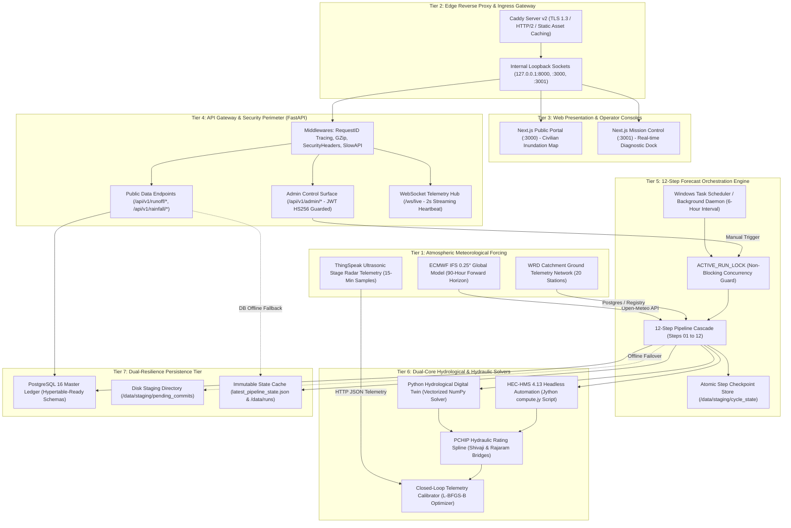
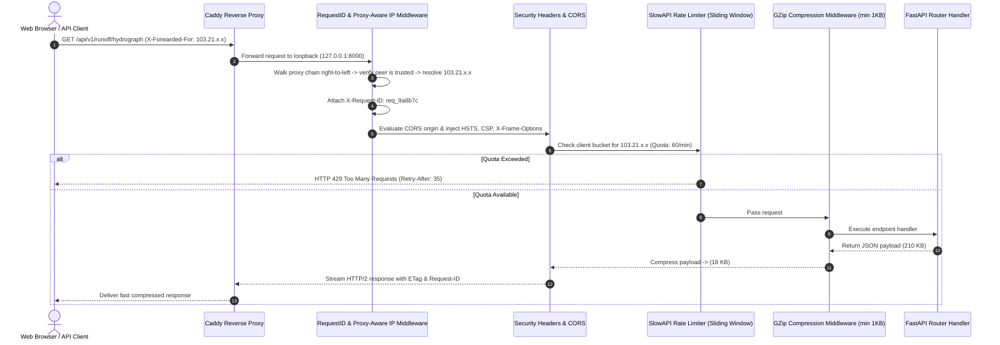

# Architecture Atlas: Windows Server 2025 Production Topology
*Written by Principal Systems Architect & Chief Hydrologist*
*Target System: HydroCast Panchganga Operational Flood Intelligence Engine*

---

## Executive Architectural Overview

This document is the authoritative systems and physics reference for how **HydroCast** actually moves water from an oceanic numerical weather prediction grid to an actionable, life-safety flood warning message in a municipal district control room.

Most architectural documentation suffers from a fundamental flaw: it describes what engineers *hoped* the system would do, rather than how the bytes, sockets, and differential equations actually execute on bare metal. This Atlas takes the opposite approach. It is an exhaustive, code-grounded walk down the entire pipeline:
1. **Atmospheric Forcing & Ingestion**
2. **Dynamic Spatial Precipitaiton Selection**
3. **The SCS-CN & Muskingum Hydrological Runoff Core**
4. **Hydraulic Rating Curve Transformations (PCHIP Manning)**
5. **Closed Telemetry Loops & Adaptive Real-Time Calibration**
6. **Dual-Tier Resilient Persistence (PostgreSQL & Disk Staging)**
7. **Windows Server 2025 Host Process Topology**

---

## 1. End-to-End System Topology (7-Tier Production Architecture)

The system operates across seven isolated, fault-tolerant tiers on an on-premises **Windows Server 2025** host at Shivaji University, Kolhapur:

---

## 2. The Seven Tiers Explained in Rigorous Detail

### Tier 1: Atmospheric Meteorological Forcing & Field Telemetry
The pipeline is driven externally by three distinct input streams:
1. **ECMWF Integrated Forecasting System (IFS)**:
   - Global numerical model providing Quantitative Precipitation Forecasts (QPF) at 0.25-degree grid resolution ($\approx 25\text{ km} \times 25\text{ km}$).
   - Generates 90 hourly forecast steps starting from cycle time ($T+0$ to $T+90$).
   - Polled across 18 catchment coordinates via HTTP/2 Open-Meteo failsafe clusters.
2. **ThingSpeak Ultrasonic Radar Gauge Telemetry**:
   - High-frequency ultrasonic level sensors mounted beneath Shivaji Bridge.
   - Measures stage at 15-minute intervals, reporting water level in metres above Mean Sea Level (m MSL).
   - Feeds the closed-loop ML calibration detector.
3. **WRD Ground Rain Gauge Network**:
   - 20 manual and tipping-bucket telemetry stations maintained by the Maharashtra Water Resources Department across the Kasari, Kumbhi, Dhamani, and Bhogavati subbasins.

---

### Tier 2: Ingress, Reverse Proxy & Security Perimeter
All external access is mediated by **Caddy Server v2** running natively as a Windows Service:
- **Port 80**: Plain HTTP requests receive a permanent 301 redirect to HTTPS.
- **Port 443**: Terminates TLS 1.3 using automated ECDSA certificates.
- **Loopback Proxy Isolation**: Direct connections to ports 8000 (FastAPI), 3000 (Public UI), and 3001 (Admin UI) are blocked from external interfaces via Windows Advanced Firewall rules. Caddy terminates connections and proxies downstream exclusively across `127.0.0.1`.
- **Static Asset Offload**: Pre-compressed frontend chunks in `frontend-public/.next/static` are served directly by Caddy from the filesystem with `Cache-Control: public, max-age=31536000, immutable`, bypassing Node.js entirely for static traffic.

---

### Tier 3: Web Presentation & Dashboards
HydroCast splits user interaction into two independent Next.js 14 applications built on the Node.js standalone runtime:
1. **Public Flood Intelligence Portal (Port 3000)**:
   - Designed for high-concurrency public traffic during flood panic events.
   - Features client-side Leaflet GIS mapping of the Panchganga catchment, interactive Plotly stage hydrographs, and color-coded CWC alert status banners (Normal, Watch, Warning, Danger).
   - In zero-key public mode, all GET reads utilize HTTP 304 conditional ETag caching and GZip compression to protect cellular bandwidth in disaster zones.
2. **Operator Mission Control (Port 3001)**:
   - Dedicated administrative desktop interface for district disaster officers and university researchers.
   - Features real-time WebSocket terminal docks streaming live pipeline step execution, one-click manual forecast triggers, step retries, and hardware resource telemetry gauges.

---

### Tier 4: FastAPI Gateway & Middleware Chain
The backend application object (`backend/api/main.py`) processes requests through a hardened sequential middleware pipeline:

---

### Tier 5: The 12-Step Hydrological Pipeline Cascade
The core forecast workflow executes in twelve strictly ordered, timed stages managed by `backend/service/pipeline_worker.py`:

| Step | Formal Designation | Core Technical Function | Failure Consequence |
|:---:|:---|:---|:---|
| **01** | **Weather Download** | Polls Open-Meteo ECMWF IFS 90h numerical grid across 18 station coordinates. | Degrades to Tier 2 (staged cache) or Tier 3 (climatology). |
| **02** | **Gauge Network Verification** | Inspects active status of 20 catchment rainfall stations in database. | Uses static registry fallback; logs operational warning. |
| **03** | **Quality Control & Telemetry Validation** | Runs Z-score filters and physical bounds checks on incoming telemetry. | Rejects bad sensor frames; halts cycle if rainfall impossible. |
| **04** | **Station Selection** | Dynamic Spatial Selection: assigns governing rainfall hyetograph to S1-S9. | Falls back to spatial ECMWF areal interpolation. |
| **05** | **HEC-DSS Authoring** | Encodes 90-hour rainfall records into standard USACE binary DSS blocks. | Logs warning; Python twin proceeds using in-memory arrays. |
| **06** | **Basin Parameter Verification** | Checks $I_a$, $CN$, and reach lag parameters in `Basin_1.basin`. | Clamps non-physical parameters to calibrated boundaries. |
| **07** | **Hydrological Simulation** | Computes SCS-CN runoff transforms and Muskingum channel routing. | Dual-Core: HEC-HMS 4.13 primary $\to$ Python Twin fallback. |
| **08** | **Result Extraction** | Compiles outlet hydrograph coordinates at Rajaram Weir sink (`J_Outlet`). | Halts pipeline if simulated discharge contains NaN/Inf values. |
| **09** | **Hydraulic Stage Conversion** | PCHIP monotonic spline converts outlet $Q$ to bridge stage (m MSL). | Restores upstream context on retry; never evaluates on 0.0 m³/s. |
| **10** | **Database Master Persistence** | Commits 90 hourly rows per bridge and subbasin to PostgreSQL. | Dual-Resilience: Stages to disk; marks status `degraded_staged`. |
| **11** | **Alert Evaluation & Bulletin** | Evaluates CWC flood stages; calculates arrival strike windows. | Generates emergency JSON bulletin; flags danger thresholds. |
| **12** | **Telemetry Sync & Broadcast** | Writes immutable disk JSON; pushes WebSocket alerts to consoles. | Live consoles update instantly; emergency Telegram alert fired. |

---

### Tier 6: Dual-Core Simulation & Hydraulic Rating Core
The system rejects single-point-of-failure simulation. It maintains a certified binary solver alongside an analytical Python twin:
1. **HEC-HMS 4.13 Headless Automation**:
   - Executes the official US Army Corps of Engineers engine using Jython script `compute.jy`.
   - Reads inputs from `Panchganga_Forecast.dss`, updates `Control_1.control`, and writes simulated hydrographs to binary DSS records.
2. **Python Hydrological Digital Twin**:
   - Independent analytical implementation of SCS-CN loss method and Muskingum finite-difference routing in pure vectorized NumPy.
   - Evaluates 9 subbasins and 5 routing reaches in **under 150 milliseconds**.
   - Executes identically whether HEC-HMS is installed or absent.
3. **PCHIP Hydraulic Rating Spline**:
   - Converts simulated discharge $Q$ into river water surface elevation $H$ (m MSL).
   - Enforces mathematical monotonicity ($\frac{dH}{dQ} > 0$ strictly), preventing non-physical stage drops during flood surges.

---

### Tier 7: Dual-Resilience Persistence Architecture
The persistence layer guarantees zero data loss across database outages:
- **Normal Operation**: Transactions commit directly to PostgreSQL master tables (`simulation_runs`, `bridge_stage_forecast`, `hydrograph_results`).
- **PostgreSQL Downtime**: The resilient pool catches connection errors, records an honest `status="degraded_staged"`, and writes an atomic JSON payload to `data/staging/pending_commits/staged_{cycle_id}_*.json`.
- **Self-Healing Replay**: When the database recovers, `replay_staged_transactions()` acquires an atomic `.processing` file claim, wraps execution in a dedicated rollback block, and commits all backlogged historical forecasts.
