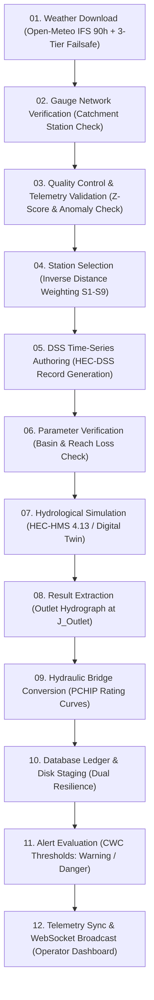
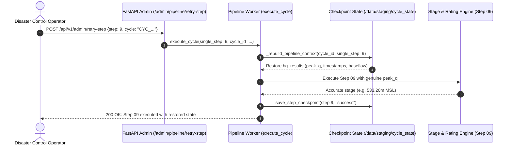

# Forecast Pipeline Lifecycle & Execution Manual
**HydroCast Panchganga Operational Flood Forecasting System**  
*The 12-Step Hydrological Computation Cascade & Resilient Checkpointing*

---

## 1. Overview of the 12-Step Forecast Cycle

HydroCast executes its complete flood forecasting pipeline in twelve distinct, sequential phases known as the **12-Step Computation Cascade**. The cycle runs on a strict 6-hourly schedule (00Z, 06Z, 12Z, 18Z) or on-demand via administrative manual dispatch. 

Each step is completely modular, timed with high-resolution performance counters, logged to the persistent `data/logs/orchestrator.log`, broadcast to live operator WebSockets, and recorded in the database `pipeline_step_log` table.

---

## 2. Exhaustive Step-by-Step Specification

### Step 01: Weather Ingestion & 3-Tier Failsafe
- **Module**: `backend/rainfall/open_meteo_failsafe.py`
- **Operation**: Queries ECMWF IFS 0.25-degree numerical QPF grids for 18 geographic station coordinates across the Panchganga catchment for a 90-hour forward horizon.
- **Resilience Engine**:
  - Automatically executes up to 5 retries with exponential backoff (`backoff_factor=0.2`).
  - Upon success, persists a stamped backup (`weather_success_YYYYMMDD_HHMM.json`) and updates `latest_successful_weather.json`.
  - Automatically executes cache retention sweeps (`purge_expired_weather_cache()`), removing historical raw weather JSON files older than 30 days to protect disk storage.
  - If Tier 1 fails, seamlessly switches to Tier 2 (cached previous cycle) and sets operational warning flags.

### Step 02: Rain Gauge Network Verification
- **Module**: `backend/processing/gauge_fetcher.py`
- **Operation**: Verifies the operational status of the 20 physical raingauge stations in the Panchganga network. Inspects station active flags in PostgreSQL `gauge_stations` or falls back to static registry verification when the database is offline.

### Step 03: Telemetry Quality Control & Anomaly Filtering
- **Module**: `backend/validation/realtime_telemetry_validator.py`
- **Operation**: Runs strict physical bounds and statistical plausibility filters against incoming telemetry:
  - Detects sensor dropouts, stuck values (zero variance over > 6 hours), and non-physical spikes (e.g. > 150 mm/hr rainfall or > 550 m water stage).
  - Normalizes timestamps to UTC ISO-8601 standards.

### Step 04: Dynamic Station Selection & Spatial Weighting
- **Module**: `backend/rainfall/station_selector.py`
- **Operation**: Computes representative precipitation forcing for each of the nine subbasins ($S_1$ through $S_9$).
- **Methodology**: Evaluates available ground gauge telemetry against ECMWF numerical grid points. If a local raingauge is active and reporting within 3 hours, it is dynamically selected; otherwise, the system transparently falls back to ECMWF spatial interpolation, recording governing decisions in `station_selection_log`.

### Step 05: HEC-DSS Time-Series Generation
- **Module**: `backend/dss/writer.py`
- **Operation**: Formats the 90-hour precipitation series into standard US Army Corps of Engineers HEC-DSS format. Authoring uses exact pathname conventions (`/PANCHGANGA/{SUBBASIN}/PRECIP-INC/{START}/{INTERVAL}/{VERSION}/`) and writes binary records into `data/dss/Panchganga_Forecast.dss`.

### Step 06: Hydrological Model Parameter Verification
- **Module**: `backend/hms/basin_parser.py`
- **Operation**: Inspects the HEC-HMS basin specification (`dss/HMS_Automation_RJKT/Basin_1.basin`) and control parameters. Verifies that Initial Abstraction ($I_a$), Curve Number ($CN$), lag times, and Muskingum channel parameters ($K, X$) fall strictly within physically realistic bounds for the Western Ghats Deccan basalts.

### Step 07: Hydrological Routing & Simulation
- **Module**: `backend/hms/runner.py`
- **Execution Path**:
  - **Headless HEC-HMS**: If HEC-HMS 4.13 is installed on the host, the pipeline launches the engine in headless batch mode using Jython automation script `compute.jy`.
  - **Python Digital Twin Emulator**: If HEC-HMS is absent or headless execution times out, the native Python digital twin emulator executes. The emulator solves the exact same SCS-CN non-linear runoff transforms and Muskingum finite-difference routing cascades in pure vectorized Python, generating an identical 90-hour outlet discharge hydrograph.

### Step 08: Result Extraction & Outlet Hydrograph Compilation
- **Module**: `backend/dss/results_extractor.py`
- **Operation**: Reads the simulated hydrographs from HEC-DSS or memory buffers at the basin sink (`J_Outlet` at Rajaram Weir). Extracts 90 hourly discharge coordinates ($Q$ in $\text{m}^3/\text{s}$), determines the peak discharge magnitude, calculates the time of peak ($T_p$ in hours), and integrates total hydrograph runoff volume in million cubic metres (MCM).

### Step 09: Hydraulic Bridge Stage Conversion
- **Module**: `backend/stage_conversion/stage_converter.py`
- **Operation**: Converts outlet discharge into actual river stage (metres above Mean Sea Level - m MSL) at two critical urban crossings:
  1. **Shivaji Bridge (KT Weir / Road Crossing)**
  2. **Rajaram Weir / Bridge**
- **Methodology**: Uses monotonic Piecewise Cubic Hermite Interpolating Polynomials (PCHIP) calibrated against Maharashtra Water Resources Department (WRD) cross-sectional acoustic surveys and Manning's hydraulic equations.

### Step 10: PostgreSQL Ledger Persistence & Dual Resilience
- **Module**: `backend/service/pipeline/persistence.py` & `backend/db/resilient_pool.py`
- **Operation**: Persists all forecast series into PostgreSQL master tables:
  - `hydrograph_results`: 90 hourly outlet rows.
  - `bridge_stage_forecast`: 90 hourly rows per bridge site.
  - `subbasin_rainfall_ts`: 90 hourly precipitation forcing rows per subbasin.
  - `simulation_runs`: Master cycle metadata and validation metrics.
- **Dual Resilience**: If PostgreSQL is unreachable or crashes during write operations:
  - Step 10 records an honest `status="degraded_staged"`.
  - The entire transactional payload is serialized to `data/staging/pending_commits/staged_{cycle_id}_*.json`.
  - When the database re-establishes connectivity, `replay_staged_transactions()` automatically acquires atomic file claims (`.processing`) and replays all records without data loss.

### Step 11: Flood Alert Evaluation & Regulatory Bulletin
- **Module**: `backend/alerts/evaluator.py`
- **Operation**: Evaluates peak water stages against Central Water Commission (CWC) and WRD regulatory flood stages:
  - **Shivaji Bridge**: Warning Level = 542.70 m MSL, Danger Level = 543.30 m MSL.
  - **Rajaram Weir**: Warning Level = 542.07 m MSL, Danger Level = 543.30 m MSL.
- Categorizes alert severity (`NORMAL`, `WATCH`, `WARNING`, `DANGER`), determines earliest and latest flood strike arrival windows, and formats the executive JSON bulletin.

### Step 12: Telemetry Synchronization & Broadcast
- **Module**: `backend/api/websocket_hub.py` & `backend/alerts/telegram_bot.py`
- **Operation**:
  - Writes dashboard state files `latest_pipeline_state.json` and `data/runs/{cycle_id}.json`.
  - Pushes live WebSocket payloads to all connected Operator Consoles (`/ws/live`).
  - Dispatches emergency flood warning alerts via Telegram Bot webhooks if alert level exceeds `WARNING`.

---

## 3. State Checkpointing & Single-Step Retry Architecture

During hardware reboots or external service disruptions, operational continuity is maintained via disk checkpoints saved at `data/staging/cycle_state/{cycle_id}_step_{step_num}.json`.

### Context Rebuilding Protection (P0 Safety Standard)
If an operator retries an isolated step (e.g. Step 9 or Step 10):
1. The pipeline worker calls `_rebuild_pipeline_context()`.
2. It deserializes the upstream simulation state (`hg_results`, `station_selection`, `weather_data`) from previously saved checkpoint artifacts.
3. This prevents the critical "zero-discharge corruption bug", ensuring that isolated stage conversions never calculate water levels on empty ($0.0\text{ m}^3/\text{s}$) inputs.

