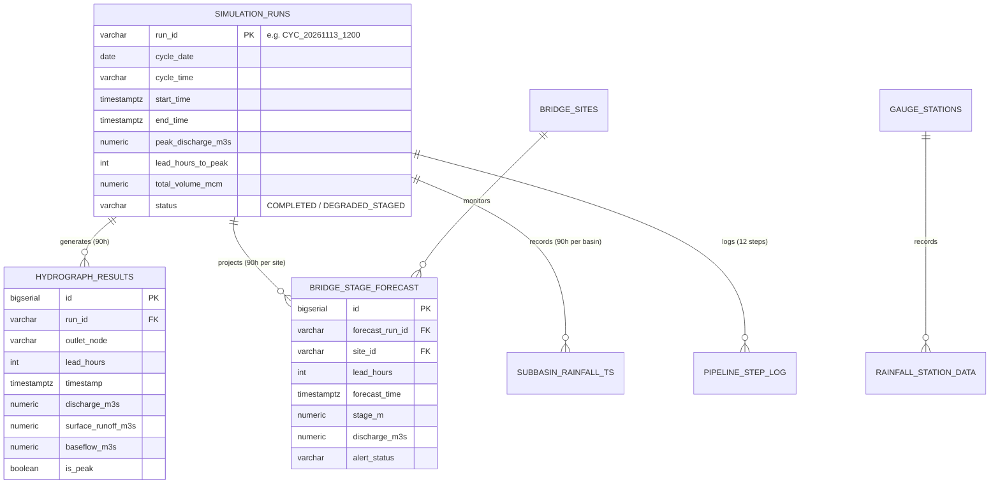
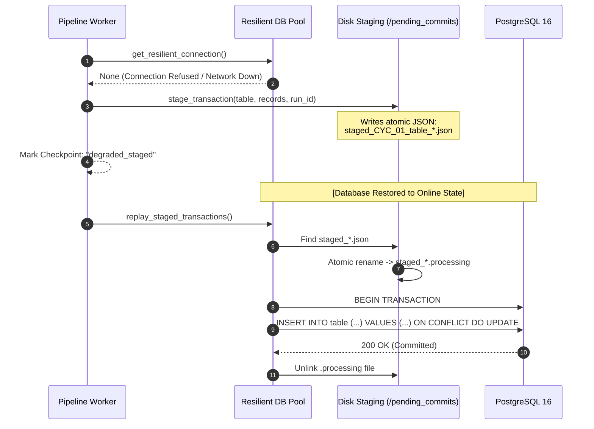

# Database Schemas & Persistence Architecture
**HydroCast Panchganga Operational Flood Forecasting System**  
*Relational Time-Series Architecture, Indexing Strategy, and Offline Staging*

---

## 1. Relational Database Overview

HydroCast utilizes a relational persistence tier powered by **PostgreSQL 16** (with optional **TimescaleDB** extensions for high-frequency sensor telemetry). The database design satisfies three rigorous criteria:
1. **Immutable Historical Auditability**: Every forecast cycle is permanently registered with full provenance, including start time, completion duration, and governing meteorological inputs.
2. **Sub-Millisecond Query Response**: High-frequency public dashboard reads querying 90-hour horizons are accelerated via compound indexes tailored to primary query access paths.
3. **Transactional Safety with Offline Resilience**: In the event of network disruption or database maintenance, the application tier decouples from PostgreSQL, writing atomic staging payloads to disk and replaying them upon reconnection.



---

## 2. Core Table Definitions & Indexing Strategy

### 2.1. Bridge Stage Forecast (`bridge_stage_forecast`)
This table holds the operational flood prediction series for critical bridge sites (Shivaji Bridge KT Weir and Rajaram Weir). For each 6-hourly cycle, 90 hourly rows are recorded per bridge (180 rows per cycle).

```sql
CREATE TABLE IF NOT EXISTS bridge_stage_forecast (
    id                  BIGSERIAL PRIMARY KEY,
    forecast_run_id     VARCHAR(64) NOT NULL REFERENCES simulation_runs(run_id) ON DELETE CASCADE,
    site_id             VARCHAR(32) NOT NULL REFERENCES bridge_sites(site_id),
    forecast_time       TIMESTAMPTZ NOT NULL,
    lead_hours          INTEGER NOT NULL CHECK (lead_hours >= 0 AND lead_hours <= 120),
    stage_m             NUMERIC(6, 2) NOT NULL,
    discharge_m3s       NUMERIC(10, 2) NOT NULL,
    alert_status        VARCHAR(16) NOT NULL DEFAULT 'NORMAL',
    flood_arrival_time  TIMESTAMPTZ,
    created_at          TIMESTAMPTZ NOT NULL DEFAULT NOW()
);
```

#### Indexing Optimization (Leading Column Fix)
- **Primary Dashboard Query Access Pattern**:
  ```sql
  SELECT * FROM bridge_stage_forecast 
  WHERE forecast_run_id = $1 
  ORDER BY site_id, lead_hours;
  ```
- **The Indexing Challenge**: If an index is constructed as `(site_id, forecast_run_id)`, PostgreSQL cannot use the index to fulfill queries filtering purely by `forecast_run_id`, degrading to sequential table scans over hundreds of thousands of rows.
- **Production Index**:
  ```sql
  CREATE INDEX IF NOT EXISTS idx_bsf_run_site_lead 
  ON bridge_stage_forecast (forecast_run_id, site_id, lead_hours);
  ```
  Placing `forecast_run_id` as the **leading column** guarantees that historical lookups execute via sub-millisecond B-Tree Index Scans.

---

### 2.2. Master Simulation Runs (`simulation_runs`)
The anchor table for the entire forecasting cycle. All foreign keys cascade from `run_id`.

```sql
CREATE TABLE IF NOT EXISTS simulation_runs (
    run_id              VARCHAR(64) PRIMARY KEY,
    cycle_date          DATE NOT NULL,
    cycle_time          VARCHAR(8) NOT NULL,
    start_time          TIMESTAMPTZ NOT NULL,
    end_time            TIMESTAMPTZ,
    duration_seconds    NUMERIC(8, 2),
    peak_discharge_m3s  NUMERIC(10, 2),
    lead_hours_to_peak  INTEGER,
    total_volume_mcm    NUMERIC(10, 4),
    mean_catchment_rain NUMERIC(6, 2),
    status              VARCHAR(32) NOT NULL DEFAULT 'RUNNING',
    created_at          TIMESTAMPTZ NOT NULL DEFAULT NOW()
);
```

---

### 2.3. Outlet Hydrograph Results (`hydrograph_results`)
Records the 90-hour total, surface, and baseflow discharge series at the catchment outlet (`J_Outlet`).

```sql
CREATE TABLE IF NOT EXISTS hydrograph_results (
    id                  BIGSERIAL PRIMARY KEY,
    run_id              VARCHAR(64) NOT NULL REFERENCES simulation_runs(run_id) ON DELETE CASCADE,
    basin_id            VARCHAR(32) NOT NULL DEFAULT 'MAIN_BASIN',
    outlet_node         VARCHAR(32) NOT NULL DEFAULT 'J_Outlet',
    timestamp           TIMESTAMPTZ NOT NULL,
    lead_hours          INTEGER NOT NULL,
    discharge_m3s       NUMERIC(10, 2) NOT NULL,
    surface_runoff_m3s  NUMERIC(10, 2) NOT NULL,
    baseflow_m3s        NUMERIC(10, 2) NOT NULL,
    is_peak             BOOLEAN NOT NULL DEFAULT FALSE,
    created_at          TIMESTAMPTZ NOT NULL DEFAULT NOW()
);
```

---

## 3. Resilient Disk Staging & Transaction Replay Engine

When PostgreSQL is unreachable, the system executes disk-backed staging via `backend/db/resilient_pool.py`.



### 3.1. Security Whitelist & Injection Prevention
To ensure that replaying transaction files cannot be abused to execute arbitrary SQL, `resilient_pool.py` enforces two strict guards:
1. **Table Whitelist (`ALLOWED_STAGING_TABLES`)**: Staged payloads can only target vetted internal tables (`simulation_runs`, `bridge_stage_forecast`, `hydrograph_results`, etc.). Any unlisted table raises `ValueError` immediately.
2. **Identifier Regex & Parameterization**: All column names must match `^[a-zA-Z_][a-zA-Z0-9_]*$`, and values are bound using `psycopg2.sql.Identifier` and `sql.Placeholder()`, neutralizing SQL injection vectors.

### 3.2. Atomic File Processing & Transaction Rollback
- To prevent race conditions between concurrent worker threads and admin processes, files are renamed to `.processing` before being opened.
- If a query fails midway through a staged file, `active_conn.rollback()` is invoked immediately to prevent cascading connection abortions (`InFailedSqlTransaction`), and the file is restored for operator inspection.

