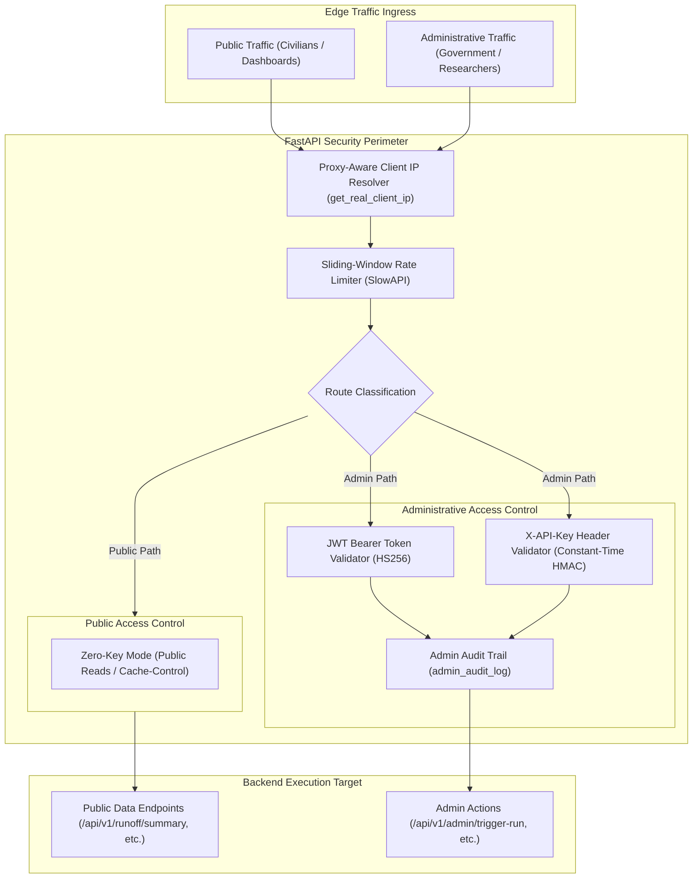

# Security Architecture & Authentication Manual
**HydroCast Panchganga Operational Flood Forecasting System**  
*Role-Based Access Control, Token Lifecycles, and Proxy Security Standards*

---

## 1. Security Philosophy & Threat Model

HydroCast delivers safety-of-life public flood intelligence while simultaneously safeguarding mission-critical municipal infrastructure controls. Consequently, the security architecture operates under a **Dual-Surface Security Model**:
1. **Public Read-Only Surface (Open & Rate-Limited)**:
   Civilians, news organizations, and local response agencies require free, unhindered access to river levels, flood hazard classifications, and rain hyetographs. This surface must remain accessible under surge load without credential requirements, protected strictly by reverse-proxy rate limiters and payload caching.
2. **Administrative Control Surface (Zero-Trust & Authenticated)**:
   Capabilities such as manual simulation triggering, step retries, parameter calibration overrides, database archival, and emergency aborts are locked behind signed JSON Web Tokens (JWT) and hardened HTTP headers.



---

## 2. Authentication & Authorization Framework

### 2.1. JWT Access Tokens (HS256)
- **Token Format**: Standard HMAC-SHA256 signed JSON Web Tokens.
- **Payload Schema**:
  ```json
  {
    "sub": "operator.username",
    "role": "admin",
    "exp": 1794567890,
    "iat": 1794481490,
    "iss": "hydrocast-api"
  }
  ```
- **Secret Management**:
  - The signing secret is read strictly from the `JWT_SECRET` (or `ADMIN_JWT_SECRET`) environment variable.
  - In production (`APP_ENV=production`), the application enforces **fail-closed startup validation**: if `JWT_SECRET` is unset, empty, or uses default testing strings, the backend process immediately logs a critical error and aborts startup (`sys.exit(1)`).
- **Expiration Policy**: Tokens carry an explicit lifetime (defaulting to 24 hours / 1,440 minutes, configured via `JWT_EXPIRATION_MINUTES`). Expired tokens return `HTTP 401 Unauthorized` with `WWW-Authenticate: Bearer`.

### 2.2. Master System API Key (`X-API-Key`)
For automated background cron jobs, monitoring probes, and system-to-system integrations, the API accepts a master key transmitted via the `X-API-Key` HTTP header. 
- **Constant-Time Verification**: Verification uses `hmac.compare_digest()` to eliminate timing attack vulnerabilities.
- **Fail-Closed Guard**: If `API_KEY` is unset in the environment, the endpoint rejects all API key requests, preventing empty headers from matching an empty string.

---

## 3. Strict Secrets Management: Zero Credentials in Version Control

In accordance with OWASP security standards, **no plain-text passwords, static credential dictionaries, or hardcoded hashes are permitted in source code or documentation**.

### 3.1. Elimination of In-Code Admin Dictionaries
Earlier iterations of the system contained a hardcoded `PRIMARY_ADMIN_ACCOUNTS` dictionary within `security.py`. This represented an operational security hazard:
- Hashes stored in Git history are subject to offline brute-force attacks.
- Disabling an account in PostgreSQL (`UPDATE admin_users SET is_active=false`) failed to block access because the in-code dictionary acted as an immutable backdoor.

### 3.2. Production Account Management & Break-Glass Seeding
1. **Primary Administration**: All administrative accounts are created and managed dynamically within the PostgreSQL `admin_users` table with bcrypt password hashing (work factor / cost = 12).
2. **Break-Glass Offline Mode**:
   For standalone development, initial deployment bootstrapping, or disaster scenarios where PostgreSQL is completely offline, access can be granted via explicit runtime environment variables:
   ```env
   # Emergency Break-Glass Configuration (.env only - never committed)
   HYDROCAST_BREAKGLASS_USER=emergency_admin
   HYDROCAST_BREAKGLASS_HASH=<bcrypt_hash>
   HYDROCAST_BREAKGLASS_ROLE=admin
   ```
   When configured, this break-glass admin is loaded into memory only, loud warnings are emitted to logs, and all actions are recorded in the audit trail.

---

## 4. Edge Rate-Limiting & Anti-Scraping Protection

### 4.1. Rate Limiting Configuration
The public API employs sliding-window rate limiters implemented via SlowAPI and Redis/in-memory backends:
- **Public Read Limit (`RATE_LIMIT_PUBLIC`)**: 60 requests/minute per client IP.
- **Burst Limit (`RATE_LIMIT_BURST`)**: 100 requests/minute for transient bursts.
- **Violations**: When a client breaches quota, the server responds with `HTTP 429 Too Many Requests` containing an RFC-compliant `Retry-After: <seconds>` header.

### 4.2. Trusted Proxy Resolution
To prevent IP spoofing in environments fronted by reverse proxies (Caddy/Nginx):
```python
def get_real_client_ip(request: Request) -> str:
    # 1. Determine direct peer IP
    # 2. If peer is NOT in HYDROCAST_TRUSTED_PROXIES (e.g. 127.0.0.1/32),
    #    return direct peer (ignore forwarded headers).
    # 3. If peer IS trusted proxy, walk X-Forwarded-For chain from RIGHT to LEFT.
    # 4. Return the first non-trusted IP in the chain as true client.
```
This guarantees that university intranet clients cannot spoof custom `X-Forwarded-For` headers to evade rate limits.

---

## 5. Administrative Audit Logging

Every state-changing administrative action is immutably logged to the `admin_audit_log` table:
- **Tracked Operations**:
  - `MANUAL_RUN_DISPATCH`: Triggering ad-hoc forecast cycles.
  - `STEP_RETRY`: Executing an isolated pipeline step.
  - `CALIBRATION_RECAL`: Adjusting hydrological parameters.
  - `DB_BACKUP`: Initiating database dumps.
  - `COLD_STORAGE_ARCHIVAL`: Running Parquet partitions.
- **Captured Metadata**: Timestamp (UTC), admin username, client IP, action parameters, exit status (`SUCCESS`/`FAILED`), and response output.

