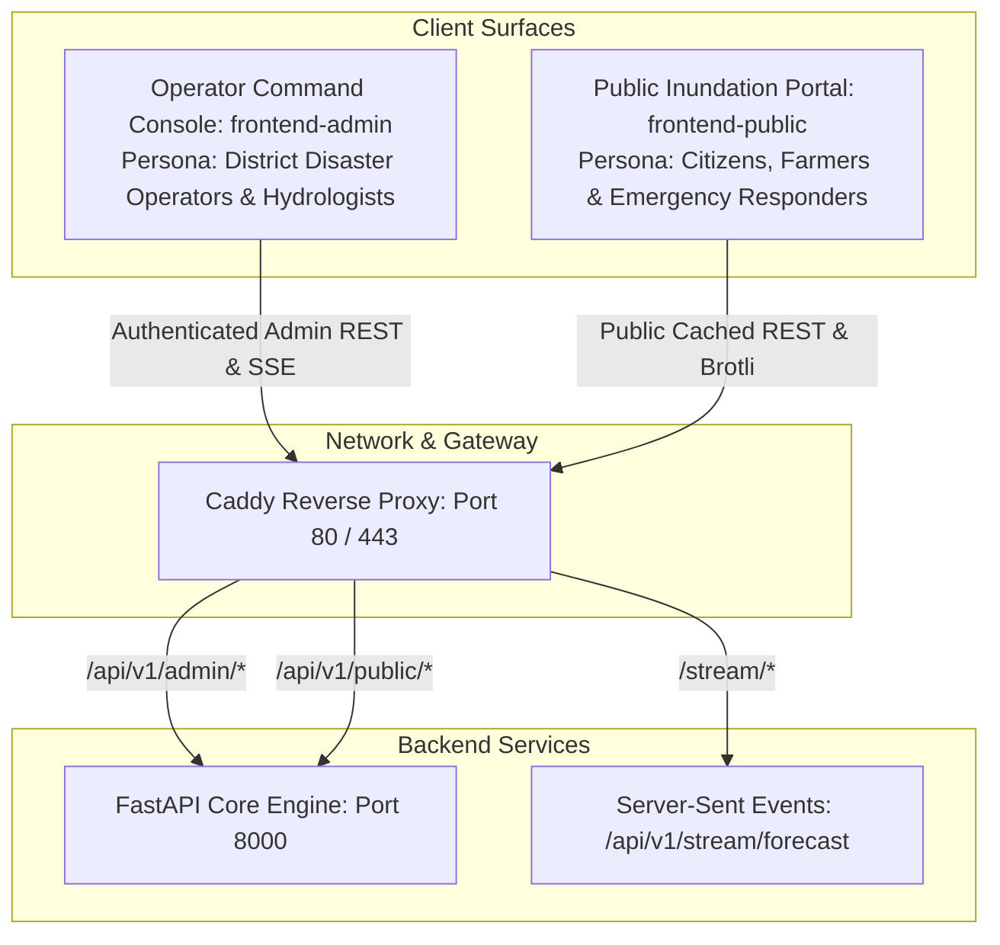
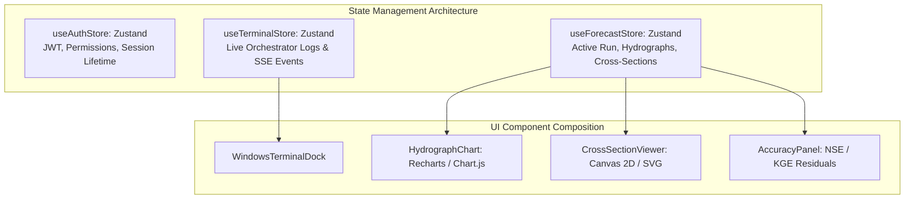
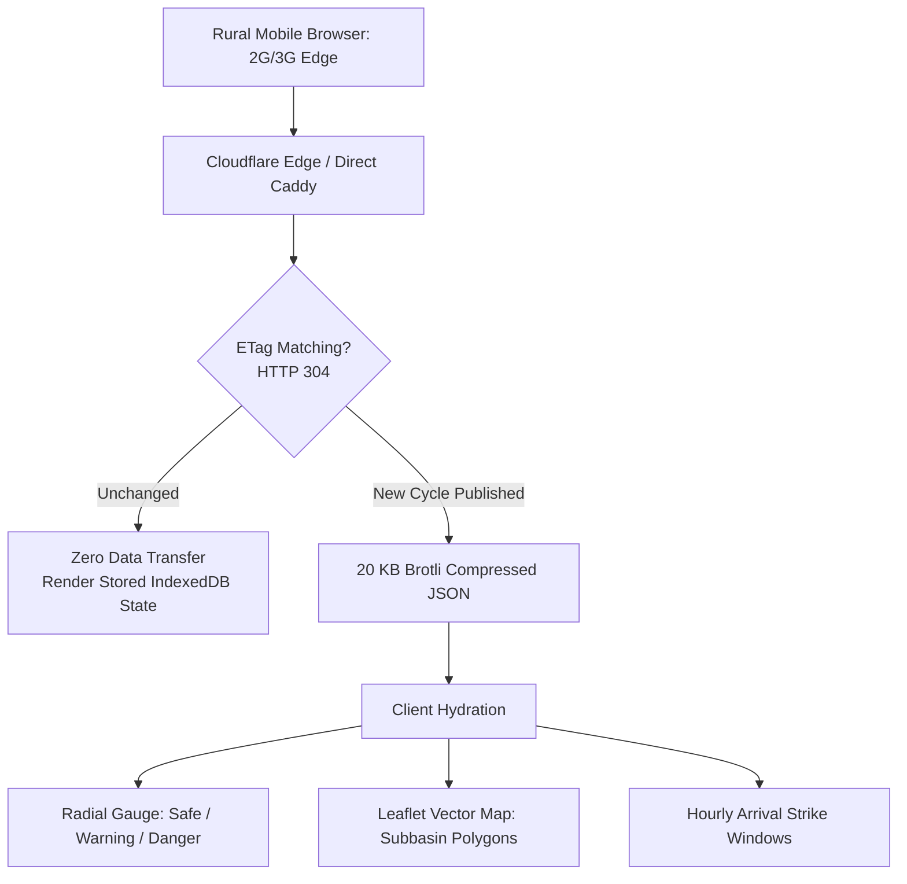
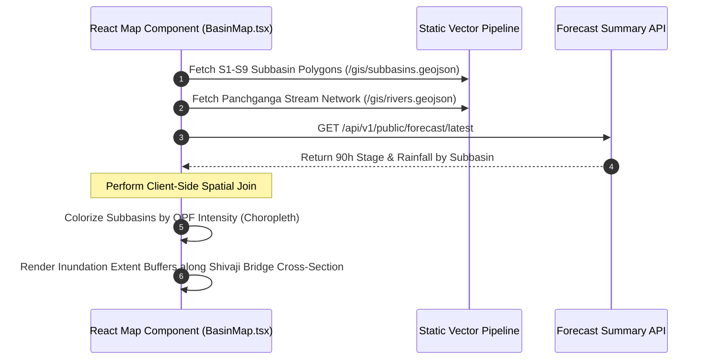

# HydroCast Frontend Architecture: Operator Console, Public Inundation Portal, and Visualization Engineering

This document specifies the software architecture, design patterns, state management models, GIS map rendering layers, and real-time visualization pipelines powering HydroCast's user-facing applications.

---

## 1. Dual-Frontend Strategy and System Topology

HydroCast maintains two distinct frontend applications engineered for fundamentally different operational personas and network environments:



### Architectural Differentiation Matrix

| Engineering Dimension | Operator Command Console (`frontend-admin`) | Public Inundation Portal (`frontend-public`) |
| :--- | :--- | :--- |
| **Framework & Runtime** | Next.js 14 (App Router) + React 18 + TypeScript | React 18 + Vite / Next.js Static Export |
| **User Metaphor** | High-density Windows 11 Desktop / Mission Control dock | Responsive Mobile-First Single-Page Inundation App |
| **Target Network** | Municipal Local Area Network (1 Gbps / Low Latency) | 2G/3G/4G Mobile Edge in rural Kolhapur ($< 1\text{ Mbps}$) |
| **Bundle Size Budget** | $\le 1.2\text{ MB}$ (GZipped) with rich analytical toolkits | $\le 120\text{ KB}$ (GZipped) ultra-light initial bundle |
| **Security Surface** | JWT Bearer in HTTP-only Secure Cookies + CSRF Header | Zero Authentication (Read-only anonymous public cache) |
| **Primary Visualizations** | 90h dynamic hyetographs, rating splines, cross-sections | Radial stage gauges, flood map layers, strike window dials |
| **Localization** | Technical English (Hydrometric & Engineering terminology) | Bilingual (Marathi / English) with one-tap toggle |

---

## 2. Operator Command Console Architecture (`frontend-admin`)

The Operator Console is engineered as a high-density, mission-critical workspace featuring floating windows, multi-monitor dock capabilities, and synchronous terminal streams.



### Key UI Subsystems

1. **Hydraulic Cross-Section Viewer (`CrossSectionViewer.tsx`)**:
   - Renders physical surveyed river cross-sections for Shivaji Bridge (Section 17) and Rajaram Weir (Section 29).
   - Computes live water surface elevation (WSE) intersection lines against Gauckler-Manning trapezoidal profiles using HTML5 Canvas vector drawing.
   - Visually indicates bed invert ($530.12\text{ m}$), Warning Mark ($540.00\text{ m}$), and Danger Mark ($542.50\text{ m}$) with sub-millimeter coordinate mapping.

2. **Dual-Axis Hydrograph & Hyetograph (`HydrographChart.tsx`)**:
   - Displays time-series streamflow discharge ($\text{cusecs}$ / $\text{m}^3/\text{s}$) on the primary Y-axis, rainfall precipitation hyetograph bars ($\text{mm}$) inverted on the secondary top axis, and projected water surface elevation ($\text{m AMSL}$).
   - Includes historic flood reference overlays ($2019$ and $2021$ peak flood curves) for instant visual comparison by duty engineers.

3. **Windows Terminal Dock (`WindowsTerminalDock.tsx`)**:
   - Maintains an active Server-Sent Events (SSE) or WebSocket connection to `/api/v1/admin/orchestrator/stream`.
   - Renders ANSI-colored orchestrator logs in real time with line-by-line step execution status, allowing duty operators to observe Step 1 through Step 12 computations live without opening SSH/RDP sessions.

---

## 3. Public Inundation Portal Architecture (`frontend-public`)

The Public Portal is optimized for emergency accessibility under extreme mobile bandwidth constraints during flood disasters.



### Critical Optimization Strategies

1. **ETag-Gated IndexedDB Caching**:
   - Forecast payloads are cached locally in the user's browser via IndexedDB.
   - Subsequent page visits transmit the `If-None-Match` header. If water surface levels have not changed in the current cycle, the server responds with `HTTP 304 Not Modified`, consuming zero egress bandwidth.
2. **Marathi First Localization (`mr-IN`)**:
   - All flood advisories, strike window countdowns, and warning levels are localized natively into Marathi:
     - Warning Level: *"धोकादायक पातळी जवळ आली आहे (इशारा पातळी: ५४०.०० मी)"*
     - Danger Level: *"तातडीने सुरक्षित स्थळी स्थलांतर करा (धोका पातळी: ५४२.५० मी)"*
3. **Progressive Web App (PWA) Offline Readiness**:
   - Service workers cache all static vector icons, Leaflet map tiles for Kolhapur district, and font assets, allowing the portal to open and render the last verified flood forecast even if local cell towers lose backhaul connectivity.

---

## 4. GIS Inundation & Basin Mapping Pipeline

Both frontends utilize Leaflet and MapLibre GL for geospatial spatial visualization.



### Geospatial Layer Hierarchy
1. **Basemap Layer**: Ultra-light CartoDB Positron vector tiles (or offline cached OpenStreetMap tiles).
2. **Subbasin Layer (S1 to S9)**: Interactive GeoJSON choropleth shaded dynamically by 24-hour cumulative rainfall ($< 50\text{ mm}$ green, $50\text{--}100\text{ mm}$ yellow, $100\text{--}200\text{ mm}$ orange, $> 200\text{ mm}$ severe purple).
3. **Hydrometric Stations**: Custom SVG pins indicating real-time gauge health, current stage, and threshold breach status.
4. **Dam Vectors**: Upstream reservoir points (Radhanagari, Tulshi, Warna, Dudhganga, Kasari) displaying live gate discharge callouts.

---

## 5. Frontend Build, Linting & Type Safety Standards

All frontend code must satisfy the following automated compilation gates:

```powershell
# 1. Type-check Operator Console
cd "frontend-admin"
npx tsc --noEmit

# 2. Production Build Verification
npm run build

# 3. Type-check Public Inundation Portal
cd "../frontend-public"
npx tsc --noEmit
npm run build
```

- **Zero-Tolerance for Type Bypass**: No usage of `@ts-ignore` or unchecked `any` primitives in mathematical transformation components (`hydraulics.ts`, `rating_curve.ts`).
- **Bundle Analysis**: Automated bundle analysis (`@next/bundle-analyzer`) fails CI if client-side vendor chunks exceed $400\text{ KB}$ raw size.
