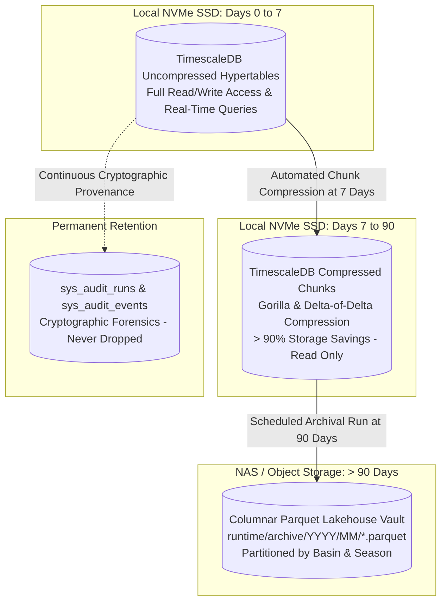
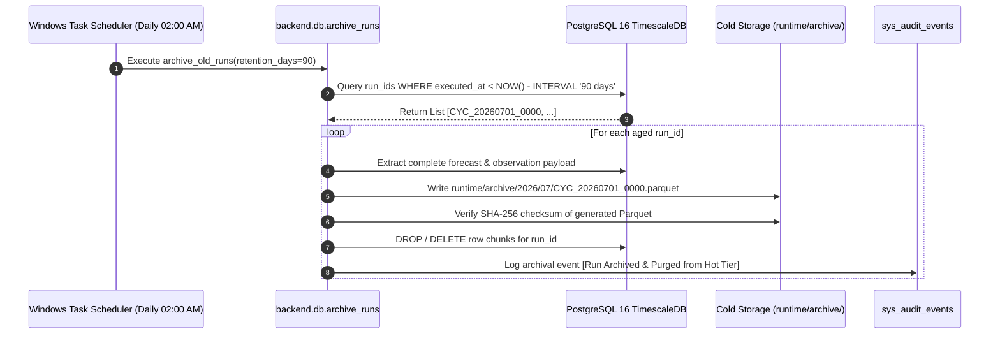
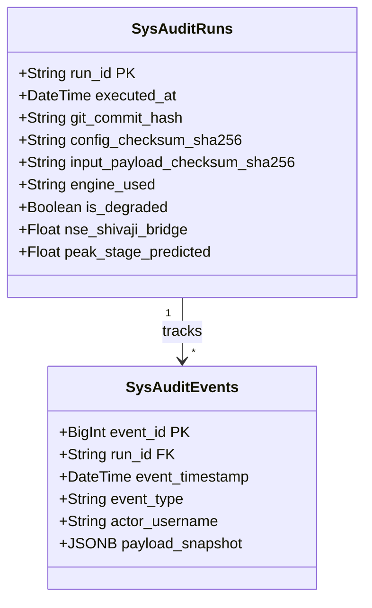

# HydroCast Data Retention & Archival Architecture: TimescaleDB Chunk Compression, Lakehouse Parquet Export, and WORM Audit Ledgers

This document defines the data lifecycle policies, database chunk compression mechanics, cold storage lakehouse export workflows, and forensic audit trail preservation standards enforced across HydroCast's persistence tier.

---

## 1. Storage Lifecycle & Tiering Framework

A 90-hour forward forecast generated every 6 hours across 9 subbasins, 5 dams, and 4 river crossings generates approximately $35,000$ hydrometric and meteorological time-series records per operational cycle. Over a 4-month monsoon season, this accumulation demands a structured, multi-tiered lifecycle architecture:



### Storage Tier Specifications

| Lifecycle Tier | Storage Technology & Format | Age Range | Compression Algorithm | Query Latency Target | Retention Window |
| :--- | :--- | :--- | :--- | :--- | :--- |
| **Hot Tier** | PostgreSQL 16 / TimescaleDB Hypertable | $0 \text{ to } 7\text{ Days}$ | None (Raw Relational Rows) | $< 15\text{ ms}$ | $7\text{ Days}$ |
| **Warm Tier** | TimescaleDB Native Columnar Chunks | $7 \text{ to } 90\text{ Days}$ | Gorilla (Floats) + Delta-of-Delta (Timestamps) | $< 40\text{ ms}$ | $90\text{ Days}$ |
| **Cold Tier** | Apache Parquet Columnar Files | $> 90\text{ Days}$ | Snappy / ZSTD Level 3 | $< 250\text{ ms}$ (Batch) | $10\text{ Years}$ (Statutory) |
| **Audit Tier** | PostgreSQL Append-Only Ledger (WORM) | Permanent | Standard B-Tree / GIN | $< 20\text{ ms}$ | **Permanent (Never Dropped)** |

---

## 2. TimescaleDB Chunk Compression Architecture

HydroCast leverages TimescaleDB native hypertable compression policies to prevent disk space exhaustion without sacrificing SQL query capabilities.

```mermaid
flowchart LR
    RowChunk[Raw 1-Day Chunk: 120 MB\nRow-oriented relational storage] --> Compressor[TimescaleDB Background Worker]
    Compressor --> ColChunk[Compressed Chunk: 8.5 MB\nSegmented by site_id\nOrdered by recorded_at DESC]
    Note over ColChunk: 92.9% Storage Reduction\nGorilla Float Compression Active
```

### Compression Policy Configuration
TimescaleDB compression is applied to the primary forecast ledger `hyd_basin_forecast`:

```sql
-- Enable TimescaleDB native columnar compression
ALTER TABLE hyd_basin_forecast SET (
    timescaledb.compress,
    timescaledb.compress_segmentby = 'site_id, run_id',
    timescaledb.compress_orderby = 'recorded_at DESC'
);

-- Establish automated rolling compression policy for chunks older than 7 days
SELECT add_compression_policy('hyd_basin_forecast', INTERVAL '7 days');
```

1. **Segment-By Key**: Segmenting by `site_id` and `run_id` physically isolates individual time-series hydrographs within compressed blocks.
2. **Order-By Key**: Ordering by `recorded_at DESC` enables TimescaleDB's run-length and delta-of-delta encoders to achieve maximum compression ratios ($> 90\%$) on monotonically advancing timestamps and smooth hydrograph curves.

---

## 3. Cold Storage Lakehouse Archival (`backend.db.archive_runs`)

Forecast cycles older than 90 days are transitioned out of PostgreSQL into self-contained, partitioned **Apache Parquet** lakehouse archives located at `runtime/archive/`.



### Parquet Schema Definition
The exported Parquet archive encapsulates the entire multidimensional execution vector:

```python
ARCHIVE_PARQUET_SCHEMA = pa.schema([
    ("run_id", pa.string()),
    ("site_id", pa.string()),
    ("recorded_at", pa.timestamp("us", tz="UTC")),
    ("lead_time_hours", pa.float32()),
    ("stage_m", pa.float32()),
    ("discharge_cusecs", pa.float32()),
    ("is_interpolated", pa.bool_()),
    ("engine_used", pa.string()),
    ("execution_status", pa.string()),
    ("metadata_json", pa.string())
])
```

---

## 4. Immutable Forensic Audit Ledger (WORM Storage)

In flood disaster liability investigations, the question of *"What did the model know, and when did it know it?"* is of critical legal importance. Under the **Zero-Fabrication Policy**, HydroCast enforces strict **Write-Once-Read-Many (WORM)** immutability on all audit logs.



### Enforcing Immutability via Database Triggers
PostgreSQL rules and triggers prevent `UPDATE` or `DELETE` operations on audit tables:

```sql
-- Trigger function prohibiting modification of audit records
CREATE OR REPLACE FUNCTION prevent_audit_tampering()
RETURNS TRIGGER AS $$
BEGIN
    RAISE EXCEPTION 'CRITICAL SECURITY VIOLATION: Records in % are immutable and cannot be updated or deleted.', TG_TABLE_NAME;
END;
$$ LANGUAGE plpgsql;

-- Bind trigger to audit ledger
CREATE TRIGGER trg_protect_audit_runs
BEFORE UPDATE OR DELETE ON sys_audit_runs
FOR EACH ROW EXECUTE FUNCTION prevent_audit_tampering();

CREATE TRIGGER trg_protect_audit_events
BEFORE UPDATE OR DELETE ON sys_audit_events
FOR EACH ROW EXECUTE FUNCTION prevent_audit_tampering();
```
Any programmatic attempt or administrative command to modify or delete rows in `sys_audit_runs` raises an immediate SQL exception and terminates the transaction.

