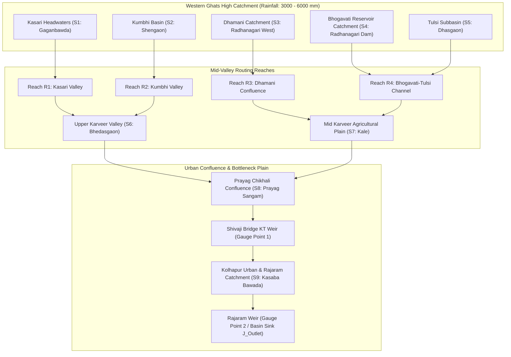

# Panchganga Basin Hydrology & Watershed Modeling
**HydroCast Panchganga Operational Flood Forecasting System**  
*Physical Geography, Subbasin Delineation, and Rainfall-Runoff Transformation*

---

## 1. Physical Catchment Geography

The Panchganga River Basin covers an area of approximately **2,570 km²** in the Kolhapur district of southwestern Maharashtra, India. The river is a vital tributary of the upper Krishna River system, formed by the confluence of five tributary streams:
1. **Kumbhi**
2. **Dhamani**
3. **Kasari**
4. **Bhogavati**
5. **Tulsi** (joins the Bhogavati upstream)

The basin originates in the high-elevation crests of the Western Ghats (Sahyadri Range) at elevations exceeding 1,000 m MSL and descends eastward into the Deccan Plateau plain, terminating near Rajaram Weir (elevation ~532–536 m MSL) before eventually merging with the Krishna River at Narsobawadi.

---

## 2. Delineation of the Nine Subbasins (S1 to S9)

To achieve high spatial fidelity, the catchment is discretized into nine hydrologic subbasins ($S_1$ to $S_9$), each parameterized by drainage area, soil hydrologic classification, curve number, and overland travel lag times.

| Subbasin ID | Name | Area ($\text{km}^2$) | Primary Gauge Anchor | Hydrological Characteristics |
|:---|:---|:---|:---|:---|
| **$S_1$** | Kasari Basin | 312.4 | Gaganbawda / Dhangarwadi | Steep basalt escarpments, shallow forest soils, rapid runoff response ($T_{\text{lag}} \approx 180\text{ min}$). |
| **$S_2$** | Kumbhi Catchment | 248.6 | Shengaon / Kumbhi Dam | Deep valleys, heavily forested headwaters, moderate retention. |
| **$S_3$** | Dhamani Valley | 195.2 | Radhanagari West | Dense forest canopy, steep western slopes, high AMC susceptibility. |
| **$S_4$** | Bhogavati Basin | 425.8 | Radhanagari / Fejiwade | Largest upstream catchment, regulated by Radhanagari Dam spillways. |
| **$S_5$** | Tulsi Subbasin | 168.4 | Dhasgaon / Tulsi Dam | Small mountainous catchment, quick-peaking tributary hydrograph. |
| **$S_6$** | Upper Karveer | 342.1 | Bhedasgaon / Panhala | Foothill transition zone, mixed agriculture and scrub forest. |
| **$S_7$** | Mid Karveer | 288.5 | Kale / Karveer Rural | Agricultural floodplain, black cotton soils, broad valley storage. |
| **$S_8$** | Prayag Confluence | 310.2 | Prayag Chikhali | Major hydrological choke-point where all 5 tributaries merge. |
| **$S_9$** | Rajaram / Kolhapur | 278.8 | Kasaba Bawada / Shivaji Bridge | Urbanized plain, backwater-sensitive lowlands, outlet at Rajaram Weir. |
| **Total** | **Panchganga Basin** | **2,570.0** | **Main Catchment Network** | **Integrated outlet discharge at Rajaram Weir (`J_Outlet`)** |

---

## 3. Hydrological Transformation Mechanics

### 3.1. SCS-CN Precipitation Loss Method
Infiltration losses and surface runoff excess are computed using the USDA Soil Conservation Service (SCS) Curve Number method adapted for tropical Deccan basalt conditions:

$$\text{Potential Maximum Retention: } S = \frac{25400}{CN} - 254 \quad (\text{mm})$$

$$\text{Initial Abstraction: } I_a = \lambda \cdot S$$

In standard US SCS literature, $\lambda = 0.20$. However, field calibration and WRD historical flood reconstructions for the Western Ghats indicate that continuous monsoon saturation reduces initial abstraction to $\lambda = 0.05\text{ to }0.10$.

$$\text{Cumulative Runoff Excess: } Q_{\text{surf}} = \begin{cases} 
0 & \text{if } P \le I_a \\
\frac{(P - I_a)^2}{P - I_a + S} & \text{if } P > I_a 
\end{cases}$$

### 3.2. Antecedent Moisture Condition (AMC) Dynamics
The catchment Curve Number ($CN$) is not static; it transitions dynamically across three moisture regimes based on 5-day cumulative antecedent rainfall ($P_5$):
- **AMC-I (Dry Catchment)**: $P_5 < 35\text{ mm}$ (Dry season / early June).
- **AMC-II (Normal / Average)**: $35\text{ mm} \le P_5 \le 52.5\text{ mm}$.
- **AMC-III (Saturated / Flood Prime)**: $P_5 > 52.5\text{ mm}$ (Heavy monsoon episodes where nearly 100% of rain converts to runoff).

Mathematical conversion from normal $CN_{II}$ to saturated $CN_{III}$:

$$CN_{III} = \frac{CN_{II}}{0.427 + 0.00573 \cdot CN_{II}}$$

---

## 4. River Routing & The Muskingum Cascade (R1 to R5)

Runoff hydrographs generated at subbasin outlets traverse five primary river reaches ($R_1$ to $R_5$) before converging at the urban bottleneck. Routing is computed via the finite-difference **Muskingum Equation**:

$$O_2 = C_0 \cdot I_2 + C_1 \cdot I_1 + C_2 \cdot O_1$$

Where the routing coefficients satisfy $C_0 + C_1 + C_2 = 1.0$:

$$C_0 = \frac{\Delta t - 2 K X}{2 K (1 - X) + \Delta t}, \quad C_1 = \frac{\Delta t + 2 K X}{2 K (1 - X) + \Delta t}, \quad C_2 = \frac{2 K (1 - X) - \Delta t}{2 K (1 - X) + \Delta t}$$

- **Travel Time ($K$)**: Ranges between $4.5\text{ and }8.0\text{ hours}$ depending on reach length and riverbed slope.
- **Weighting Factor ($X$)**: Set to $X = 0.15\text{ to }0.25$, reflecting the pronounced natural floodplain attenuation and channel storage capacity of the Panchganga River.
- **Numerical Stability**: The operational simulation timestep ($\Delta t = 1.0\text{ hour}$) satisfies the Courant-Friedrichs-Lewy stability criterion: $2 K X < \Delta t \le 2 K (1 - X)$.

