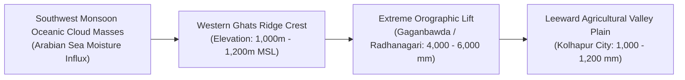
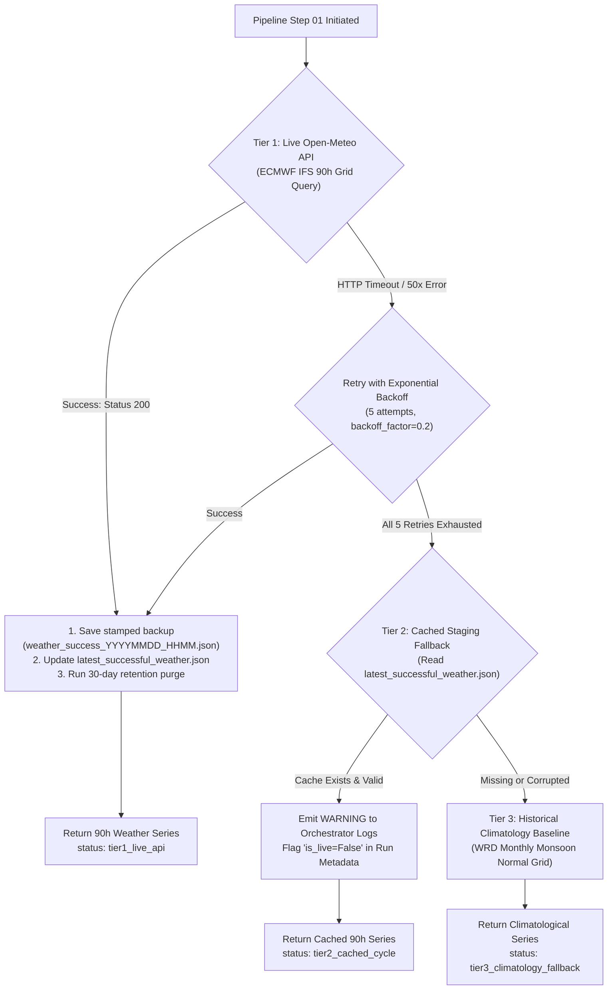

# Meteorology & Precipitation Ingestion Architecture
**HydroCast Panchganga Operational Flood Forecasting System**  
*Lead Systems Architect & Chief Hydrologist Engineering Reference Manual*

---

## 1. Meteorological Setting of the Panchganga Catchment

To build or evaluate an operational flood forecasting platform, an engineer must first understand the meteorological forcing driving the hydrological system. The Panchganga basin is situated on the eastern leeward edge of the Western Ghats (Sahyadri Range) in Maharashtra, India. It represents one of the steepest precipitation gradients in peninsular India:

- **Headwater Ridge Crests (Subbasins $S_1$ to $S_5$)**: Stations such as Gaganbawda, Shengaon, and Radhanagari receive between **4,000 mm and 6,000 mm** of precipitation during the 4-month Southwest Monsoon (June through September). Intense orographic lifting causes cloudburst-style continuous downpours where 24-hour rainfall can exceed 300 mm.
- **Valley Inundation Zone (Subbasins $S_8$ and $S_9$)**: Kolhapur city and Rajaram Weir receive only **1,000 mm to 1,200 mm** annually. 

**The Engineering Challenge**: Flooding in Kolhapur city is **not** caused by rain falling in Kolhapur city. It is caused by extreme cloudburst events 60 km upstream in the Ghats taking 12 to 24 hours to travel downstream and choke the urban plain. Therefore, an operational system must forecast Ghat precipitation with high temporal and spatial accuracy days in advance.

---

## 2. Quantitative Precipitation Forecasting: ECMWF IFS Model

HydroCast uses the European Centre for Medium-Range Weather Forecasts (ECMWF) Integrated Forecasting System (IFS) model as its primary meteorological forcing dataset, accessed via the Open-Meteo High-Performance API cluster.

### 2.1. Model Characteristics & Ingestion Parameters
- **Model Resolution**: 0.25-degree spatial grid ($\approx 25\text{ km} \times 25\text{ km}$).
- **Forecast Horizon**: 90 hours forward projection with 1-hour temporal discretization.
- **Governing Variables Ingested**:
  - `precipitation`: Total liquid precipitation ($\text{mm/hour}$).
  - `rain`: Direct liquid rainfall component ($\text{mm/hour}$).
  - `surface_pressure`: Atmospheric surface pressure ($\text{hPa}$).
  - `soil_temperature_0_to_7cm`: Near-surface soil temperature ($^\circ\text{C}$).
  - `soil_moisture_0_to_7cm`: Volumetric soil moisture ($\text{m}^3/\text{m}^3$), used to validate Antecedent Moisture Conditions (AMC).

### 2.2. Geographic Coordinate Anchors (Catchment Ingestion Grid)
The ingestion engine polls 18 distinct geographic coordinates covering the 9 subbasins:

| Subbasin Code | Primary Anchor Station | Latitude ($^\circ\text{N}$) | Longitude ($^\circ\text{E}$) | Elevation (m MSL) | Hydrologic Purpose |
|:---|:---|:---|:---|:---|:---|
| $S_1$ | Gaganbawda / Kasari | 16.540 | 73.820 | 610 | High-headwater flash runoff anchor |
| $S_2$ | Shengaon / Kumbhi | 16.610 | 73.910 | 585 | Western steep valley boundary |
| $S_3$ | Radhanagari West / Dhamani | 16.410 | 73.950 | 560 | Dam catchment upper watershed |
| $S_4$ | Radhanagari Dam / Bhogavati| 16.410 | 74.000 | 545 | Reservoir inflow calculation |
| $S_5$ | Dhasgaon / Tulsi | 16.520 | 74.010 | 550 | Southern tributary input |
| $S_6$ | Bhedasgaon / Upper Karveer | 16.750 | 74.050 | 565 | Mid-catchment northern slope |
| $S_7$ | Kale / Mid Karveer | 16.710 | 74.150 | 555 | Central agricultural floodplain |
| $S_8$ | Prayag Chikhali Confluence | 16.710 | 74.190 | 542 | 5-Tributary confluence bottleneck |
| $S_9$ | Kasaba Bawada / Shivaji Br. | 16.720 | 74.230 | 536 | Urban flood inundation monitoring |

---

## 3. High-Reliability 3-Tier Weather Ingestion Engine

In a mission-critical safety platform, network failure can never be allowed to stop forecast generation. The weather subsystem (`backend/rainfall/open_meteo_failsafe.py`) implements a self-healing, multi-tiered acquisition cascade:

### 3.1. Exponential Backoff & In-Memory Concurrency Fix
- **HTTP Transport**: Built on `requests_cache` with an **in-memory session backend** (`backend='memory'`). Earlier versions utilized an uncoordinated `.cache.sqlite` file on disk, which threw `sqlite3.OperationalError: database is locked` during concurrent test runs and automated scheduling cycles. The memory backend eliminates cross-thread lock contention entirely.
- **Cache Purge Automaton**: Every successful Tier 1 download triggers `purge_expired_weather_cache()`. Any historical weather payload file older than `CACHE_RETENTION_DAYS` (default 30 days) is automatically deleted from disk, keeping disk utilization strictly bounded.

---

## 4. Ground Rain Gauge Integration & Spatial Interpolation

While numerical weather models project the forward 90-hour rainfall, ground raingauges provide real-time ground truth. The spatial weighting engine (`backend/rainfall/station_selector.py`) maps point observations to subbasin hyetographs:

### 4.1. Inverse Distance Weighting (IDW) Formulation
When multiple gauge stations report within or adjacent to a subbasin, the mean areal precipitation $P_{\text{sub}}$ is computed via Inverse Distance Weighting:

$$P_{\text{sub}}(t) = \frac{\sum_{i=1}^{N} w_i \cdot P_i(t)}{\sum_{i=1}^{N} w_i}, \quad \text{where } w_i = \frac{1}{d_i^p}$$

- $P_i(t)$: Hourly rainfall recorded at station $i$ ($\text{mm/hour}$).
- $d_i$: Great-circle Haversine distance from station $i$ to the subbasin centroid ($\text{km}$).
- $p$: Power parameter, calibrated to $p = 2.0$ for the steep topography of the Western Ghats.

### 4.2. Governing Station Decision Logging
Every subbasin decision is immutably logged into `station_selection_log` in PostgreSQL:
- Which raingauge was selected as governing.
- Distance from subbasin centroid.
- Cumulative 90-hour rainfall depth ($\text{mm}$).
- Fallback flag indicating whether ground telemetry or numerical ECMWF forcing was utilized.

