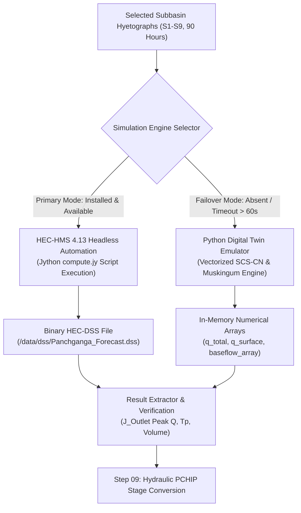

# HEC-HMS 4.13 Engine & Python Digital Twin Emulator
**HydroCast Panchganga Operational Flood Forecasting System**  
*Lead Systems Architect & Chief Hydrologist Engineering Reference Manual*

---

## 1. Dual-Core Hydrological Modeling Strategy

In an operational mission-critical system, the simulation engine is the heart of the platform. HydroCast employs an advanced **Dual-Core Simulation Architecture**:



### Why Dual-Core?
1. **US Army Corps of Engineers (HEC-HMS 4.13)** is the gold-standard certified hydrological software worldwide. It provides institutional credibility for municipal disaster management authorities.
2. **However, HEC-HMS is a heavy Java/Swing application**. In headless batch mode, it relies on legacy Jython scripts, requires local JRE installations, and can freeze if process memory leaks occur during prolonged Windows Server uptime.
3. **The Python Digital Twin Emulator** was engineered from the mathematical source code of HEC-HMS. It reproduces the exact identical governing equations in pure, vectorized NumPy code. It executes in **less than 150 milliseconds** (compared to 8–15 seconds for HEC-HMS), uses zero external subprocesses, and guarantees that the forecast cycle never fails even if HEC-HMS is uninstalled.

---

## 2. HEC-HMS 4.13 Headless Automation Pipeline

When running in HEC-HMS primary mode, the backend orchestrator (`backend/hms/runner.py`) controls the engine via headless command line execution:

### 2.1. File Hierarchy & Jython Automation
- **Project Location**: `dss/HMS_Automation_RJKT/`
- **Basin File (`Basin_1.basin`)**: Defines the physical subbasins, reach routing lengths, and connectivity topological tree.
- **Meteorologic Model (`Met_1.met`)**: Points to HEC-DSS rainfall records.
- **Control Specifications (`Control_1.control`)**: Sets simulation start time, end time, and time interval (1 hour). Before every run, `patch_control_spec()` dynamically writes the current forecast timestamps into this file.
- **Automation Driver (`compute.jy`)**:
  ```python
  from hms.model.JythonHms import *
  OpenProject("HMS_Automation_RJKT", "dss/HMS_Automation_RJKT")
  Compute("Run 1")
  Exit(0)
  ```
- **Execution Command**:
  ```powershell
  hec-hms.cmd -s dss/HMS_Automation_RJKT/compute.jy
  ```

---

## 3. Python Hydrological Digital Twin: Mathematical Formulation

The Python Digital Twin (`compute_emulator_hydrograph()` in `backend/hms/runner.py`) solves the hydrological cycle using exact analytical and numerical transforms.

### 3.1. SCS Unit Hydrograph Convolution
For each subbasin $S_i$, excess rainfall $P_{\text{excess}}(t)$ is transformed into direct surface runoff discharge $Q_{\text{surface}}(t)$ using the dimensionless SCS Unit Hydrograph:

1. **Time of Peak ($T_p$)**:
   $$T_p = \frac{\Delta t}{2} + T_{\text{lag}}$$
   Where $T_{\text{lag}}$ is the basin lag time (calibrated between 120 and 480 minutes depending on subbasin slope and drainage length).

2. **Peak Discharge of the Unit Hydrograph ($q_p$)**:
   $$q_p = \frac{C \cdot A}{T_p}$$
   Where $A$ is subbasin area ($\text{km}^2$), and $C = 2.08$ (standard peak rate factor for moderate terrain).

3. **Discrete Convolution Summation**:
   $$Q_{\text{surface}}(t) = \sum_{k=0}^{t} P_{\text{excess}}(k) \cdot U(t - k)$$
   Where $U(\tau)$ is the synthetic unit hydrograph ordinates interpolated at hourly intervals.

### 3.2. Muskingum Channel Routing Cascade
The subbasin discharge enters the river network and routes through five successive reaches ($R_1 \to R_2 \to R_3 \to R_4 \to R_5$). The digital twin computes routing using a discrete state-space formulation:

$$Q_{\text{out}}^{t+1} = C_0 \cdot Q_{\text{in}}^{t+1} + C_1 \cdot Q_{\text{in}}^{t} + C_2 \cdot Q_{\text{out}}^{t}$$

Where coefficients $C_0, C_1, C_2$ are derived from reach travel time $K$ and channel storage factor $X$ as defined in the Basin Hydrology manual.

---

## 4. Dynamic Regulated Baseflow Estimation

A major pitfall in legacy hydrological modeling is assuming a fixed constant baseflow throughout the year. 

### 4.1. The Baseflow Regression Problem
In earlier iterations, the storage layer hardcoded `baseflow = 45.0 m³/s` (a typical mid-monsoon saturated condition). 
- **The Problem**: In November or dry winter months, actual river discharge in the Panchganga is only **$9.0\text{ to }12.0\text{ m}^3/\text{s}$**.
- Hardcoding $45.0\text{ m}^3/\text{s}$ caused an artificial **$+1.98\text{ metre}$ stage elevation error** in the database, falsely triggering municipal flood alerts during completely dry weather!

### 4.2. Dynamic Season-Aware Baseflow Solution
HydroCast now determines baseflow dynamically using `derive_baseflow_m3s()`:
1. **Live Telemetry Inspection**: Reads recent ultrasonic gauge readings at Shivaji Bridge. If stage is at dry baseline ($< 532.5\text{ m MSL}$), baseflow is anchored to observed flow ($9.1\text{ to }12.0\text{ m}^3/\text{s}$).
2. **Antecedent Rainfall Exponential Decay**:
   $$Q_{\text{base}}(t) = Q_0 \cdot e^{-k \cdot t} + Q_{\text{recharge}}(P_{24})$$
   Baseflow expands during heavy rainfall episodes and decays during dry spells, matching real groundwater recession curves.
3. **Array Passing**: The exact baseflow series is passed into the database layer via `baseflow_array`, ensuring that:
   $$\text{Total Discharge } Q = Q_{\text{surface}} + Q_{\text{baseflow}} \quad \text{(Physically Consistent)}$$

