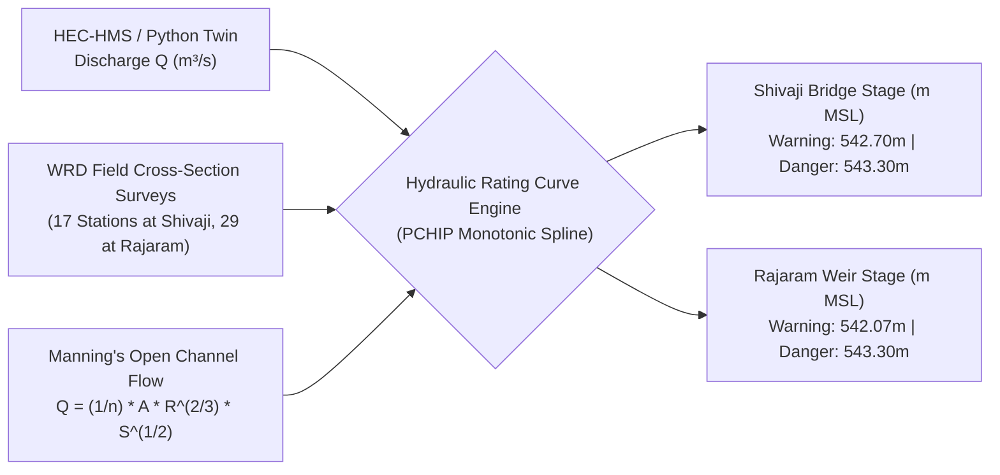
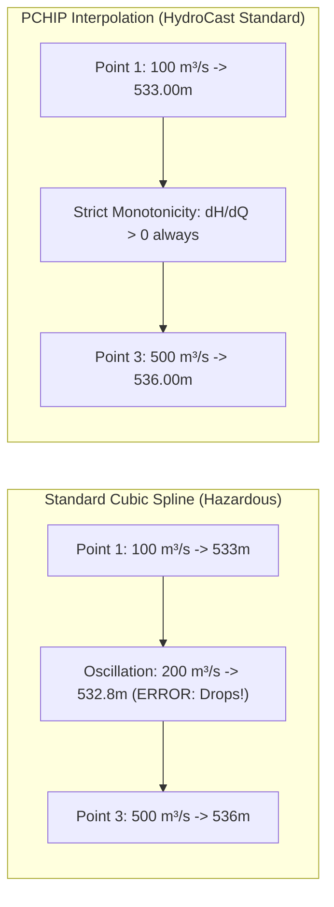

# Hydraulic Rating Curves & Stage-Discharge Conversion
**HydroCast Panchganga Operational Flood Forecasting System**  
*Lead Systems Architect & Chief Hydrologist Engineering Reference Manual*

---

## 1. Why Hydraulic Stage Conversion is Critical

Hydrological models compute **discharge** ($Q$ in $\text{m}^3/\text{s}$ or cusecs). However:
- Disaster management officers cannot evacuate a neighborhood based on $\text{m}^3/\text{s}$.
- Police cannot close a bridge based on cusecs.
- Evacuation plans, bridge road decks, and municipal flood boundaries are exclusively defined by **water stage level** ($H$ in metres above Mean Sea Level - m MSL).

The stage conversion engine (`backend/stage_conversion/stage_converter.py`) is the bridge between hydrological simulation and municipal civil protection. It converts simulated discharge at the basin outlet into exact river water surface elevations at two primary urban choke points:
1. **Shivaji Bridge (KT Weir / Main Kolhapur Arterial Crossing)**
2. **Rajaram Bridge & Weir (Basin Sink)**

---

## 2. Regulatory Water Level Benchmarks (WRD / CWC)

Stage elevations are tied to the Maharashtra Water Resources Department (WRD) benchmark datum. The official warning and danger thresholds established by the Central Water Commission (CWC) are:

| Location | River Bed Level | Dry Baseline Stage | Warning Level (Alert) | Danger Level (Flood) | 2019 Historic Peak | 2021 Historic Peak |
|:---|:---|:---|:---|:---|:---|:---|
| **Shivaji Bridge** | 530.50 m MSL | 531.80 m MSL | **542.70 m MSL** | **543.30 m MSL** | 545.92 m MSL | 545.45 m MSL |
| **Rajaram Weir** | 531.20 m MSL | 532.70 m MSL | **542.07 m MSL** | **543.30 m MSL** | 546.50 m MSL | 545.80 m MSL |

*Operational Note*: At Shivaji Bridge, water overflows the KT weir road deck when stage crosses **535.50 m MSL**. When stage crosses **542.70 m MSL** (Warning Level), extensive backwater flooding inundates the low-lying wards of Kasaba Bawada and Chikhali.

---

## 3. Mathematical Formulation: Manning's Equation & Compound Cross-Sections

For open channel flow through natural river cross-sections, the stage-discharge relationship is governed by Gauckler-Manning's equation:

$$Q = \frac{1}{n} \cdot A \cdot R^{2/3} \cdot S^{1/2}$$

- $Q$: Total discharge ($\text{m}^3/\text{s}$).
- $n$: Manning's roughness coefficient (calibrated against flood events).
- $A$: Cross-sectional wetted flow area ($\text{m}^2$).
- $R$: Hydraulic radius ($R = A / P$, where $P$ is wetted perimeter in metres).
- $S$: Energy slope / longitudinal bed slope of the Panchganga River ($S \approx 0.00045$, or 1 in 2,200).

### 3.1. Compound Section Discretization
The Panchganga channel is deeply incised with a compound geometry: a deep, narrow main channel flanked by broad, heavily vegetated agricultural floodplains. Because floodplain roughness ($n_{\text{fp}} \approx 0.055$) is significantly higher than channel bed roughness ($n_{\text{ch}} \approx 0.035$), a single composite $n$ causes massive stage underestimation during overbank flow.

The stage converter subdivides the cross-section into vertical slices:

$$Q_{\text{total}}(H) = Q_{\text{left floodplain}}(H) + Q_{\text{main channel}}(H) + Q_{\text{right floodplain}}(H)$$

$$Q_{\text{total}}(H) = \left[ \frac{A_{\text{lf}} R_{\text{lf}}^{2/3}}{n_{\text{lf}}} + \frac{A_{\text{ch}} R_{\text{ch}}^{2/3}}{n_{\text{ch}}} + \frac{A_{\text{rf}} R_{\text{rf}}^{2/3}}{n_{\text{rf}}} \right] \cdot S^{1/2}$$

---

## 4. PCHIP Monotonic Rating Curve Calibration

Standard cubic splines frequently suffer from "overshoot" or "undershoot" oscillations between calibration points, which can predict non-physical water level drops when discharge increases. 

HydroCast enforces strict **monotonicity** by using **Piecewise Cubic Hermite Interpolating Polynomials (PCHIP)** (`scipy.interpolate.PchipInterpolator`):

### 4.1. Mathematical Guarantee
For any two consecutive discharge coordinates $Q_k < Q_{k+1}$:

$$\frac{d H}{d Q} > 0 \quad \forall Q \ge 0$$

An increase in river discharge **guarantees** an increase (or plateau) in water stage elevation. Inundation levels can never artificially drop during a rising flood limb.

### 4.2. Acoustic Cross-Section Benchmark Datasets
The curves are fitted against field cross-sectional bathymetric survey files located in `data/wrd_cross_sections/`:
- `shivaji_xsection_17_survey.txt`: 17 survey station elevation points across the KT weir section.
- `rajaram_xsection_29_survey.txt`: 29 survey station elevation points capturing the weir crest, abutments, and overflow spillways.

