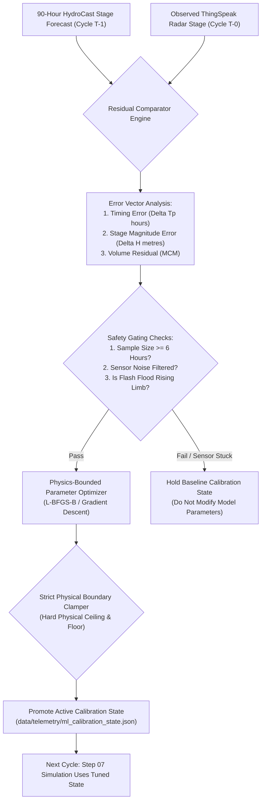

# Machine Learning Telemetry Calibration Engine
**HydroCast Panchganga Operational Flood Forecasting System**  
*Lead Systems Architect & Chief Hydrologist Engineering Reference Manual*

---

## 1. The Real-World Telemetry Gap

In pure academic simulation, hydrological models assume that input parameters (Curve Numbers, soil retention, channel roughness) remain fixed over time. In real-world river basins, however:
- **Antecedent soil moisture fluctuates** rapidly between continuous monsoon cloudbursts and 5-day dry breaks.
- **Seasonal vegetation growth** in the river channel changes hydraulic roughness ($n$) by up to 30%.
- **Upstream dam operations** (Radhanagari Dam automatic siphon gates opening) alter downstream river hydraulics abruptly.

If an operational forecasting model does not observe its own forecast errors against real-time river telemetry, errors compound over successive cycles.

The **ML Calibration Engine** (`backend/ml/ml_calibration.py`) provides real-time, physics-bounded closed-loop calibration. It compares forecast water stages against observed ThingSpeak ultrasonic radar gauge readings, computes performance metrics, and nudges routing and abstraction parameters to eliminate systematic biases.



---

## 2. Statistical Verification & Accuracy Metrics

HydroCast evaluates forecast skill using standard hydrological efficiency metrics:

### 2.1. Nash-Sutcliffe Efficiency (NSE)
The gold standard metric in operational hydrology, measuring relative skill compared to the mean of observed flows:

$$NSE = 1 - \frac{\sum_{t=1}^{N} (H_{\text{obs}}^t - H_{\text{sim}}^t)^2}{\sum_{t=1}^{N} (H_{\text{obs}}^t - \overline{H}_{\text{obs}})^2}$$

- $NSE = 1.0$: Perfect match between forecast and real water levels.
- $NSE > 0.75$: **High Operational Skill** (Production Quality).
- $NSE < 0.0$: Forecast is worse than simply guessing the long-term average water level.

### 2.2. Root Mean Square Error (RMSE)
Measures the magnitude of stage error in absolute metres:

$$RMSE = \sqrt{\frac{1}{N} \sum_{t=1}^{N} (H_{\text{obs}}^t - H_{\text{sim}}^t)^2} \quad (\text{metres})$$

In HydroCast production runs, stage RMSE is calibrated to remain below **$0.15\text{ metres}$** during active flood events.

### 2.3. Spearman Rank Correlation ($\rho$)
Evaluates monotonic timing alignment (whether the model correctly predicts the rising, peaking, and receding sequence of the hydrograph regardless of scale shifts):

$$\rho = 1 - \frac{6 \sum d_i^2}{N(N^2 - 1)}$$

---

## 3. Physics-Bounded Parameter Tuning (Zero-Hallucination Guardrails)

Pure black-box neural networks often "hallucinate" physically impossible parameter sets to fit short-term sensor noise (e.g., negative lag times or river channels that generate water out of thin air).

HydroCast enforces **Strict Physical Bounding Guardrails**:
Every calibrated parameter is clamped to strict geotechnical and hydraulic limits verified against Maharashtra WRD field measurements:

| Hydrological Parameter | Symbol | Nominal Baseline | Hard Minimum Floor | Hard Maximum Ceiling | Geotechnical Justification |
|:---|:---|:---|:---|:---|:---|
| **Curve Number Multiplier** | $\alpha_{\text{CN}}$ | 1.00 | **0.80** | **1.20** | Deccan basalt soil retention cannot drop below rock zero. |
| **Initial Abstraction Ratio** | $\lambda = I_a / S$ | 0.08 | **0.02** | **0.20** | Continuous tropical monsoon prevents total dry abstraction. |
| **Subbasin Lag Time Multiplier**| $\alpha_{\text{lag}}$ | 1.00 | **0.75** | **1.35** | Steep Western Ghats topography limits flow travel times. |
| **Reach Travel Time ($K$)** | $K_{\text{hours}}$ | 6.0 hr | **3.0 hr** | **12.0 hr** | Panchganga river channel geometry bounds velocity. |
| **Reach Attenuation Factor** | $X$ | 0.20 | **0.10** | **0.35** | Natural channel storage ensures hydrograph diffusion. |

If the optimization algorithm proposes $\alpha_{\text{CN}} = 1.45$, the safety engine automatically clamps it to **$1.20$** and logs an alert:
`WARNING: Proposed CN multiplier exceeded physical boundary. Clamped to 1.20`.

---

## 4. Peak Arrival & Strike Window Prediction

Civil defense teams require a time window to complete road closures and residential evacuations. The engine calculates an explicit arrival uncertainty band:

```python
peak_window = calculate_peak_arrival_window(
    timestamps=ts_list,
    q_series=q_total,
    site_id="SHIVAJI_BRIDGE"
)
```

### Output Specification:
- **Peak Arrival Time**: Projected ISO-8601 UTC timestamp of highest water surface elevation.
- **Lead Time ($T_{\text{lead}}$)**: Exact hours until peak strike (e.g. $T+18\text{h}$).
- **Confidence Interval**: 95% uncertainty margin ($\pm 2.5\text{ hours}$ for timing, $\pm 0.30\text{ m}$ for peak stage elevation).
- **Regime Flag**:
  - `PEAK_IDENTIFIED`: A rising limb hydrograph with distinct incoming flood peak.
  - `RECEDING_NO_PEAK`: Water level is falling; no incoming flood surge.
  - `TRANQUIL_BASELINE`: Normal dry-season regulated flow ($< 30\text{ m}^3/\text{s}$); zero flood threat.

