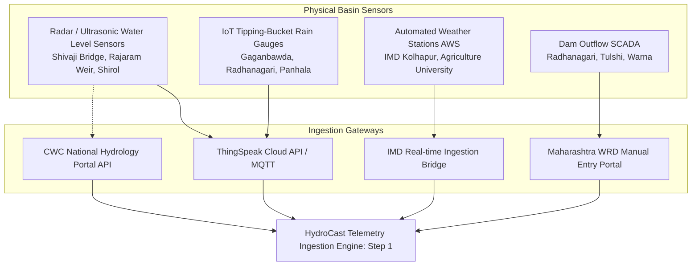
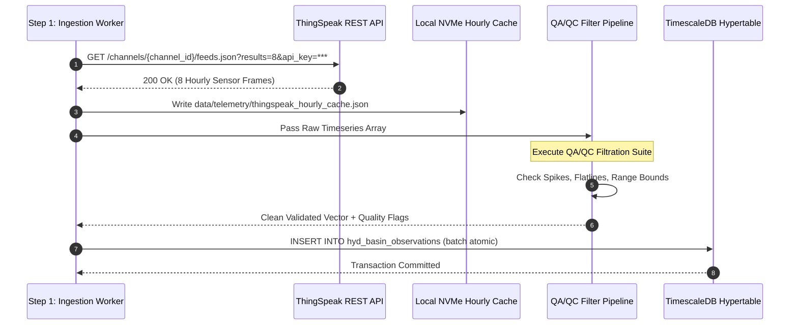

# HydroCast Sensor & Telemetry Engineering: IoT Ingestion, River Gauge Networks, and Automated Data Quality Assurance

This document specifies the hardware instrumentation topologies, IoT protocol integrations, automated telemetry ingestion pipelines, and algorithmic data quality assurance (QA/QC) filters governing physical observations across the Panchganga River Basin.

---

## 1. Field Hydrometric & Meteorological Sensor Network

Physical observations within the Panchganga Basin are collected from a heterogeneous array of automated river stage sensors, IoT tipping-bucket rain gauges, automated weather stations (AWS), and dam reservoir telemetry nodes.



### Physical Gauge Station Inventory

| Station Code | Sensor Type & Technology | Sampling Frequency | Ingestion Gateway | Primary Physical Metric |
| :--- | :--- | :--- | :--- | :--- |
| `SHIVAJI_BRIDGE` | Ott RLS Radar Level Sensor (26 GHz FMCW) | 15 Minutes | ThingSpeak Channel / CWC | Water Surface Elevation ($\text{m AMSL}$) |
| `RAJARAM_WEIR` | Hydrostatic Pressure Transducer + Float Gauge | 15 Minutes | ThingSpeak Channel / WRD | Water Surface Elevation ($\text{m AMSL}$) |
| `GAGANBAWDA_ARG` | Pronamic Dual Tipping-Bucket Gauge ($0.2\text{ mm}$) | 60 Minutes | ThingSpeak Channel (Cellular IoT) | Incremental Rainfall Depth ($\text{mm}$) |
| `RADHANAGARI_ARG`| Dual Tipping-Bucket Gauge ($0.2\text{ mm}$) | 60 Minutes | ThingSpeak Channel (Cellular IoT) | Incremental Rainfall Depth ($\text{mm}$) |
| `PANHALA_ARG`    | Dual Tipping-Bucket Gauge ($0.2\text{ mm}$) | 60 Minutes | ThingSpeak Channel (Cellular IoT) | Incremental Rainfall Depth ($\text{mm}$) |
| `KOLHAPUR_AWS`   | Campbell Scientific AWS (Temp, Wind, Hum, Rain) | 60 Minutes | IMD Open Data REST Feed | Meteorological Vector |
| `RADHANAGARI_DAM`| Spillway Gate Encoder Telemetry | 60 Minutes | Maharashtra WRD Scraper | Outflow Discharge ($\text{cusecs}$) |

---

## 2. Ingestion Protocols & Communication Architecture

Telemetry data is ingested into the HydroCast backend through asynchronous scheduled collectors located in `backend.processing.gauge_fetcher` and `backend.sensors.thingspeak`.



### ThingSpeak JSON Response Normalization
Raw IoT frames transmitted over GSM/GPRS cellular modems are normalized into typed internal data contracts:

```python
class NormalizedSensorFrame(BaseModel):
    station_id: str
    timestamp_utc: datetime
    raw_stage_m: Optional[float]
    incremental_rain_mm: Optional[float]
    battery_voltage_v: float
    signal_rssi_dbm: int
    quality_code: ObservationQualityCode
```

---

## 3. Algorithmic Data Quality Assurance (QA/QC) Matrix

Raw telemetry in mountainous monsoon environments is subject to insect blockages, cellular packet drops, float siltation, and electronic sensor drift. HydroCast applies a multi-stage deterministic QA/QC filter before observations enter the hydrologic calibration loop:

```mermaid
flowchart TD
    Raw[Raw Telemetry Ingestion] --> F1{Range Check:\nMin <= Value <= Max}
    F1 -->|Out of Range| FlagOOR[Flag: OUT_OF_RANGE\nClip or Nullify]
    F1 -->|Pass| F2{Rate of Change Check:\n|dStage/dt| <= 0.60 m/hr}
    F2 -->|Exceeds Delta| FlagSpike[Flag: SPIKE_REJECTED\nDrop Instantaneous Spike]
    F2 -->|Pass| F3{Flatline Check:\nVariance > 0 over 6 hrs}
    F3 -->|Zero Variance| FlagFlat[Flag: SENSOR_STUCK\nTrigger Maintenance Alert]
    F3 -->|Pass| Clean[Flag: VERIFIED_CLEAN\nPass to Model Calibration]
```

### 1. Physical Plausibility Range Verification
Observations are strictly clamped between physical bed invert and historical maximum boundaries:

$$S_{\text{bed}} \le S(t) \le S_{\text{HFL}} + 2.0\text{ m}$$

For Shivaji Bridge:
$$530.12\text{ m} \le S(t) \le 547.24\text{ m}$$

Any telemetry frame reporting $S(t) < 530.12\text{ m}$ (indicating sensor detachment) or $S(t) > 547.24\text{ m}$ is rejected with quality flag `ERR_OUT_OF_BOUNDS`.

### 2. High-Frequency Spike Rejection
Hydraulic mass conservation dictates that river stage at a major bridge crossing cannot rise or fall faster than physical channel inflow allows:

$$\left| \frac{S(t) - S(t - \Delta t)}{\Delta t} \right| \le 0.60\text{ m/hour}$$

If a 15-minute radar reading reports an instantaneous jump of $\Delta S > 0.15\text{ m}$ (equivalent to $> 0.60\text{ m/hr}$), the reading is flagged as `SPIKE_ANOMALY`. The system replaces the anomalous point with linear interpolation from adjacent valid readings if the spike is isolated to a single frame.

### 3. Sensor Sticking & Flatline Detection
A float gauge stuck in silt or a radar sensor frozen in error mode produces continuous constant values during high-rainfall periods:

$$\text{Var}\left( S(t - 6\text{h}), \dots, S(t) \right) = 0 \quad \text{while } \sum P_{\text{basin}} > 10\text{ mm}$$

When basin rainfall is active but river stage variance remains exactly $0.000\text{ m}$ over 6 consecutive hours, the sensor is tagged as `SENSOR_FROZEN_DEFECTIVE`, and the orchestrator falls back to secondary upstream hydrometric stations.

---

## 4. Packet Loss Handling & Temporal Alignment

Because remote IoT rain gauges in the Western Ghats experience intermittent cellular connectivity, data packets often arrive in delayed batches.

1. **Forward-Fill & Backward Reconciliation**:
   - The real-time forecast engine operates strictly on observations received up to execution cutoff time $T_0$.
   - When delayed packets arrive during a subsequent cycle, HydroCast performs an **asynchronous historical back-fill**, updating the historical database records without altering immutable signed past run outputs.
2. **Standardized Hourly Resampling**:
   - Tipping-bucket events occurring at irregular intervals are aggregated into standardized UTC hour buckets ($[t, t+1\text{h})$) using conservative mass-conserving step integration:
     $$P_{\text{hourly}}(t) = \sum_{\tau \in [t, t+1)} \delta_{\text{tip}}(\tau) \times 0.2\text{ mm}$$

---

## 5. Field Calibration & Maintenance Protocol

Field technicians must conduct physical calibration every pre-monsoon season (May 15 to May 31):
1. **Physical Staff Gauge Verification**:
   - Read the enamel brass staff gauge attached to Pier 3 of Shivaji Bridge manually using a surveyor's level.
   - Compare manual reading against the active radar distance offset:
     $$\text{Offset} = S_{\text{datum}} - D_{\text{radar}}$$
2. **Zero-Drift Adjustment**:
   - Update the station calibration coefficient in `data/inputs/stations/station_offsets.json`.
   - Record the calibration metadata, technician signature, and date in the system audit log.
