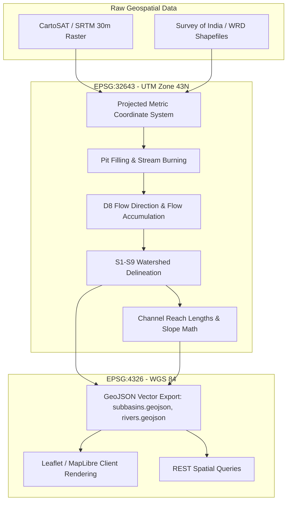
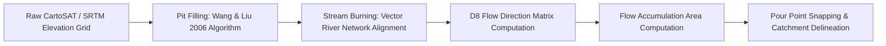
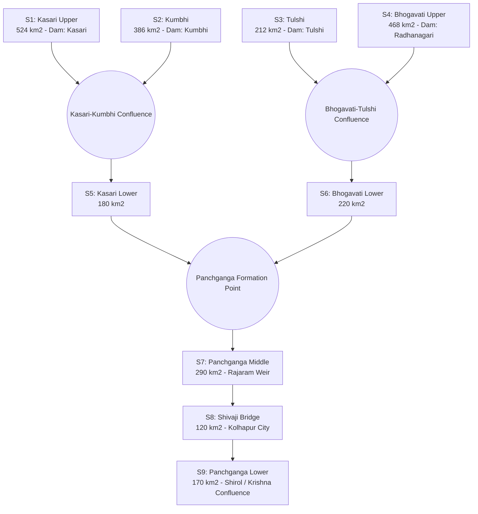
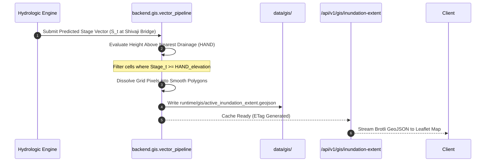

# HydroCast GIS & Spatial Engineering: Topographic Conditioning, Subbasin Delineation, and Vector Geospatial Pipelines

This document details the Geographic Information Systems (GIS) architecture, Digital Elevation Model (DEM) conditioning methodologies, watershed delineation workflows, and vector layer pipelines utilized across the Panchganga Basin within HydroCast.

---

## 1. Spatial Geospatial Architecture & Coordinate Reference Systems (CRS)

HydroCast strictly segregates geometric operations across two standardized Coordinate Reference Systems to preserve mathematical metric integrity while maintaining lightweight web client compatibility.



### Coordinate System Standards

| Standard ID | Name & Projection Type | Units | Architectural Role in HydroCast |
| :--- | :--- | :--- | :--- |
| **`EPSG:32643`** | WGS 84 / UTM Zone 43N (Transverse Mercator) | Meters ($\text{m}$) | **Mandatory for all hydrological calculations**: Subbasin surface areas ($A_i$), river channel lengths ($L$), hydraulic slope ($S_0$), and Gauckler-Manning cross-sections. |
| **`EPSG:4326`** | WGS 84 (Geographic / Unprojected) | Decimal Degrees ($^\circ$) | **Mandatory for all client delivery & storage**: GeoJSON payloads served by FastAPI to Leaflet/MapLibre web clients and PostGIS geographic queries. |

---

## 2. Digital Elevation Model (DEM) Hydrologic Conditioning

Raw satellite elevation rasters contain artificial sinks (depressions) and bridge obstructions that impede continuous hydrologic flow routing. HydroCast utilizes conditioned CartoSAT-1 ($10\text{ m}$) and SRTM ($30\text{ m}$) DEM rasters processed via the automated Python `richdem` and `rasterio` pipeline:



### 1. Pit Filling (Depression Removal)
Sinks are filled using the **Wang & Liu (2006)** depression-filling algorithm, which guarantees continuous downstream slope monotonicity:

$$Z_{\text{filled}}(x, y) = \max \left( Z_{\text{raw}}(x, y), \min_{(u,v) \in \text{Neighbor}} Z_{\text{filled}}(u, v) + \epsilon \right)$$

### 2. Stream Burning (AGREE Algorithm)
To force the DEM to honor known historical river cross-sections and eliminate planar bridges at Shivaji Bridge and Rajaram Weir, an artificial elevation trench of $\Delta z = 5.0\text{ m}$ is burned into the grid along digitized river centerlines:

$$Z_{\text{burned}}(x, y) = Z_{\text{filled}}(x, y) - \Delta z \quad \forall (x, y) \in \text{Channel Grid}$$

### 3. D8 Flow Routing
Flow direction from each raster cell to its steepest down-gradient neighbor is computed across the 8 cardinal and diagonal directions:

$$S_i = \frac{Z_0 - Z_i}{d_i}, \quad \text{Direction} = \arg\max_{i \in [1, 8]} S_i$$

Where $d_i = \Delta x$ for cardinal neighbors and $d_i = \sqrt{2}\Delta x$ for diagonal cells.

---

## 3. Subbasin Delineation & Topographic Topology (S1 to S9)

The Panchganga catchment ($2,570\text{ km}^2$) is partitioned into nine hydrologically distinct subbasins based on physical confluence nodes and hydrometric monitoring weirs.



### Topographic Parameters of Delineated Subbasins

| Subbasin ID | Catchment Name | Contributing Area ($\text{km}^2$) | Mean Elevation ($\text{m AMSL}$) | Centroid Coordinates (EPSG:4326) | Dominant Land Cover Class |
| :--- | :--- | :--- | :--- | :--- | :--- |
| **S1** | Kasari Upper | $524.12$ | $880.5$ | $16.7842^\circ\text{ N}, 73.8912^\circ\text{ E}$ | Dense Ghats Deciduous Forest |
| **S2** | Kumbhi Catchment | $386.45$ | $840.2$ | $16.6521^\circ\text{ N}, 73.9105^\circ\text{ E}$ | Semi-Evergreen Forest & Scrub |
| **S3** | Tulshi Catchment | $212.30$ | $760.0$ | $16.5812^\circ\text{ N}, 74.0240^\circ\text{ E}$ | Agricultural Terraces & Grassland |
| **S4** | Bhogavati Upper (Radhanagari)| $468.10$ | $895.0$ | $16.4215^\circ\text{ N}, 74.0150^\circ\text{ E}$ | Dense Tropical Rain Forest |
| **S5** | Kasari Lower | $180.20$ | $610.4$ | $16.7102^\circ\text{ N}, 74.0815^\circ\text{ E}$ | Sugarcane Agriculture |
| **S6** | Bhogavati Lower | $220.50$ | $590.2$ | $16.6410^\circ\text{ N}, 74.1205^\circ\text{ E}$ | Sugarcane Agriculture |
| **S7** | Panchganga Middle (Rajaram) | $290.40$ | $560.1$ | $16.6912^\circ\text{ N}, 74.2105^\circ\text{ E}$ | Peri-urban & Riparian Floodplain |
| **S8** | Kolhapur Urban (Shivaji Bridge) | $120.35$ | $545.0$ | $16.7081^\circ\text{ N}, 74.2425^\circ\text{ E}$ | High-Density Urban Impervious (64%) |
| **S9** | Lower Panchganga (Shirol) | $170.80$ | $530.2$ | $16.7410^\circ\text{ N}, 74.4510^\circ\text{ E}$ | Alluvial Agriculture / Backwater Zone |

---

## 4. Vector Export & Dynamic Inundation Pipeline

HydroCast processes static vector topologies into highly optimized GeoJSON structures served to client applications.



### Inundation Mapping via Height Above Nearest Drainage (HAND)
To translate point-based 1D stage forecasts ($S(t)$ at Shivaji Bridge) into 2D spatial flood maps:
1. Every grid cell in the digital elevation model is normalized to its relative height above the nearest hydraulic stream reach:
   $$\text{HAND}(x, y) = Z(x, y) - Z_{\text{stream}}(\text{drain}(x, y))$$
2. A grid cell $(x, y)$ is classified as inundated at time $t$ if the local flood stage depth exceeds its HAND elevation:
   $$\text{Inundated}(x, y, t) = \begin{cases} 1 & \text{if } S_{\text{reach}}(t) - S_{\text{bed}} \ge \text{HAND}(x, y) \\ 0 & \text{otherwise} \end{cases}$$
3. The resulting binary raster is vectorized using `shapely` and `geopandas`, smoothed with a Douglas-Peucker geometric simplification tolerance of $0.0001^\circ$, and served as vector polygon GeoJSON.

---

## 5. Automated GIS Maintenance Scripts

The GIS pipeline is fully automated and reproducible via the Python maintenance suite:

```powershell
# Regenerate all GeoJSON vector layers from source shapefiles
python -m backend.gis.vector_pipeline --regenerate-all --simplify-tolerance 0.0001

# Verify coordinate projection bounds and topology closure
python -m backend.gis.verify_geometries --crs EPSG:4326
```
