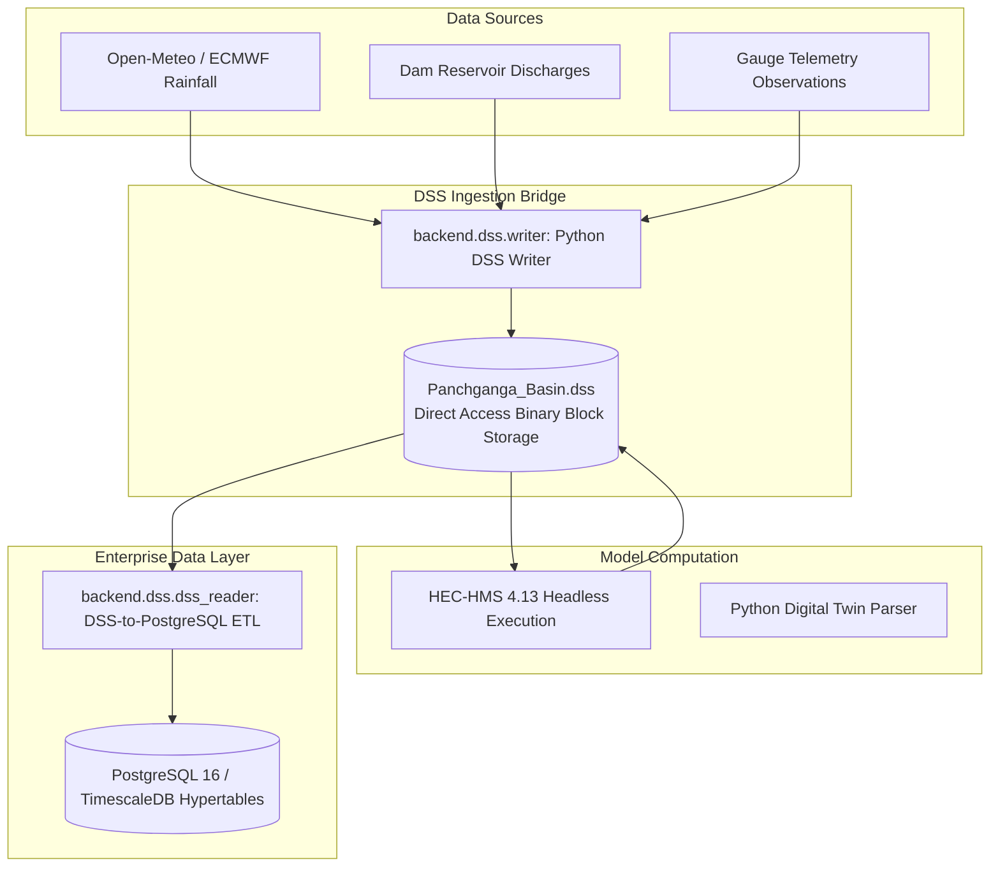
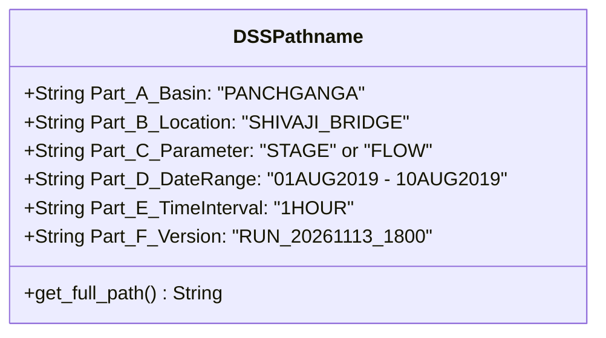
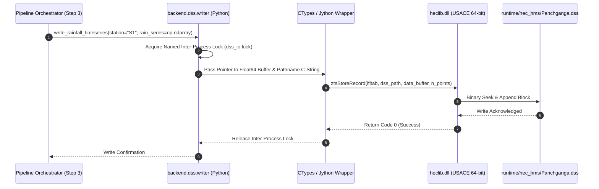
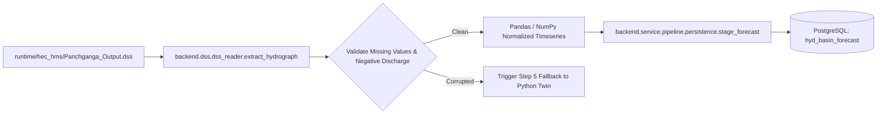

# HydroCast Engineering Guide: HEC-DSS Binary File Storage, Record Paths, and Relational Database Synchronization

This document specifies the technical architecture, binary record formatting, file locking protocols, and relational database ETL pipelines governing HEC-DSS (Hydrologic Engineering Center Data Storage System) integration within HydroCast.

---

## 1. Role of HEC-DSS in the HydroCast Architecture

HEC-DSS is the proprietary, highly optimized direct-access binary database format developed by the US Army Corps of Engineers (USACE) for storing hydrologic and hydraulic time-series and gridded spatial data.



While HydroCast leverages PostgreSQL 16 and TimescaleDB for its primary application layer and web APIs, **HEC-DSS remains the mandatory scientific storage medium** required by the USACE HEC-HMS 4.13 computation engine.

---

## 2. Standardized DSS Pathname Architecture

HEC-DSS organizes all time-series records using standardized six-part pathnames structured as:

$$\text{Pathname Format: } /\text{A}/\text{B}/\text{C}/\text{D}/\text{E}/\text{F}/$$



### Pathname Part Semantics in HydroCast

| Part | Name | Description & Allowed HydroCast Primitives | Example Record Path |
| :--- | :--- | :--- | :--- |
| **A** | **Basin / Project** | Identifies the geographic catchment name. Strictly `PANCHGANGA`. | `/PANCHGANGA/...` |
| **B** | **Location ID** | Subbasin code (`S1` to `S9`), hydrometric station (`SHIVAJI_BRIDGE`, `RAJARAM_WEIR`), or dam name (`RADHANAGARI_DAM`). | `.../SHIVAJI_BRIDGE/...` |
| **C** | **Parameter** | Physical parameter type: `PRECIP-INC` (incremental rainfall, $\text{mm}$), `FLOW` (discharge, $\text{m}^3/\text{s}$), or `STAGE` (water level, $\text{m AMSL}$). | `.../STAGE/...` |
| **D** | **Date / Block** | The starting date of the data block in USACE format (`DDMMMYYYY`, e.g., `01AUG2026`). | `.../01AUG2026/...` |
| **E** | **Time Interval** | Sampling frequency. Strictly `1HOUR` for hourly forecast vectors, or `15MIN` for raw radar telemetry. | `.../1HOUR/...` |
| **F** | **Version / Tag** | Cryptographic execution cycle ID (`CYC_YYYYMMDD_HH00`) or calibration regime (`OBSERVED`, `RAW_SIMULATED`). | `.../CYC_20261113_1800/` |

---

## 3. Binary Block Structure and Low-Level Access

HEC-DSS files (`.dss`) are composed of 32-bit (DSS Version 6) or 64-bit (DSS Version 7) binary records arranged in variable-sized disk clusters:


1. **Header Word Array**: Contains metadata including physical engineering units (`MM`, `M3/S`, `M`), measurement types (`PER-CUM` for cumulative precipitation, `INST-VAL` for instantaneous river stage), and missing data sentinels (typically `-901.0` or `-9999.0`).
2. **Data Array Compression**: Values are stored as sequential IEEE-754 floating-point arrays. HydroCast enforces strict zero-sanitization, converting unphysical missing data sentinels into IEEE `NaN` primitives upon ingestion to prevent corrupted calculations.

---

## 4. Python-to-DSS Interoperability Layer

Because USACE distributes HEC-DSS libraries natively as compiled C/Fortran dynamic link libraries (`heclib.dll`), HydroCast employs a robust, thread-safe Python abstraction bridge located in `backend.dss`:



### Handling Inter-Process File Locking on Windows Server
On Windows Server environments, simultaneous reads or writes from HEC-HMS and Python to the same `.dss` file can cause fatal OS file lock errors:
```text
System.IO.IOException: The process cannot access the file because it is being used by another process.
```
HydroCast circumvents this through **Staged Write Isolation**:
1. All input meteorological timeseries are written to a temporary pre-run copy: `runtime/hec_hms/scratch/input_staged.dss`.
2. Once write operations are complete and file handles are explicitly closed, the file is atomically renamed into the active HEC-HMS directory via `os.replace()`.
3. HEC-HMS executes in read-only input mode, writing its simulated hydrographs to a dedicated output container: `runtime/hec_hms/Panchganga_Output.dss`.

---

## 5. DSS-to-PostgreSQL ETL Synchronization Pipeline

Following successful completion of Step 5 (HEC-HMS simulation), the DSS output hydrographs are extracted, parsed, and mirrored into PostgreSQL 16 TimescaleDB hypertables:



### Step-by-Step Ingestion SQL
Extracted timeseries records are written using atomic multi-row insertions into the primary forecast hypertable:

```sql
INSERT INTO hyd_basin_forecast (
    run_id, site_id, recorded_at, lead_time_hours, 
    discharge_cusecs, stage_m, is_interpolated, engine_used
) VALUES 
    ('CYC_20261113_1800', 'SHIVAJI_BRIDGE', '2026-11-13 19:00:00+00', 1.0, 14250.0, 536.12, false, 'HEC-HMS_4.13'),
    ('CYC_20261113_1800', 'SHIVAJI_BRIDGE', '2026-11-13 20:00:00+00', 2.0, 14890.0, 536.35, false, 'HEC-HMS_4.13')
ON CONFLICT (run_id, site_id, recorded_at) 
DO UPDATE SET 
    discharge_cusecs = EXCLUDED.discharge_cusecs,
    stage_m = EXCLUDED.stage_m;
```

