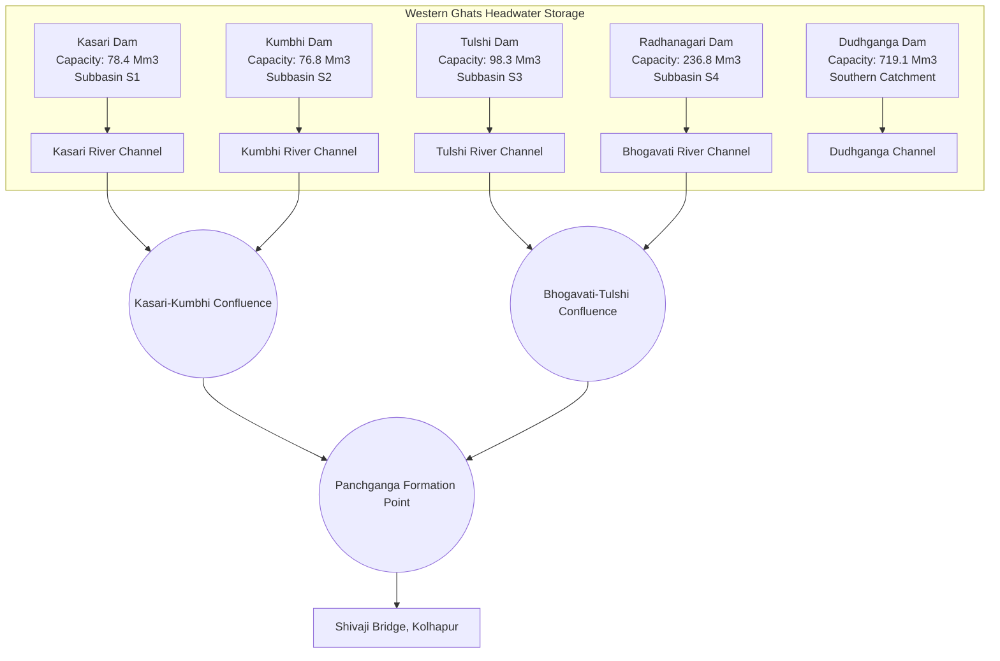
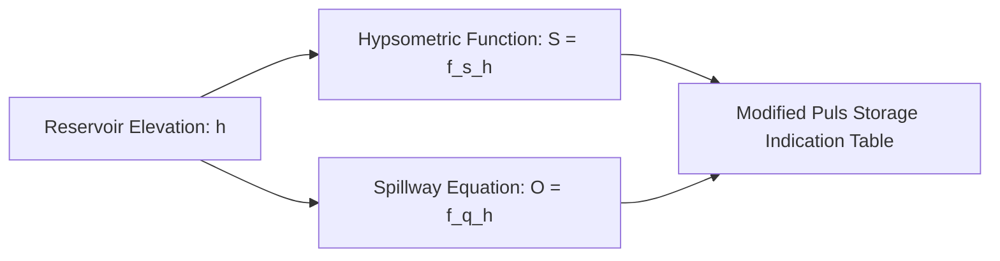
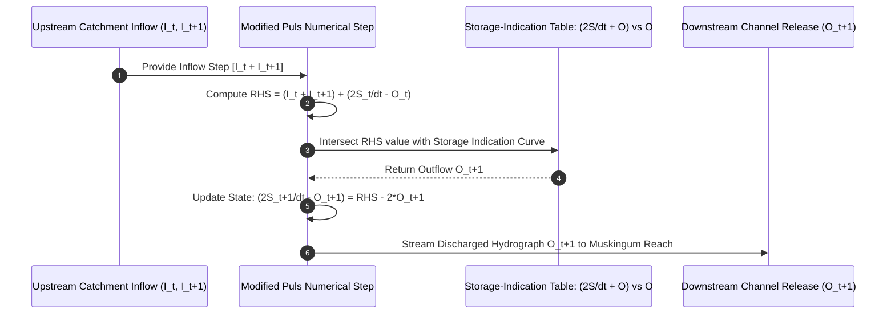
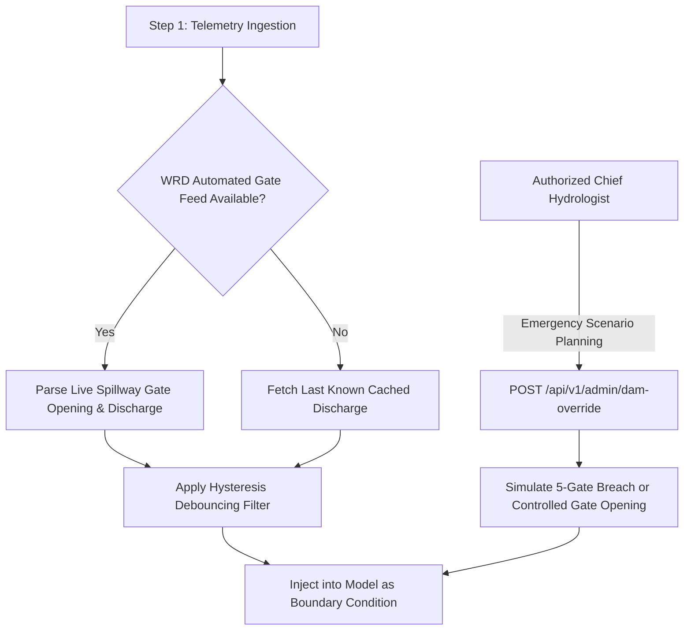

# HydroCast Reservoir Hydraulics: Dam Operation Rules, Level-Pool Routing, and Spillway Discharge Mechanics

This technical manual details the mathematical formulations, reservoir routing algorithms, spillway discharge rating equations, and operational gate rules governing the five major reservoirs in the Panchganga River Basin within HydroCast.

---

## 1. Upstream Reservoir Inventory & Geographic Topology

The Panchganga River is formed by five major tributaries, each regulated at its upper mountainous catchment by a state-operated storage reservoir:



### Dam Hydraulic Characteristics Matrix

| Reservoir Name | Regulated River | Gross Storage ($V_g$) | Full Reservoir Level (FRL) | Spillway Gate Architecture | Maximum Discharge ($Q_{\max}$) | Travel Time to Shivaji Bridge |
| :--- | :--- | :--- | :--- | :--- | :--- | :--- |
| **Radhanagari Dam** | Bhogavati | $236.8\text{ Mm}^3$ | $548.64\text{ m AMSL}$ | **7 Automatic Siphons (Emergency)** + 5 Gated Sluices | **$45,800\text{ cusecs}$** ($1,297\text{ m}^3/\text{s}$) | $11.0\text{ Hours}$ |
| **Tulshi Dam** | Tulshi | $98.3\text{ Mm}^3$ | $612.00\text{ m AMSL}$ | 3 Radial Motorized Gates ($10\text{ m} \times 6\text{ m}$) | **$14,200\text{ cusecs}$** ($402\text{ m}^3/\text{s}$) | $8.5\text{ Hours}$ |
| **Kasari Dam** | Kasari | $78.4\text{ Mm}^3$ | $626.50\text{ m AMSL}$ | 2 Radial Motorized Gates | **$11,800\text{ cusecs}$** ($334\text{ m}^3/\text{s}$) | $13.5\text{ Hours}$ |
| **Kumbhi Dam** | Kumbhi | $76.8\text{ Mm}^3$ | $652.00\text{ m AMSL}$ | Uncontrolled Ogee Crest + 2 Sluices | **$9,600\text{ cusecs}$** ($272\text{ m}^3/\text{s}$) | $12.0\text{ Hours}$ |
| **Dudhganga Dam** | Dudhganga | $719.1\text{ Mm}^3$ | $643.00\text{ m AMSL}$ | 5 Radial Motorized Gates ($12\text{ m} \times 8\text{ m}$) | **$58,000\text{ cusecs}$** ($1,642\text{ m}^3/\text{s}$) | Downstream Confluence |

---

## 2. Reservoir Storage-Elevation-Discharge Dynamics

For each reservoir, HydroCast represents the physical basin bathymetry via continuous hypsometric functions relating water surface elevation ($h$), impounded storage volume ($S$), and outflow discharge ($O$).



### 1. Hypsometric Storage Capacity Function $S(h)$
The relation between reservoir stage $h$ and impounded volume $S$ is modeled using piecewise quadratic splines calibrated against WRD bathymetric surveys:

$$S(h) = a_i (h - h_i)^2 + b_i (h - h_i) + c_i \quad \text{for } h \in [h_i, h_{i+1}]$$

Where $A(h) = \frac{dS}{dh}$ yields the active water surface area at elevation $h$.

### 2. Spillway Discharge Rating Formulation
Spillway discharge is modeled according to the physical crest structure:
- **For Gated Ogee Spillways (Tulshi, Kasari)**:
  $$Q_{\text{spill}}(h) = C_d \cdot L_e \cdot (h - h_{\text{crest}})^{1.5}$$
  Where $C_d \approx 2.15\text{ SI}$ is the discharge coefficient, and $L_e = L - 2(N K_p + K_a)(h - h_{\text{crest}})$ is the effective crest length corrected for pier contractions ($K_p$) and abutments ($K_a$).
- **For Radhanagari Automatic Siphon Spillways**:
  The siphon gates deploy sequentially as the upstream water head primes the siphon throat:
  $$Q_{\text{siphon}}(h) = \sum_{j=1}^{7} \Theta(h - h_{\text{prime}, j}) \cdot C_{\text{siph}} \cdot A_j \cdot \sqrt{2g \Delta H_j}$$
  Where $\Theta(x)$ is the Heaviside step function, $A_j$ is the cross-sectional throat area ($9.29\text{ m}^2$), and $\Delta H_j$ is the operating hydraulic head.

---

## 3. Numerical Level-Pool Routing (Modified Puls Method)

Reservoir flood routing within both HEC-HMS and the native Python Twin is computed using the **Modified Puls (Storage-Indication)** method, which integrates the hydrologic continuity equation over discrete time steps $\Delta t$:

$$\frac{S_{t+1} - S_t}{\Delta t} = \frac{I_t + I_{t+1}}{2} - \frac{O_t + O_{t+1}}{2}$$

Rearranging into known quantities at time $t$ on the right-hand side and unknown quantities at time $t+1$ on the left-hand side:

$$\left( \frac{2 S_{t+1}}{\Delta t} + O_{t+1} \right) = \left( I_t + I_{t+1} \right) + \left( \frac{2 S_t}{\Delta t} - O_t \right)$$



HydroCast pre-computes the monotonic storage-indication table $\left( \frac{2S}{\Delta t} + O \right) \mapsto O$ at $0.05\text{ m}$ elevation increments, enabling $O(1)$ interpolated lookups in the Python Twin loop.

---

## 4. Dam Ingestion Pipelines & Emergency Gate Override Protocols

In real-world monsoon operations, dam discharges are governed by human gate operators following WRD rule curves.



### Emergency Gate Override API Contract
Authorized operators can model hypothetical spillway releases (e.g., *"What happens if Radhanagari opens 5 gates releasing 30,000 cusecs at midnight?"*) without affecting the production live public feed:

```json
{
  "scenario_name": "RADHANAGARI_5_GATE_RELEASE_TEST",
  "author": "CHIEF_HYDROLOGIST",
  "dam_id": "RADHANAGARI_DAM",
  "overrides": [
    {
      "start_time_utc": "2026-11-14T00:00:00Z",
      "end_time_utc": "2026-11-14T12:00:00Z",
      "forced_discharge_cusecs": 30000.0,
      "gate_status": "5_GATES_OPEN"
    }
  ]
}
```
The orchestrator executes an isolated simulation sandbox, rendering the projected peak stage at Shivaji Bridge and indicating precisely whether the forced release will trigger Danger Mark inundation downstream.

