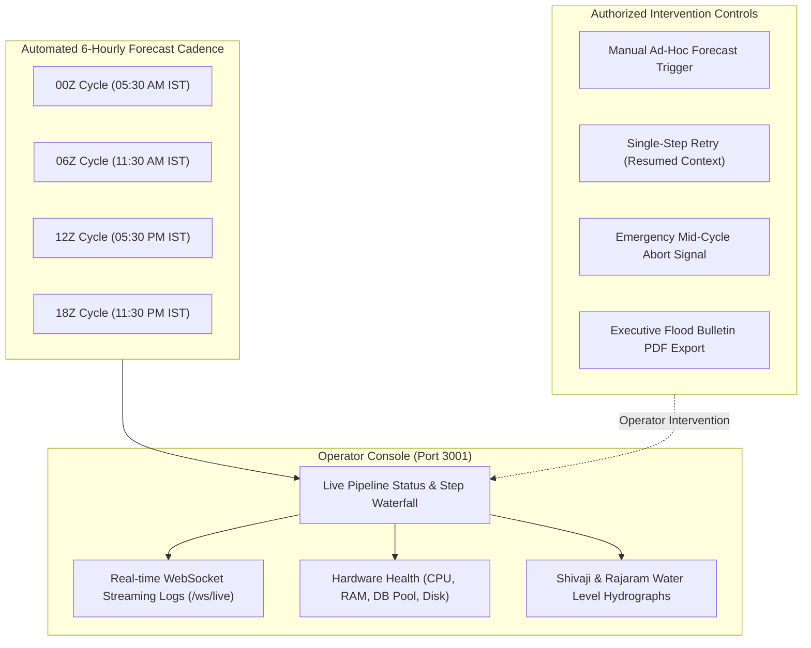

# Production Operator & Municipal Disaster Guide
**HydroCast Panchganga Operational Flood Forecasting System**  
*Lead Systems Architect & Chief Hydrologist Engineering Reference Manual*

---

## 1. System Role & Operational Responsibilities

This manual provides disaster control room operators, university technical leads, and district authorities (DDMA Kolhapur) with clear operational procedures for running, monitoring, and overriding the HydroCast platform.



---

## 2. Windows Server 2025 Process Management

The operational host runs HydroCast as native Windows background processes managed by PM2 / Windows Services and Windows Task Scheduler.

### 2.1. Critical Service Endpoints
| Component | Protocol & Host | Operational Purpose |
|:---|:---|:---|
| **Caddy Gateway** | `https://localhost` / Port 443 | Edge TLS termination & Reverse Proxy |
| **Backend API** | `http://127.0.0.1:8000` | FastAPI application & WebSocket server |
| **Public Portal** | `http://127.0.0.1:3000` | Civilian flood dashboard |
| **Operator Console** | `http://127.0.0.1:3001` | Disaster control room mission control |
| **PostgreSQL 16** | `127.0.0.1:5432` | Relational master persistence database |

### 2.2. Service Control Commands (PowerShell Admin)
To check or restart services on the host machine:

```powershell
# Check running PM2 node/python processes
pm2 status

# Restart backend API service
pm2 restart hydrocast-backend

# Restart Next.js dashboards
pm2 restart hydrocast-public-ui
pm2 restart hydrocast-admin-ui

# Inspect real-time combined backend logs
pm2 logs hydrocast-backend --lines 100
```

---

## 3. Routine Forecast Verification Workflow

At the start of every 6-hour shift (or immediately following extreme rainfall alerts), the duty operator must perform the **3-Minute Operational Verification**:

1. **Verify Live Connection**:
   Open the Operator Console at `http://localhost:3001` (or via official domain). Ensure the top-right indicator displays `● SYSTEM ONLINE (GREEN)`.
2. **Inspect Latest Forecast Cycle**:
   - Check the **Cycle ID** header (e.g., `CYC_20261113_1200`).
   - Confirm that all **12 Steps** show `status: success`.
   - Verify that **Execution Duration** is between **4.0s and 12.0s**.
3. **Verify Water Level Forecasts**:
   - Navigate to the **Stage Forecast Card**.
   - Check **Shivaji Bridge Peak Stage**:
     - If $< 542.70\text{ m MSL}$: Status is **NORMAL**. No civil action required.
     - If $\ge 542.70\text{ m MSL}$: Status is **WARNING**. Notify municipal police to monitor KT weir approaches.
     - If $\ge 543.30\text{ m MSL}$: Status is **DANGER**. Initiate urban flood alert protocol.

---

## 4. Manual Interventions & Step Overrides

### 4.1. Triggering an Ad-Hoc Forecast Run
If sudden extreme cloudburst rainfall occurs between regular 6-hourly cycles, the operator can force an immediate ad-hoc simulation:
1. Navigate to **Mission Control -> Actions**.
2. Click **[Trigger Immediate Forecast Cycle]**.
3. Enter optional cycle notes (e.g., `HEAVY_CLOUDBURST_RADHANAGARI_OBSERVED`).
4. Click **Confirm**.
5. The pipeline initiates immediately, streaming live Step 01 through Step 12 progress to the console terminal window.

### 4.2. Retrying a Single Step (Restored Context)
If an individual step fails (for example, Step 01 timed out due to a temporary internet glitch):
1. In the pipeline step waterfall, locate the failed step (e.g. `Step 01: Weather Ingestion`).
2. Click the **[Retry Step]** button next to it.
3. **P0 Safety Architecture**: The worker automatically rebuilds previous simulation artifacts from `data/staging/cycle_state/` into memory before executing the step, ensuring no zeros or corrupted hydrographs are generated.

### 4.3. Emergency Cycle Abort
If a run was triggered with erroneous test parameters, click **[Emergency Abort]**. The backend sets an internal `ABORT_EVENT` flag. The running worker halts at the completion of its active step, rolls back temporary buffers, and restores system readiness without corrupting database state.

