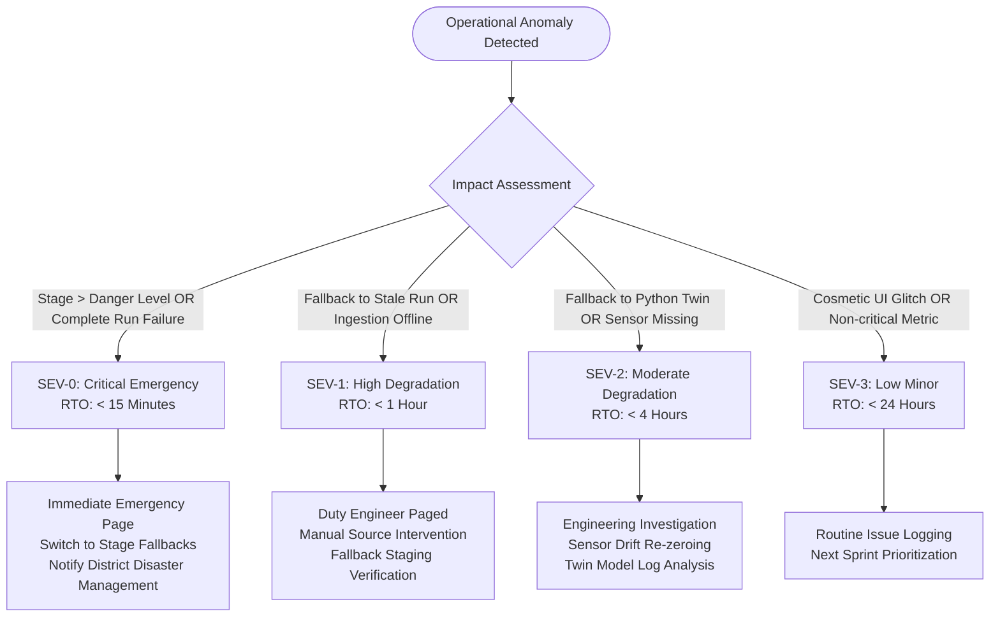
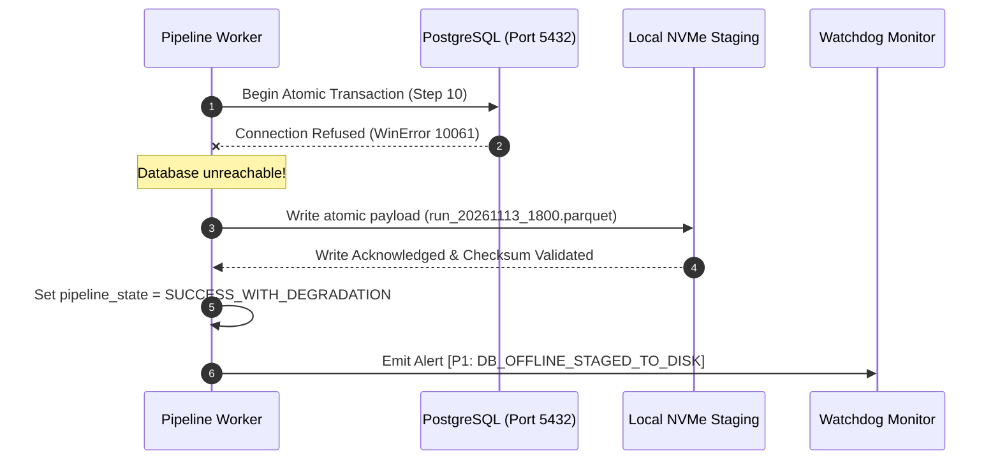
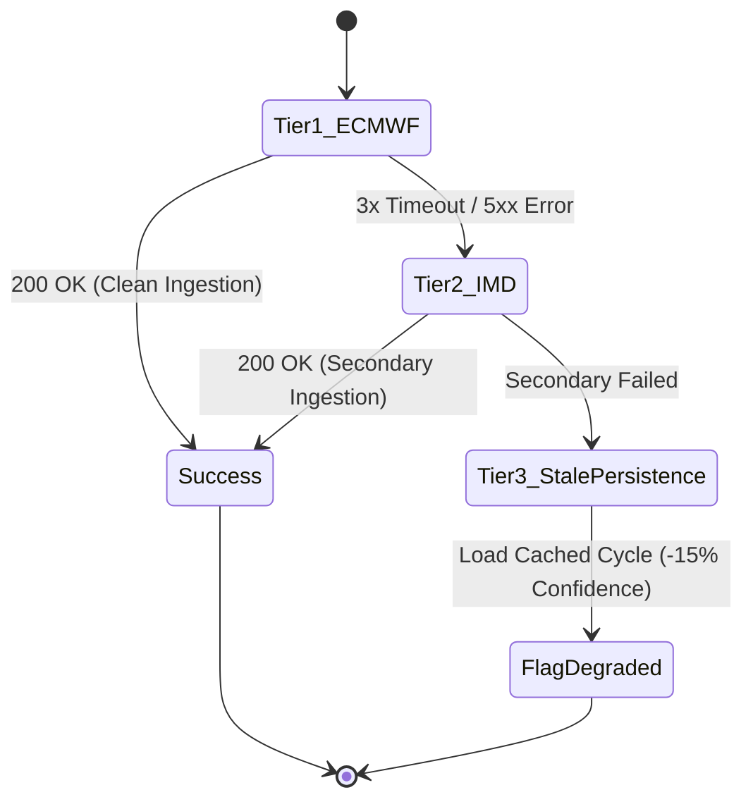
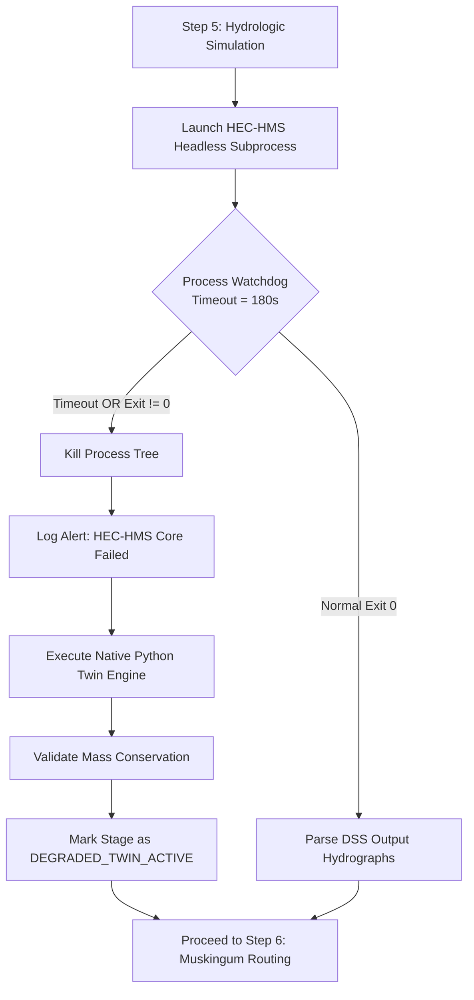
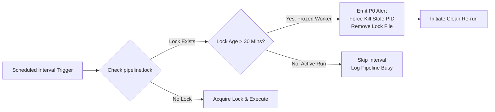
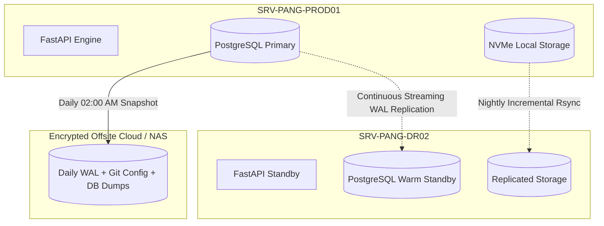

# HydroCast Engineering Runbook: Incident Management, Disaster Recovery, and Degraded State Triage

This document serves as the authoritative operational recovery manual for the HydroCast Panchganga Basin forecasting system. It defines root-cause triage methodologies, failover protocols, and step-by-step remediation procedures for critical operational incidents, network partitions, database outages, model convergence failures, and unhandled runtime exceptions.

---

## 1. Incident Severity Classification Framework

Operational anomalies within HydroCast are categorized into four standardized severity tiers (P0 through P3). Incident response protocols, alerting escalation pathways, and Recovery Time Objectives (RTO) are strictly dictated by these classifications.



| Severity Tier | Definition & Impact Criteria | Operational Constraints | Target RTO / RPO | Escalation Path |
| :--- | :--- | :--- | :--- | :--- |
| **P0 (Critical)** | Pipeline completely halted during active monsoon (June-October); or hydraulic stage prediction exceeds Danger Mark ($542.50\text{ m}$ at Shivaji Bridge) with zero upstream telemetry updates for $> 3$ hours; or master database corruption. | Immediate suspension of automated deployments. Emergency conference bridge active within 5 minutes. | $\text{RTO} \le 15\text{ mins}$<br>$\text{RPO} \le 1\text{ hour}$ | Lead Systems Architect, Chief Hydrologist, District Collector Control Room |
| **P1 (High)** | Open-Meteo or CWC telemetry endpoints unreachable for two consecutive scheduled cycles ($> 12\text{ hours}$); primary pipeline falls back to stale execution cache; automated daily bulletin generation fails. | Automated fallback to Tier-2 IMD/GFS and offline staging mode. Mandatory verification of staged Parquet files. | $\text{RTO} \le 60\text{ mins}$<br>$\text{RPO} \le 6\text{ hours}$ | Lead SDE, Senior Hydrology Modeler, Shift Lead |
| **P2 (Moderate)** | HEC-HMS headless engine crashes with memory segmentation or license fault, causing automatic fallback to the internal Python Digital Twin; single upstream discharge sensor (e.g., Kumbhi Dam outflow) reports flatlined values. | Pipeline execution marked `DEGRADED`. Simulation results flagged with caveat badge on public dashboards. | $\text{RTO} \le 4\text{ hours}$<br>$\text{RPO} \le 12\text{ hours}$ | SDE On-Call, Field Instrumentation Technician |
| **P3 (Low)** | Non-blocking telemetry ingestion warning (e.g., secondary IMD temperature sensor absent); Grafana Prometheus exporter scrape timeout; minor frontend formatting discrepancy on mobile browser. | Standard ticketing workflow. Does not impede scheduled 6-hour execution cycles. | $\text{RTO} \le 24\text{ hours}$<br>$\text{RPO} \le 24\text{ hours}$ | DevOps Engineer, Frontend Developer |

---

## 2. High-Priority Operational Incidents & Triage Protocols

### Incident Scenario A: Primary Database Outage (PostgreSQL / TimescaleDB Offline)

#### Architectural Failure Signature
During Step 10 (`DB_PERSISTENCE`) or live API query routing, the application log outputs recurring connection refused exceptions:
```text
psycopg2.OperationalError: could not connect to server: Connection refused (0x0000274D/10061)
	Is the server running on host "127.0.0.1" and accepting
	TCP/IP connections on port 5432?
sqlalchemy.exc.OperationalError: (psycopg2.OperationalError) [WinError 10061] No connection could be made...
```

#### Immediate Degraded Behavior
The FastAPI backend switches to read-only memory cache mode if Redis or localized memory cache is warm, serving cached state for up to 6 hours with the response header `X-HydroCast-Degraded: Database-Offline`. The background pipeline worker catches the failure during Step 10 and writes the entire run payload to atomic staging disk storage (`runtime/staging/run_<run_id>.parquet` and `.json`), returning status `SUCCESS_WITH_DEGRADATION`.



#### Remediation and Recovery Procedure
1. **Verify Windows Service Status**:
   Open an elevated administrative PowerShell prompt and inspect the PostgreSQL service:
   ```powershell
   Get-Service -Name "postgresql*"
   ```
2. **Restart Database Engine**:
   If the service is stopped or in a hung state:
   ```powershell
   Restart-Service -Name "postgresql-x64-16" -Force
   ```
3. **Verify Port Accessibility and Connection Limit**:
   Confirm that PostgreSQL is actively listening and not exhausted by connection leaks:
   ```powershell
   Test-NetConnection -ComputerName 127.0.0.1 -Port 5432
   ```
4. **Inspect PostgreSQL Engine Logs**:
   Review the active log directory (typically `C:\Program Files\PostgreSQL\16\data\log\`) for out-of-disk-space errors, transaction log corruption (`pg_wal` saturation), or panic shutdowns.
5. **Replay Staged Hydrological Payloads**:
   Once the database engine has recovered and accepts queries, execute the staging replay script to ingest all unpersisted cycles without corrupting transaction sequences:
   ```powershell
   python -m backend.tools.replay_staged_runs --source "runtime/staging/" --delete-on-success
   ```
6. **Validate Data Integrity**:
   Verify that the latest water levels at Shivaji Bridge reflect current forecast lead times:
   ```sql
   SELECT run_id, recorded_at, stage_m, discharge_cusecs, is_interpolated 
   FROM hyd_basin_forecast 
   WHERE site_id = 'SHIVAJI_BRIDGE' 
   ORDER BY recorded_at DESC LIMIT 10;
   ```

---

### Incident Scenario B: External Meteorology Outage (Open-Meteo & IMD Partition)

#### Architectural Failure Signature
During Step 2 (`METEOROLOGY_INGESTION`), all external HTTP calls time out or return `503 Service Unavailable`:
```text
urllib3.exceptions.MaxRetryError: HTTPSConnectionPool(host='api.open-meteo.com', port=443): 
Max retries exceeded with url: /v1/forecast?latitude=16.70&longitude=74.24...
backend.core.errors.IngestionError: [MET_EXT_001] Primary and secondary meteorological feeds exhausted.
```

#### Immediate Degraded Behavior
The system triggers the **Three-Tier Meteorological Fallback Protocol**:
1. **Tier 1 (Real-time ECMWF IFS 0.25°)**: Retries 3 times with exponential backoff ($2\text{s}, 4\text{s}, 8\text{s}$). If failed, switches to Tier 2.
2. **Tier 2 (IMD Open Data / NCMRWF Local GFS Grid)**: Attempts spatial raster download. If unavailable, switches to Tier 3.
3. **Tier 3 (Persistence Climatological Stale Extrapolation)**: Extrapolates precipitation using the preceding 12-hour spatial decay model and cached forecast vectors from the previous cycle, penalizing confidence scores by $15\%$ per 6-hour extrapolation step.



#### Remediation and Recovery Procedure
1. **Inspect Egress Connectivity**:
   Confirm whether the host Windows Server has lost outbound internet access or DNS resolution:
   ```powershell
   Resolve-DnsName api.open-meteo.com
   Test-NetConnection -ComputerName api.open-meteo.com -Port 443
   ```
2. **Review Firewall / Proxy State**:
   Verify whether organizational proxy policies or Windows Defender Firewall rules were altered during automated Windows Updates.
3. **Trigger Manual Climatological Injection (Break-Glass)**:
   In the event of an extended upstream meteorological outage during active flood conditions, an authorized hydrologist may inject custom rainfall scenarios (e.g., $150\text{ mm}$ uniform 24-hour rainfall over Gaganbawda) via the administrative CLI:
   ```powershell
   python -m backend.tools.inject_synthetic_meteorology --subbasin S1 --depth-mm 185.0 --duration-hrs 24 --author "CHIEF_HYDROLOGIST"
   python -m backend.orchestrator.pipeline_worker --run-now --override-met
   ```

---

### Incident Scenario C: HEC-HMS Core Failure & Native Python Twin Activation

#### Architectural Failure Signature
During Step 5 (`HYDROLOGIC_SIMULATION`), the headless HEC-HMS 4.13 Java process fails to complete within the 180-second watchdog window, throws a null pointer exception, or terminates with exit code `1`:
```text
ERROR [HydrologicEngine] HEC-HMS process failed with return code 1.
java.lang.NullPointerException at hec.hms.model.BasinModel.compute(...)
backend.core.errors.ModelExecutionError: HEC-HMS execution terminated abnormally. Falling back to Python Twin.
```

#### Immediate Degraded Behavior
The orchestrator immediately invokes `backend.hydrology.python_twin_engine.run_simulation()`. The native Python engine executes the identical subbasin cascade (S1 through S9) using NumPy vectorization, completing in $< 1.5$ seconds. The cycle status is updated to `SUCCESS_WITH_DEGRADATION`, and the downstream rating curve and ML bias-correction stages proceed without interruption.



#### Remediation and Recovery Procedure
1. **Inspect HEC-HMS Compute Log**:
   Examine the generated HMS log file located at:
   `runtime/hec_hms/Panchganga_Basin/Panchganga_Basin.log`
   Common root causes include:
   - Corrupted DSS file lock (`Panchganga_Basin.dss.lock` remaining after improper termination).
   - NaN or negative values in the generated meteorological gage input tables.
2. **Clear Stale File Locks**:
   ```powershell
   Remove-Item "runtime/hec_hms/Panchganga_Basin/*.lock" -Force -ErrorAction SilentlyContinue
   ```
3. **Verify Java Runtime Environment**:
   Ensure the JRE bundled with HEC-HMS 4.13 is operational and path variables have not been modified:
   ```powershell
   & "C:\Program Files\HEC\HEC-HMS-4.13\jre\bin\java.exe" -version
   ```
4. **Execute Isolated Engine Benchmark**:
   Run an isolated validation compute to confirm engine stability:
   ```powershell
   python -m backend.hydrology.benchmark_engines --compare-all
   ```

---

### Incident Scenario D: Pipeline Worker Deadlock or Frozen Subprocess

#### Architectural Failure Signature
The orchestrator watchdog detects that the active pipeline cycle has exceeded the absolute safety threshold of $600\text{ seconds}$ ($10\text{ minutes}$), or a previous cycle's lock file (`runtime/locks/pipeline.lock`) remains stale for $> 30\text{ minutes}$.



#### Remediation and Recovery Procedure
1. **Identify Hung Process Tree**:
   Inspect active Python and Java processes associated with the HydroCast runtime:
   ```powershell
   Get-Process -Name python, java -ErrorAction SilentlyContinue | Select-Object Id, ProcessName, CPU, WorkingSet64, StartTime
   ```
2. **Execute Forceful Worker Termination**:
   If a worker is identified as frozen (CPU utilization $0\%$ for $> 10$ minutes while holding the execution lock):
   ```powershell
   # Terminate pipeline execution tree safely
   python -m backend.tools.emergency_abort --force
   ```
3. **Clear Stale Execution Locks**:
   ```powershell
   Remove-Item "runtime/locks/pipeline.lock" -Force -ErrorAction SilentlyContinue
   ```
4. **Trigger Clean Cycle Dispatch**:
   ```powershell
   python -m backend.orchestrator.pipeline_worker --run-now
   ```

---

## 3. Disaster Recovery and Cold Standby Protocol

In the event of catastrophic physical hardware failure, ransomware corruption, or primary server loss, the following disaster recovery procedure restores HydroCast to full operational readiness on a clean Windows Server environment within the $15$-minute RTO.

### Cold Standby Provisioning Topology



### Complete Bare-Metal Restoration Steps

1. **Clone Authoritative Repository**:
   ```powershell
   git clone https://github.com/organization/hydrocast-panchganga.git "E:\Hydrocast Windows Server"
   cd "E:\Hydrocast Windows Server"
   ```
2. **Provision Hardened Python Virtual Environment**:
   ```powershell
   python -m venv venv
   .\venv\Scripts\Activate.ps1
   pip install --upgrade pip
   pip install -r requirements.txt
   ```
3. **Initialize Database and Apply Alembic Migrations**:
   Ensure PostgreSQL is installed and configured with TimescaleDB extension enabled:
   ```powershell
   psql -U postgres -h 127.0.0.1 -c "CREATE DATABASE hydrocast_production;"
   psql -U postgres -h 127.0.0.1 -d hydrocast_production -c "CREATE EXTENSION IF NOT EXISTS timescaledb;"
   alembic upgrade head
   ```
4. **Restore Climatological & Rating Curve Baselines**:
   Populate reference stage-discharge lookup tables and WRD historical benchmarks:
   ```powershell
   python -m backend.db.seed_reference_data
   ```
5. **Install and Register Windows Services**:
   Register Caddy, the FastAPI backend, and the background pipeline worker via NSSM (Non-Sucking Service Manager):
   ```powershell
   nssm install HydroCastAPI "E:\Hydrocast Windows Server\venv\Scripts\python.exe" "-m uvicorn backend.api.main:app --host 127.0.0.1 --port 8000"
   nssm set HydroCastAPI AppDirectory "E:\Hydrocast Windows Server"
   nssm set HydroCastAPI Start SERVICE_AUTO_START
   nssm start HydroCastAPI

   nssm install HydroCastWorker "E:\Hydrocast Windows Server\venv\Scripts\python.exe" "-m backend.orchestrator.pipeline_worker --daemon"
   nssm set HydroCastWorker AppDirectory "E:\Hydrocast Windows Server"
   nssm set HydroCastWorker Start SERVICE_AUTO_START
   nssm start HydroCastWorker
   ```
6. **Execute End-to-End Smoke Verification**:
   Execute the automated end-to-end verification suite to ensure all 12 pipeline steps, mathematical engines, and API endpoints function cleanly:
   ```powershell
   pytest tests/test_end_to_end_pipeline.py -q
   ```

---

## 4. Post-Incident Review (PIR) and Audit Trail Standards

Following the resolution of any P0 or P1 operational incident, a formal Post-Incident Review must be conducted within 48 hours.

### Mandatory PIR Documentation Requirements
1. **Incident Timeline**: High-precision timeline documenting initial sensor drift or exception occurrence, automated alert dispatch, human responder acknowledgment, degraded state transition, and final service restoration.
2. **Root Cause Analysis (5 Whys)**: Exhaustive engineering analysis tracing the systemic failure mechanism (e.g., memory leak in upstream driver, unhandled null byte in external CSV, disk space exhaustion).
3. **Zero-Data-Fabrication Audit**: Independent validation confirming that no synthetic, interpolated, or unverified values were published to public or municipal disaster response interfaces without explicit degraded status labeling.
4. **Preventative Action Items**: Engineering tickets scheduled for immediate sprint commitment to prevent regression (e.g., enhanced pre-flight schema validation, tightened watchdog thresholds, automated disk rotation).

