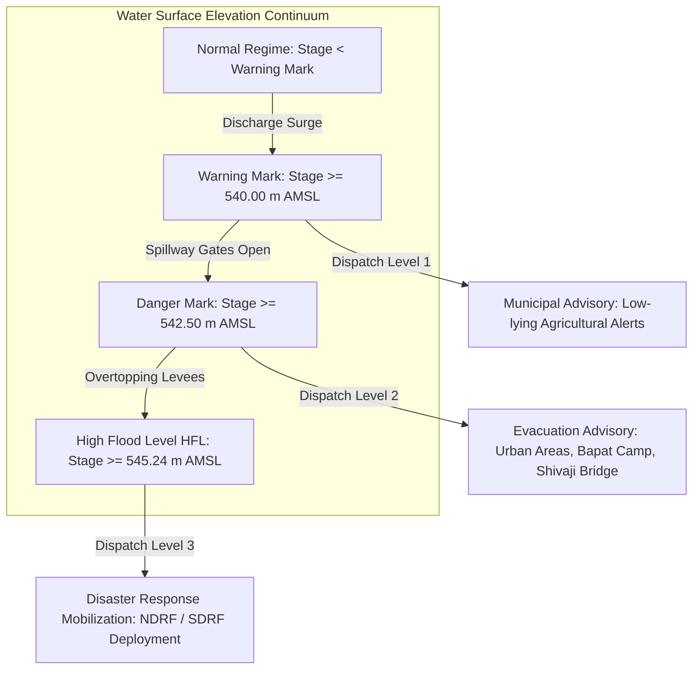
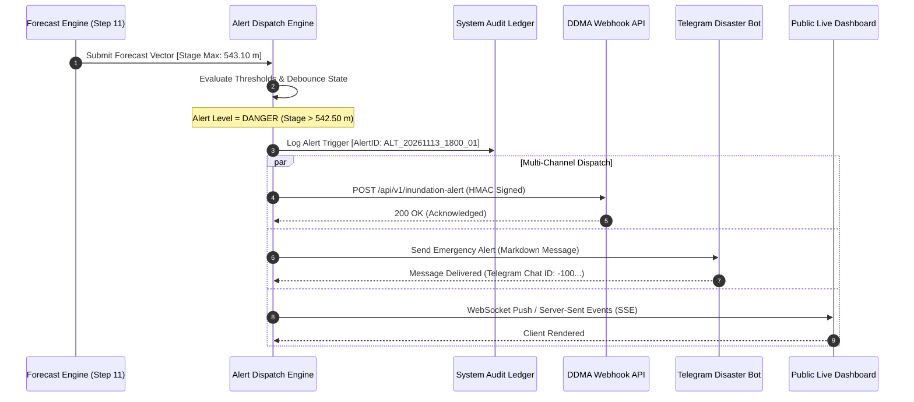
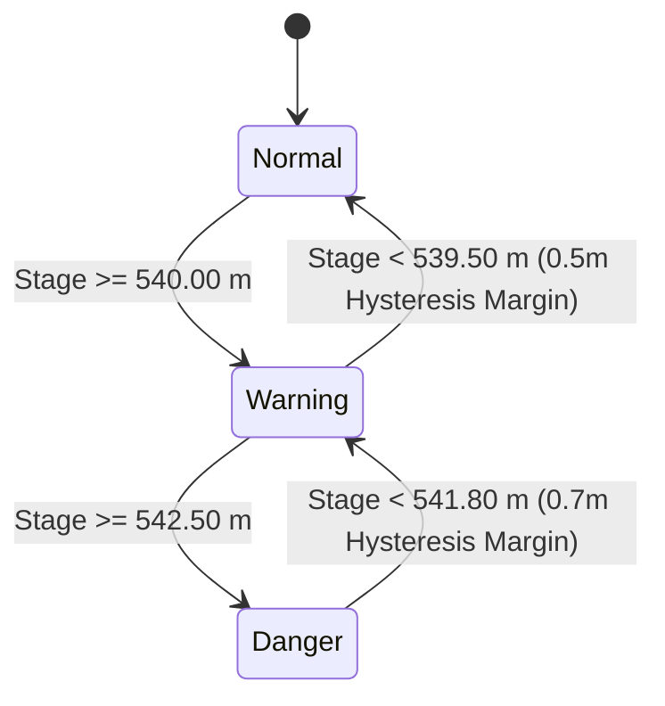
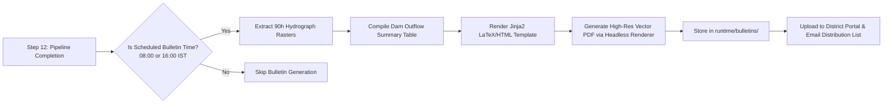

# HydroCast Operations Manual: Flood Warning Thresholds, Bulletin Synthesis, and Emergency Alert Dispatches

This manual specifies the operational criteria, statutory flood classifications, automated warning dissemination workflows, and municipal bulletin generation standards enforced by the HydroCast forecasting engine across the Panchganga Basin.

---

## 1. Statutory Flood Classification Framework

HydroCast adheres to the standardized stage thresholds established by the Central Water Commission (CWC), Government of India, and the Maharashtra Water Resources Department (WRD). Water surface elevations (WSE) are measured in meters above Mean Sea Level ($\text{m AMSL}$).



### Critical Hydrometric Benchmarks for Key River Crossings

| Station ID | River / Location | Bed Invert ($\text{m}$) | Warning Mark ($\text{m}$) | Danger Mark ($\text{m}$) | Historical HFL ($\text{m}$) & Year | Critical Inundation Impacts |
| :--- | :--- | :--- | :--- | :--- | :--- | :--- |
| `SHIVAJI_BRIDGE` | Panchganga (Kolhapur City) | $530.12$ | **$540.00$** | **$542.50$** | $545.24$ ($2019$, $2021$) | Submergence of historic arch bridge; inundation of Bapat Camp, Venus Corner, and Kolhapur-Ratnagiri Highway (NH-166). |
| `RAJARAM_WEIR` | Panchganga (Upstream Kolhapur) | $528.50$ | **$538.50$** | **$541.00$** | $544.10$ ($2019$) | Overtopping of KT weir; backwater swelling into tributary streams (Dudhganga & Bhogavati junctions). |
| `BAPAT_CAMP` | Kolhapur Lowland Confluence | $532.00$ | **$539.50$** | **$541.80$** | $544.80$ ($2021$) | Densely populated urban residential area; sewer backflow and severe road transport cutoff. |
| `SHIROL` | Panchganga-Krishna Confluence | $515.20$ | **$527.00$** | **$530.00$** | $534.50$ ($2019$) | Catastrophic backwater effect caused by high storage levels in Almatti Dam (Karnataka) downstream. |

---

## 2. Inundation Arrival Lead-Time & Strike Window Computation

HydroCast does not simply issue threshold alarms; it computes predictive **Strike Windows** representing the estimated time until critical flood thresholds are breached.

Let $S(t)$ represent the projected stage profile at Shivaji Bridge over the forecast lead time $t \in [0, 90\text{ hours}]$. Let $S_{\text{warn}} = 540.00\text{ m}$ and $S_{\text{danger}} = 542.50\text{ m}$.

$$\tau_{\text{warn}} = \min \left\{ t \;\middle|\; S(t) \ge S_{\text{warn}} \right\}$$

$$\tau_{\text{danger}} = \min \left\{ t \;\middle|\; S(t) \ge S_{\text{danger}} \right\}$$

If $\frac{dS}{dt} > 0.15\text{ m/hr}$, the system automatically flags a **Flash Surge Condition**, shrinking the alert dispatch debounce window and triggering high-frequency automated telemetry polling.

```mermaid
gantt
    title Typical HydroCast Warning Timeline (90-Hour Forecast Window)
    dateFormat  X
    axisFormat %s hrs
    section Simulation
    Run Execution Cycle           :0, 1
    Peak Wave Arrival (Hydraulic) :24, 48
    Recession Phase               :48, 90
    section Alerting Windows
    Advisory Dispatch (tau_warn)  :12, 24
    Evacuation Trigger (tau_danger):28, 48
    Clearance & All-Clear         :72, 90
```



---

## 3. Multi-Channel Alert Distribution System

Alerts are orchestrated by `backend.alerts.dispatch_engine` across three primary channels: District Disaster Management Authority (DDMA) Webhooks, Automated Telegram Emergency Bots, and Public Dashboard Broadcasts.



### Alert Payload Schema Specification
All automated webhooks transmit high-integrity, machine-readable JSON payloads protected by HMAC-SHA256 signatures:

```json
{
  "alert_id": "ALT_20261113_1800_01",
  "timestamp_utc": "2026-11-13T12:30:00Z",
  "cycle_code": "CYC_20261113_1800",
  "basin": "Panchganga",
  "station": {
    "site_id": "SHIVAJI_BRIDGE",
    "name": "Shivaji Bridge, Kolhapur",
    "coordinates": {
      "latitude": 16.7081,
      "longitude": 74.2425
    }
  },
  "current_stage_m": 537.45,
  "projected_peak": {
    "peak_stage_m": 543.12,
    "peak_time_utc": "2026-11-15T04:00:00Z",
    "peak_discharge_cusecs": 74500.0,
    "lead_time_hours": 39.5
  },
  "threshold_breaches": [
    {
      "threshold_type": "WARNING_LEVEL",
      "elevation_m": 540.00,
      "estimated_breach_utc": "2026-11-14T08:00:00Z",
      "lead_time_hours": 19.5
    },
    {
      "threshold_type": "DANGER_LEVEL",
      "elevation_m": 542.50,
      "estimated_breach_utc": "2026-11-14T22:00:00Z",
      "lead_time_hours": 33.5
    }
  ],
  "operational_severity": "SEV_1_DANGER",
  "dam_discharge_context": {
    "radhanagari_spillway_cusecs": 14200.0,
    "tulshi_outflow_cusecs": 3100.0,
    "warna_outflow_cusecs": 8500.0
  },
  "integrity": {
    "model_version": "v2.4.0-enterprise",
    "engine_used": "HEC-HMS_4.13",
    "is_degraded": false,
    "signature": "<hmac_signature>"
  }
}
```

---

## 4. Anti-Panic Debouncing & Hysteresis Controls

To avoid panic-inducing oscillations when the water surface elevation hovers near critical thresholds, HydroCast enforces algorithmic **Hysteresis** and **Debouncing**.



1. **Threshold Hysteresis Bands**:
   - An alert state is upgraded immediately upon breaching a critical threshold.
   - An alert state is downgraded **only** after the stage drops below the threshold minus the designated hysteresis band ($0.50\text{ m}$ for Warning Mark; $0.70\text{ m}$ for Danger Mark) and remains below that level for two consecutive cycles ($12\text{ hours}$).
2. **Debounce Window**:
   - Webhook dispatches are throttled to a minimum interval of $120\text{ minutes}$ unless a severity upgrade occurs (e.g., elevation jumps directly from Warning to Danger).
   - Re-dispatch of identical alert states is suppressed, preventing inbox saturation at district administrative offices.

---

## 5. Automated Daily Hydrometric Bulletin Generation

Every day at **08:00 AM** and **16:00 PM IST** (coinciding with state disaster management briefing cadences), HydroCast automatically synthesizes an official high-resolution PDF bulletin:

$$\text{Bulletin ID Format: } \text{HC-BULLETIN-YYYYMMDD-HH00.pdf}$$



### Mandatory Bulletin Components
1. **Executive Flood Situation Summary**: Key takeaways in both English and Marathi, highlighting whether water levels are rising, steady, or receding.
2. **Dam Storage & Outflow Matrix**: Live reservoir elevations, gross storage percentages, and spillway discharge rates for Radhanagari, Tulshi, Warna, Dudhganga, and Kasari dams.
3. **90-Hour Hydrograph Panels**: Visual plot displaying observed telemetry versus forecasted water surface elevation at Shivaji Bridge and Rajaram Weir, with shaded confidence intervals and distinct Warning/Danger mark lines.
4. **Subbasin Precipitation Table**: Total observed 24-hour rainfall and 72-hour projected quantitative precipitation forecasts (QPF) across subbasins S1 through S9.
5. **Engineering Certification Stamp**: Cryptographic run ID, software commit hash, and verification signature attesting to zero fabricated values.

