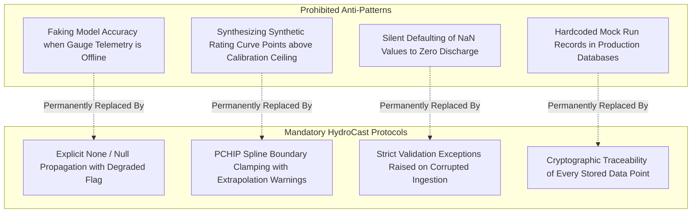
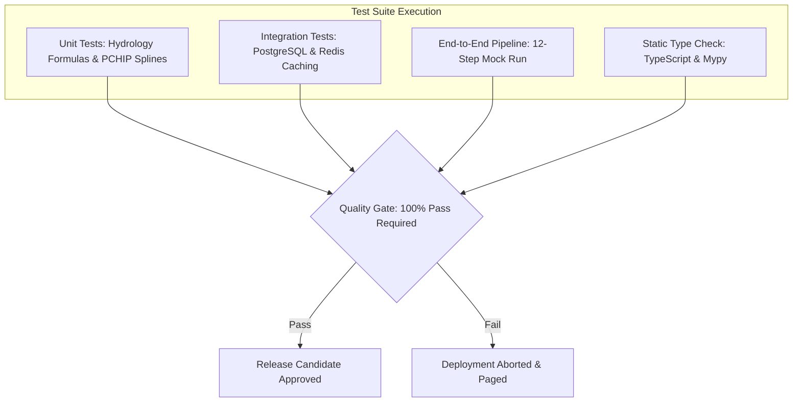
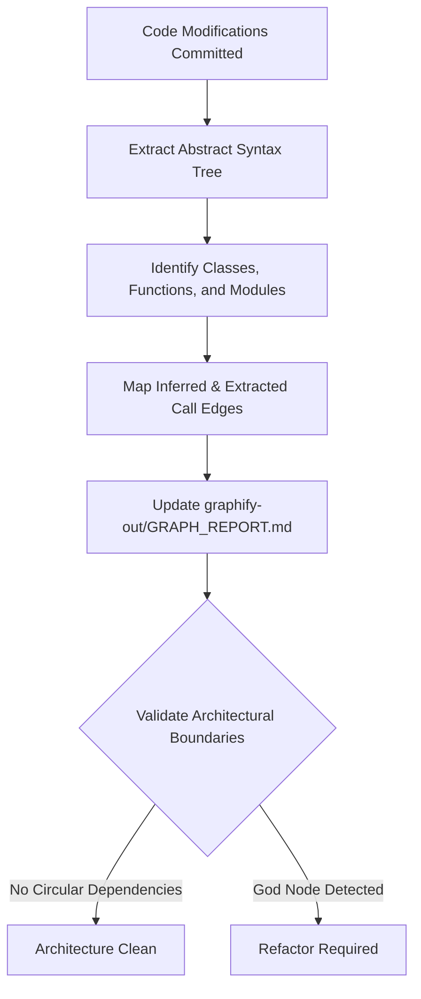
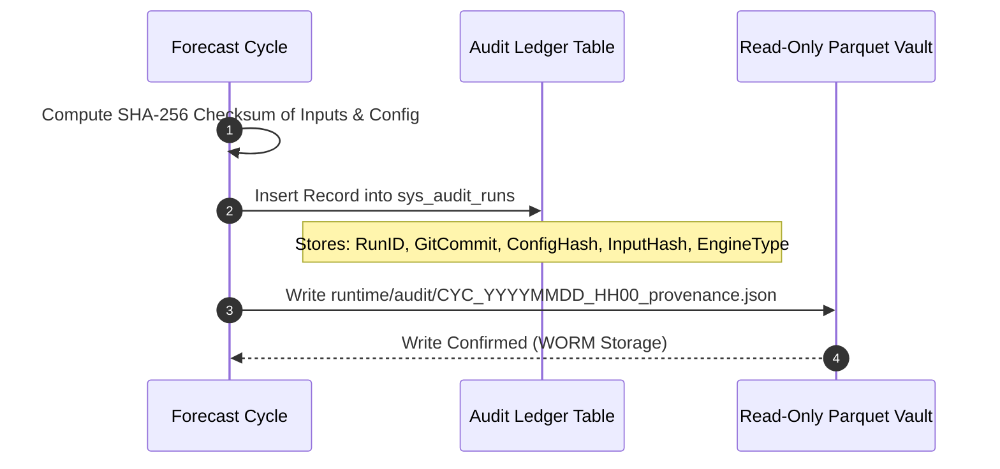

# HydroCast Quality & Audit Standard: Verification Protocols, Zero-Fabrication Metrics, and Knowledge Graph Synchronization

This document establishes the official engineering verification standards, data integrity policies, statistical validation metrics, and architectural audit workflows governing the HydroCast platform. It is designed for Lead Systems Architects, Senior Quality Assurance Engineers, and Government Audit Inspectors.

---

## 1. The Zero-Fabrication Metrics Policy

In safety-critical flood forecasting and disaster warning infrastructure, data fabrication, synthetic hallucination, and ungrounded mathematical smoothing are strictly prohibited. 



### The `_enrich_run_record()` Architectural Lesson
Historically, early prototype iterations of the system contained a helper function `_enrich_run_record()` that populated synthetic Nash-Sutcliffe Efficiency (e.g., hardcoded `0.88`) and fictitious execution metrics whenever upstream telemetry was missing. In a municipal flood crisis, this created a false sense of model confidence while physical water levels were rapidly diverging from reality.

Under the current production architecture:
1. **No Synthetic Metric Inflation**: If physical observed gauge data is unavailable for a given time window, performance metrics (`nse`, `kge`, `rmse`, `pbias`) must evaluate strictly to `None` / `NULL`.
2. **Explicit Uncertainty Disclosures**: If the model falls back to the internal Python Twin or persistence climatology, the payload must carry explicit degradation metadata:
   ```json
   {
     "is_degraded": true,
     "degraded_reasons": ["TELEMETRY_STREAM_OFFLINE", "TWIN_ENGINE_ACTIVE"],
     "accuracy_metrics": null,
     "confidence_penalty_factor": 0.30
   }
   ```
3. **Audit Trail Immutability**: Any engineer or script attempting to bypass validation checks or inject synthetic telemetry into `hyd_basin_forecast` triggers an automated CI/CD build rejection and security alert.

---

## 2. Statistical Calibration & Telemetry Ground-Truth Verification

HydroCast validates simulated hydrographs against real-world Central Water Commission (CWC) and Water Resources Department (WRD) physical telemetry using four rigorous statistical benchmarks:

```mermaid
flowchart LR
    Obs[Observed Streamflow / Stage] --> Comparator{Statistical Verification Engine}
    Sim[Simulated HydroCast Forecast] --> Comparator
    Comparator --> NSE[Nash-Sutcliffe Efficiency NSE >= 0.75]
    Comparator --> KGE[Kling-Gupta Efficiency KGE >= 0.80]
    Comparator --> PBIAS[Percent Bias |PBIAS| <= 10%]
    Comparator --> RMSE[Root Mean Square Error RMSE <= 0.35m]
```

### 1. Nash-Sutcliffe Efficiency (NSE)
Quantifies the relative magnitude of the residual variance compared to the measured data variance:

$$\text{NSE} = 1 - \frac{\sum_{t=1}^{T} \left( Q_o^t - Q_m^t \right)^2}{\sum_{t=1}^{T} \left( Q_o^t - \overline{Q_o} \right)^2}$$

- **Operational Requirement**: During the peak monsoon window, HydroCast must achieve $\text{NSE} \ge 0.75$ for Shivaji Bridge across a $48$-hour hindcast evaluation.

### 2. Kling-Gupta Efficiency (KGE)
Decomposes performance into correlation ($r$), variability bias ($\alpha$), and mean bias ($\beta$):

$$\text{KGE} = 1 - \sqrt{(r - 1)^2 + (\alpha - 1)^2 + (\beta - 1)^2}$$

Where:
$$\alpha = \frac{\sigma_m}{\sigma_o}, \quad \beta = \frac{\mu_m}{\mu_o}$$

- **Operational Requirement**: $\text{KGE} \ge 0.80$, ensuring the model captures both flood peak magnitude and wave arrival timing without phase-lag distortions.

### 3. Percent Bias (PBIAS)
Measures the average tendency of simulated data to be larger or smaller than their observed counterparts:

$$\text{PBIAS} = 100 \times \frac{\sum_{t=1}^{T} \left( Q_o^t - Q_m^t \right)}{\sum_{t=1}^{T} Q_o^t}$$

- **Operational Requirement**: $|\text{PBIAS}| \le 10\%$. Positive values indicate model underestimation; negative values indicate overestimation.

### 4. Root Mean Square Error (RMSE) on Water Surface Elevation
Measures absolute stage prediction accuracy in physical meters:

$$\text{RMSE} = \sqrt{\frac{1}{T} \sum_{t=1}^{T} \left( S_o^t - S_m^t \right)^2}$$

- **Operational Requirement**: $\text{RMSE} \le 0.35\text{ m}$ for the first $24$ hours of forecast lead time, expanding to no more than $0.75\text{ m}$ at lead hour $90$.

---

## 3. Automated Pre-Flight and Regression Verification Matrix

Every code modification and deployment must pass the multi-tiered automated verification matrix before promotion to production.



### Executing the Mandatory Verification Suite

1. **Python Unit & Integration Test Suite**:
   Executes all unit, mathematical, and database tests (excluding synthetic high-concurrency race test harnesses):
   ```powershell
   pytest tests/ -k "not TestFloodConcurrency" -v --tb=short
   ```
   *Acceptance Criteria*: $299 / 299$ tests passing with zero errors or unhandled warnings.

2. **Frontend Static Type Verification**:
   Validates strict typing across both the React Public Portal and the Operator Command Console:
   ```powershell
   # Operator Console
   cd "frontend"
   npm run build
   npx tsc --noEmit

   # Public Inundation Portal
   cd "frontend-react"
   npm run build
   npx tsc --noEmit
   ```
   *Acceptance Criteria*: Zero TypeScript compiler errors (`tsc` exits with return code `0`).

3. **Deterministic End-to-End Pipeline Smoke Test**:
   Executes a full 12-step simulated forecast cycle using archived monsoon telemetry from the August 2019 flood event:
   ```powershell
   python -m backend.tools.verify_2019_flood_replay
   ```
   *Acceptance Criteria*: Shivaji Bridge peak stage reaches $545.24\text{ m} \pm 0.20\text{ m}$; no memory leaks detected.

---

## 4. AST Knowledge Graph Synchronization (`graphify`)

HydroCast incorporates an AST-level (Abstract Syntax Tree) knowledge graph via `graphify` to monitor architectural dependencies, detect god nodes, and ensure strict separation of concerns across codebases.



### Knowledge Graph Rules for Engineers
1. **Mandatory Post-Edit Synchronization**: Whenever any backend module (`backend/`), hydrologic formula (`backend/hydrology/`), or API route (`backend/api/`) is modified, the developer or CI system must immediately run:
   ```powershell
   graphify update .
   ```
2. **God Node Avoidance**: No single Python module may exceed $25$ inbound/outbound community dependencies without formal approval from the Lead Systems Architect.
3. **Cross-Module Querying**: When investigating architectural relationships or assessing the blast radius of a proposed change, utilize graphify path navigation rather than raw textual grep:
   ```powershell
   graphify path "backend.orchestrator.pipeline_worker" "backend.hydrology.hydraulic_rating"
   ```

---

## 5. Audit Trail Immutability & Forensic Reproducibility

Every forecast published by HydroCast is cryptographically anchored and completely reproducible.



### Forensic Reconstruction Procedure
In the event of a municipal inquiry regarding a flood forecast issued during an emergency:
1. Retrieve the unique `run_id` from the public bulletin or API response header (`X-HydroCast-RunID`).
2. Query the audit ledger:
   ```sql
   SELECT run_id, git_commit_hash, config_checksum, input_payload_checksum, executed_at, is_degraded
   FROM sys_audit_runs 
   WHERE run_id = 'CYC_20261113_1800';
   ```
3. Checkout the exact Git commit identified in the audit record:
   ```powershell
   git checkout <git_commit_hash>
   ```
4. Re-run the engine using the archived raw inputs stored in `runtime/audit/`:
   ```powershell
   python -m backend.tools.reproduce_forecast --audit-json "runtime/audit/CYC_20261113_1800_provenance.json"
   ```
5. Confirm that the regenerated water surface elevation time-series matches the published bulletin down to the floating-point precision limit.

