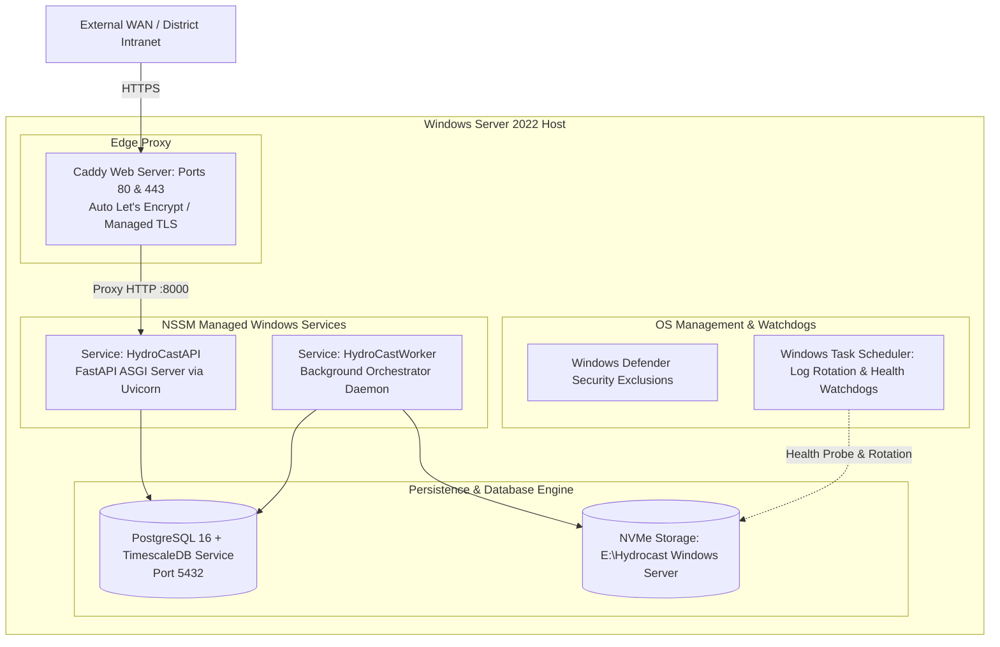
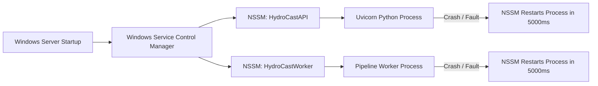
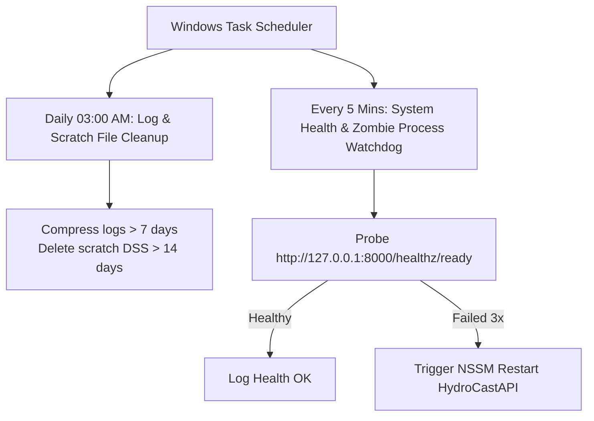

# HydroCast Production Runbook: Windows Server 2022 Bare-Metal Deployment, NSSM Service Management, and OS Hardening

This runbook provides the definitive operational blueprint for deploying, configuring, securing, and maintaining the HydroCast production stack on physical or virtual Windows Server 2022 Datacenter environments.

---

## 1. Production Architecture on Windows Server

HydroCast runs natively on the Windows NT kernel, utilizing Windows Services managed via NSSM (Non-Sucking Service Manager), Caddy as the edge TLS reverse proxy, and PostgreSQL 16 with TimescaleDB.



---

## 2. Directory Layout & Storage Allocation Strategy

Production installations must be deployed to a high-speed dedicated volume (preferably NVMe SSD) mounted at `E:\` to isolate database and model simulation I/O from the Windows OS drive (`C:\`).

```text
E:\Hydrocast Windows Server\
├── backend/              # Core Python application modules
├── frontend/             # Compiled Operator Console static assets
├── frontend-react/       # Compiled Public Inundation Portal static assets
├── data/                 # Static shapefiles, reference curves, stations
├── runtime/              # Active simulation working directory (HEC-HMS DSS, Staging)
│   ├── hec_hms/          # Active basin DSS scratch spaces
│   ├── staging/          # Uncommitted Parquet offline payloads
│   ├── locks/            # Worker execution file locks
│   └── logs/             # Standard output & error rotation logs
├── venv/                 # Hardened Python 3.12 64-bit virtual environment
├── Caddyfile             # Caddy HTTP/HTTPS reverse proxy configuration
└── alembic.ini           # Database schema migration configuration
```

---

## 3. Automated Windows Services Configuration via NSSM

HydroCast components are registered as native Windows Services using **NSSM (Non-Sucking Service Manager)** to guarantee automatic restart on system reboot or unexpected process termination.



### 1. Registering the FastAPI Backend Service (`HydroCastAPI`)
Open an administrative PowerShell prompt:

```powershell
# Set installation variables
$ProjectDir = "E:\Hydrocast Windows Server"
$PythonExe  = "$ProjectDir\venv\Scripts\python.exe"

# Install API Service
nssm install HydroCastAPI $PythonExe "-m uvicorn backend.api.main:app --host 127.0.0.1 --port 8000 --workers 4"
nssm set HydroCastAPI AppDirectory $ProjectDir
nssm set HydroCastAPI DisplayName "HydroCast Core API Service"
nssm set HydroCastAPI Description "Provides high-throughput REST and SSE flood forecasting feeds"
nssm set HydroCastAPI Start SERVICE_AUTO_START

# Configure Restart Throttling & Crash Recovery
nssm set HydroCastAPI AppRestartDelay 5000
nssm set HydroCastAPI AppThrottle 1500

# Configure Standard Output and Error Logs
nssm set HydroCastAPI AppStdout "$ProjectDir\runtime\logs\api_stdout.log"
nssm set HydroCastAPI AppStderr "$ProjectDir\runtime\logs\api_stderr.log"
nssm set HydroCastAPI AppRotateFiles 1
nssm set HydroCastAPI AppRotateBytes 52428800 # Rotate at 50 MB

# Start Service
nssm start HydroCastAPI
```

### 2. Registering the Background Forecasting Worker (`HydroCastWorker`)
```powershell
# Install Worker Service
nssm install HydroCastWorker $PythonExe "-m backend.orchestrator.pipeline_worker --daemon"
nssm set HydroCastWorker AppDirectory $ProjectDir
nssm set HydroCastWorker DisplayName "HydroCast Forecasting Worker"
nssm set HydroCastWorker Description "Orchestrates scheduled 6-hour hydrologic simulation cycles"
nssm set HydroCastWorker Start SERVICE_AUTO_START

# Configure Crash Recovery
nssm set HydroCastWorker AppRestartDelay 10000
nssm set HydroCastWorker AppStdout "$ProjectDir\runtime\logs\worker_stdout.log"
nssm set HydroCastWorker AppStderr "$ProjectDir\runtime\logs\worker_stderr.log"
nssm set HydroCastWorker AppRotateFiles 1
nssm set HydroCastWorker AppRotateBytes 52428800 # 50 MB

# Start Service
nssm start HydroCastWorker
```

---

## 4. Reverse Proxy Configuration: Caddyfile Specification

Caddy terminates SSL, provides automated Let's Encrypt certificate renewals, applies GZip/Brotli compression, and routes requests to frontend static bundles or the Python API:

```caddy
# E:\Hydrocast Windows Server\Caddyfile

hydrocast.kolhapur.gov.in {
    encode gzip zstd

    # Security Headers
    header {
        Strict-Transport-Security "max-age=31536000; includeSubDomains; preload"
        X-Content-Type-Options "nosniff"
        X-Frame-Options "DENY"
        Referrer-Policy "strict-origin-when-cross-origin"
        Server "HydroCast-Edge"
    }

    # Public Portal Static Assets
    root * "E:/Hydrocast Windows Server/frontend-react/dist"
    file_server

    # API Backend Reverse Proxy
    handle /api/* {
        reverse_proxy 127.0.0.1:8000 {
            header_up X-Real-IP {remote_host}
            header_up X-Forwarded-For {remote_host}
            header_up X-Forwarded-Proto {scheme}
        }
    }

    # Operator Console Routed Subpath
    handle_path /admin* {
        root * "E:/Hydrocast Windows Server/frontend/out"
        file_server
    }
}
```

Start and verify Caddy via administrative shell:
```powershell
caddy run --config "E:\Hydrocast Windows Server\Caddyfile"
```

---

## 5. Windows Defender Antivirus & Disk I/O Hardening

During intense simulation cycles, HEC-HMS and Python write thousands of small temporary DSS blocks and binary arrays to disk. Real-time antivirus scanning can cause significant I/O latency, leading to simulation timeouts.

### Apply Antivirus Exclusions
Run an elevated PowerShell session to exclude project execution paths:

```powershell
# Exclude Project Root Directory
Add-MpPreference -ExclusionPath "E:\Hydrocast Windows Server"

# Exclude PostgreSQL TimescaleDB Data Volume
Add-MpPreference -ExclusionPath "C:\Program Files\PostgreSQL\16\data"

# Exclude High-Frequency Executable Binaries
Add-MpPreference -ExclusionProcess "python.exe"
Add-MpPreference -ExclusionProcess "java.exe"
Add-MpPreference -ExclusionProcess "postgres.exe"
```

---

## 6. Windows Task Scheduler: Automated Maintenance & Health Watchdogs

To prevent disk saturation and ensure continuous uptime, two scheduled tasks are configured:



### 1. Log and DSS Scratch Cleanup Script (`scripts\maintenance_cleanup.ps1`)
```powershell
$ProjectDir = "E:\Hydrocast Windows Server"
$CutoffDate = (Get-Date).AddDays(-14)

# Delete temporary DSS scratch directories older than 14 days
Get-ChildItem -Path "$ProjectDir\runtime\hec_hms" -Filter "*.dss" -Recurse | Where-Object { $_.LastWriteTime -lt $CutoffDate } | Remove-Item -Force

# Gzip archive log files older than 7 days
Get-ChildItem -Path "$ProjectDir\runtime\logs" -Filter "*.log" | Where-Object { $_.LastWriteTime -lt (Get-Date).AddDays(-7) } | ForEach-Object {
    Compress-Archive -Path $_.FullName -DestinationPath "$($_.FullName).zip" -Force
    Remove-Item $_.FullName -Force
}
```

### 2. Register Cleanup Task via Task Scheduler
```powershell
$Action = New-ScheduledTaskAction -Execute "PowerShell.exe" -Argument "-ExecutionPolicy Bypass -File `"$ProjectDir\scripts\maintenance_cleanup.ps1`""
$Trigger = New-ScheduledTaskTrigger -Daily -At "03:00AM"
Register-ScheduledTask -TaskName "HydroCast_Daily_Maintenance" -Action $Action -Trigger $Trigger -User "SYSTEM" -RunLevel Highest
```

---

## 7. Prometheus Node Exporter & System Telemetry

HydroCast exposes Windows host metrics (CPU cores, RAM saturation, NVMe disk queue depth) via the **Windows Node Exporter** listening on port `9182`.

1. **Verify Metrics Endpoint**:
   ```powershell
   Invoke-RestMethod -Uri "http://127.0.0.1:9182/metrics" -Method Get
   ```
2. **Prometheus Scrape Target Configuration**:
   ```yaml
   scrape_configs:
     - job_name: 'hydrocast_windows_host'
       static_configs:
         - targets: ['127.0.0.1:9182']
     - job_name: 'hydrocast_fastapi_app'
       static_configs:
         - targets: ['127.0.0.1:8000']
   ```
