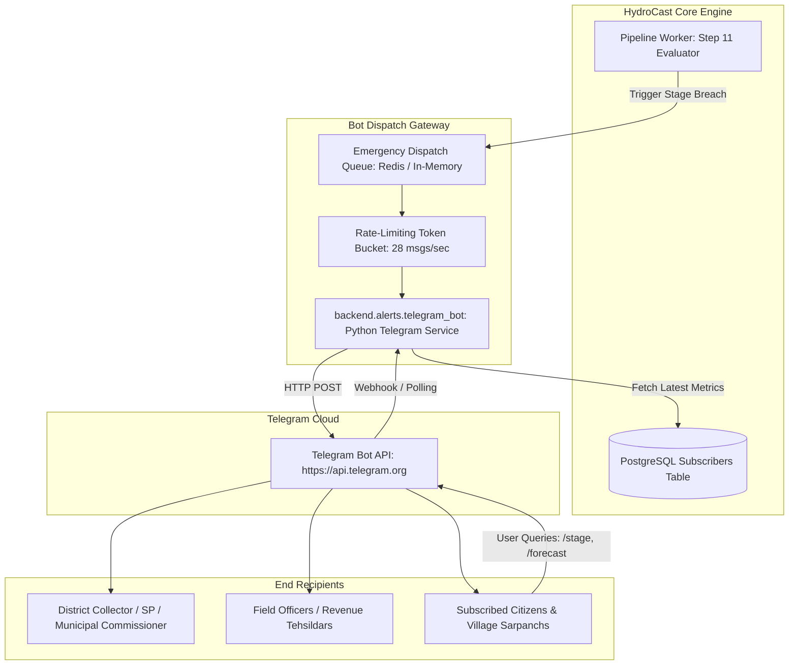
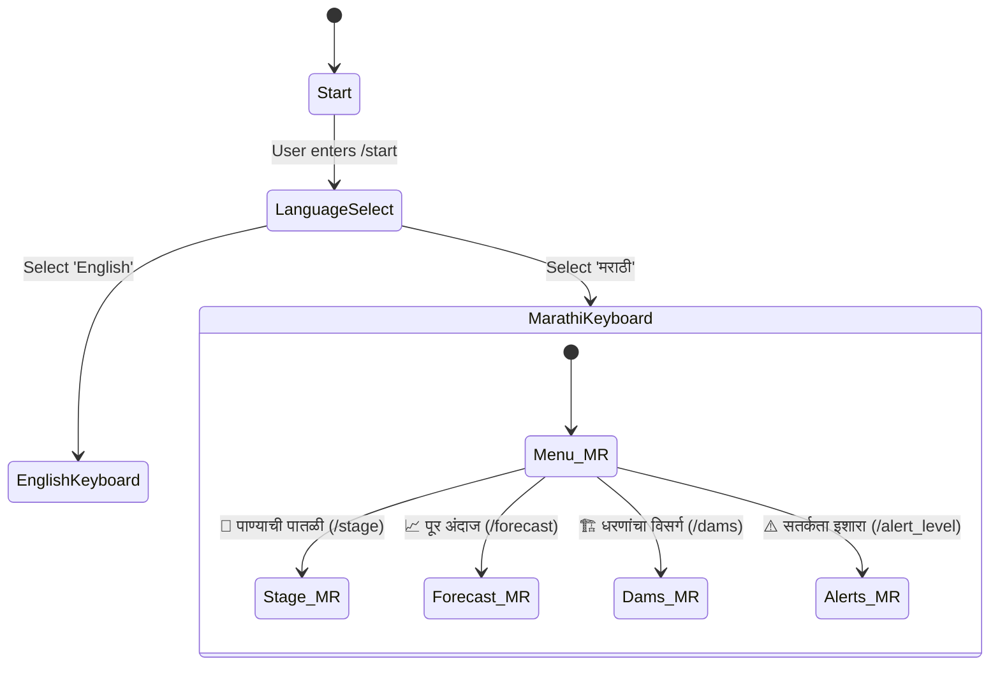
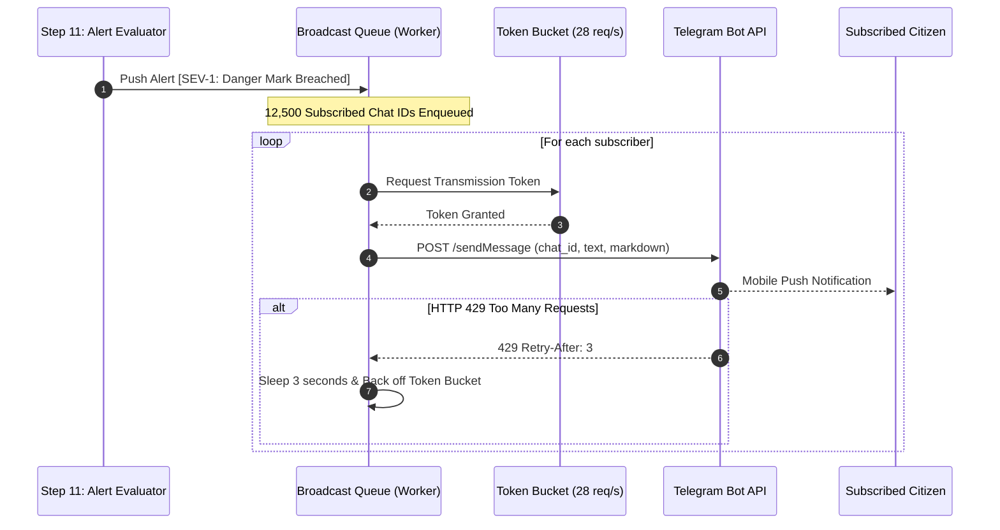

# HydroCast Telegram Disaster Bot: Architecture, Command Interfaces, and Automated Municipal Broadcasts

This document details the software architecture, command routing, security controls, and mass-broadcast delivery mechanisms of the HydroCast Telegram Disaster Alert Bot (`@PanchgangaFloodBot`).

---

## 1. System Mission & Channel Topology

The HydroCast Telegram Bot serves as an instantaneous, fault-tolerant push notification and query channel connecting municipal disaster response authorities, emergency personnel (NDRF, SDRF, police control rooms), and citizens across Kolhapur district.



---

## 2. Bot Security & Configuration Architecture

The Telegram bot operates in strict compliance with the HydroCast security framework.

### Environment Variable Bindings
Under no circumstances are Telegram API tokens hardcoded in source code or committed to Git:

```ini
# Production Environment Configuration (.env)
TELEGRAM_BOT_TOKEN=<telegram_bot_token>
TELEGRAM_ADMIN_CHAT_ID=<telegram_admin_chat_id>
TELEGRAM_ENABLE_PUBLIC_BROADCAST=True
TELEGRAM_WEBHOOK_URL=https://hydrocast.kolhapur.gov.in/api/v1/alerts/telegram-webhook
TELEGRAM_SECRET_TOKEN=<telegram_secret_token>
```

1. **Webhook HMAC Header Validation**:
   - In production, Telegram transmits incoming updates to `/api/v1/alerts/telegram-webhook`.
   - The FastAPI endpoint validates the `X-Telegram-Bot-Api-Secret-Token` header against `TELEGRAM_SECRET_TOKEN` before parsing payloads, rejecting unauthorized probing.
2. **Administrative Command Isolation**:
   - Administrative commands (e.g., `/broadcast_override`, `/force_rerun`, `/system_health`) are restricted to verified chat IDs enumerated in `TELEGRAM_ADMIN_CHAT_ID`. Unprivileged users attempting administrative commands receive generic responses.

---

## 3. Interactive User Commands & Reply Schemas

The bot provides two-way interactivity, offering intuitive touch keyboard buttons and bilingual responses (Marathi and English):



### Interactive Command Reference

| Command | Public / Admin | Description | Sample Output (Bilingual) |
| :--- | :--- | :--- | :--- |
| **`/start`** | Public | Initializes session, registers chat ID, and presents interactive keyboard. | Presents language selection and quick touch menu. |
| **`/stage`** | Public | Returns instantaneous water surface elevations at critical bridge crossings. | **शिवाजी पूल (Shivaji Bridge)**:<br>• सद्य पातळी: `५३७.२५ मी`<br>• इशारा पातळी: `५४०.०० मी` (२.७५ मी शिल्लक)<br>• धोका पातळी: `५४२.५० मी` (५.२५ मी शिल्लक)<br>• प्रवृत्ती: स्थिर (Steady) |
| **`/forecast`**| Public | Returns the 90-hour peak stage prediction and estimated arrival time. | **९०-तासांचा पूर अंदाज (90h Forecast)**:<br>• सर्वोच्च संभाव्य पातळी: `५३९.१० मी`<br>• संभाव्य वेळ: `१४ नोव्हेंबर, दुपारी ०२:००`<br>• इशारा पातळी ओलांडण्याची शक्यता: **कमी (Low)** |
| **`/dams`** | Public | Returns reservoir storage percentages and live spillway discharge rates. | **धरण साठा व विसर्ग (Dam Status)**:<br>• राधानगरी: `९४.५%` (विसर्ग: `२,४०० क्युसेक`)<br>• तुळशी: `८८.१%` (विसर्ग: `५०० क्युसेक`)<br>• वारणा: `९१.०%` (विसर्ग: `४,००० क्युसेक`) |
| **`/alert_level`**| Public | Displays current statutory CWC flood alert status. | 🟢 **सद्य स्थिती: सामान्य (NORMAL)**<br>कोणताही तात्काळ पूर धोका नाही. |
| **`/subscribe`**| Public | Registers chat ID for automated push notifications during Warning/Danger breaches. | ✅ आपण पूर सतर्कता संदेशांसाठी नोंदणीकृत झाला आहात. |

---

## 4. Emergency Mass-Broadcast Delivery Engine

During critical flood conditions, the bot must transmit push notifications to thousands of subscribed citizens and disaster officials without triggering Telegram API rate limits.



### Rate-Limiting & Anti-Flood Regulations
Telegram enforces a strict limit of **30 messages per second** across all chats for a single bot:
1. **Token Bucket Rate Limiter**:
   - HydroCast's broadcast loop is throttled to a conservative ceiling of **28 messages per second**, preserving a $7\%$ safety buffer.
2. **Priority Queue Ordering**:
   - Broadcasts are dispatched across three prioritized tiers:
     - **Tier 1 (Emergency Priority)**: District Collector, SP, Disaster Management Control Room, Fire Brigade (`chat_id` list $N \approx 50$). Delivered in $< 2$ seconds.
     - **Tier 2 (Administrative Priority)**: Tehsildars, Police Inspectors, WRD Engineers ($N \approx 500$). Delivered in $< 20$ seconds.
     - **Tier 3 (Public Broadcast)**: General citizen subscribers ($N \approx 20,000$). Delivered in sequential batches over approximately $12$ minutes.
3. **Exponential Backoff on HTTP 429**:
   - If Telegram responds with `HTTP 429 Too Many Requests`, the engine inspects the `retry_after` response header, sleeps for the specified duration plus a $500\text{ ms}$ jitter, and resumes dispatch without dropping messages.

