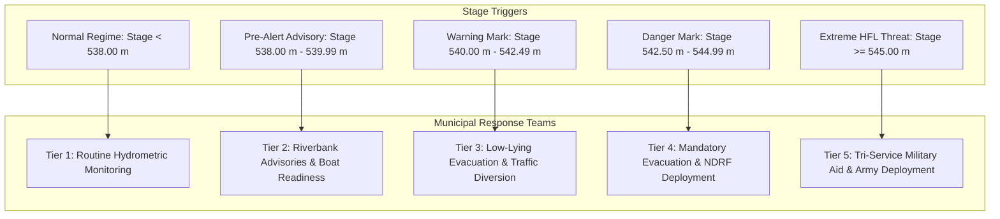
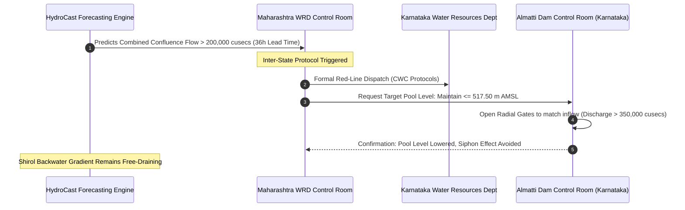
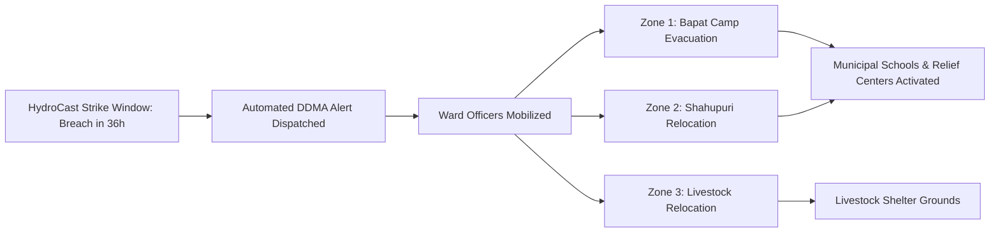

# HydroCast Standard Operating Procedures (SOP): Municipal Flood Action Matrix, Inter-State River Coordination, and Disaster Management Protocols

This manual establishes the statutory Standard Operating Procedures (SOPs) governing the Kolhapur District Disaster Management Authority (DDMA), Kolhapur Municipal Corporation (KMC), Maharashtra Water Resources Department (WRD), and inter-state coordination bodies during flood emergencies in the Panchganga Basin.

---

## 1. Five-Tier Municipal Action Matrix (Shivaji Bridge Benchmark)

Operational actions are systematically graduated according to the physical Water Surface Elevation (WSE) observed and predicted at **Shivaji Bridge, Kolhapur**:

### Statutory Stage Action Matrix

| Alert Level | Stage Threshold (AMSL) | Statutory Status | Primary Inundation Footprint | Mandatory Inter-Agency Actions |
| :--- | :--- | :--- | :--- | :--- |
| **Blue (Normal)** | $< 538.00\text{ m}$ | **Routine** | Within active riverbed channel; no surface flooding. | HydroCast 6-hour execution cycles active. Routine dam discharge logging. |
| **Green (Advisory)** | $538.00\text{ m} \text{ to } 539.99\text{ m}$ | **Pre-Alert** | Submergence of low agricultural fields in Karveer and Hatkanangale talukas. | Revenue officers issue loudspeaker warnings to riverbank farmers. Rubber rescue boats placed on 30-minute standby. |
| **Yellow (Warning)** | **$540.00\text{ m} \text{ to } 542.49\text{ m}$** | **WARNING MARK** | Submergence of Shivaji Bridge arch base; water enters Bapat Camp sewer outfalls. | **Close vehicular traffic on low bridges** (Bapat Camp road, Rajaram weir). NDRF teams positioned at Shahupuri. Relief camps opened. |
| **Red (Danger)** | **$542.50\text{ m} \text{ to } 544.99\text{ m}$** | **DANGER MARK** | Water overtops Shivaji Bridge deck; inundation of Venus Corner and NH-166. | **Mandatory evacuation of low-lying urban wards** (Bapat Camp, Shahupuri, Kumbhar Galli). Power supply isolated to prevent electrocution. |
| **Black (Extreme)** | **$\ge 545.00\text{ m}$** | **CATASTROPHIC HFL** | Record flood footprint ($2019/2021$); NH-4 highway submerged. | District Collector requisitions Indian Army and Air Force assistance for air-dropping rations and helicopter rescues. |

---

## 2. Inter-State River Coordination SOP: Maharashtra & Karnataka

The confluence of the Panchganga and Krishna rivers at **Shirol** creates a severe risk of backwater ponding if Almatti Dam in Karnataka maintains high storage levels during heavy monsoon inflows:

### Statutory Inter-State Triggers
1. **Trigger Condition 1**: If HydroCast projects streamflow discharge at Rajapur Weir (Krishna River) to exceed **$100,000\text{ cusecs}$** within 48 hours.
2. **Trigger Condition 2**: If combined Panchganga discharge exceeds **$50,000\text{ cusecs}$**.
3. **Mandatory Action**:
   - The Chief Engineer, WRD Pune, transmits an official dispatch to the Managing Director, Krishna Bhagya Jala Nigam Limited (KBJNL), Karnataka.
   - Almatti Dam must adjust its radial spillway discharge to draw down reservoir pool elevation below **$517.50\text{ m AMSL}$** (well below its Full Reservoir Level of $519.60\text{ m}$) to prevent the M1 hydraulic backwater curve from suffocating Kolhapur City.

---

## 3. Municipal Evacuation & Citizen Safety Workflows

When HydroCast predicts an arrival strike window ($\tau_{\text{danger}}$) indicating that Shivaji Bridge will breach the Danger Mark ($542.50\text{ m}$) within **36 hours**:

### Evacuation Protocol Execution Steps
1. **$T - 36\text{ Hours}$**:
   - Kolhapur Municipal Corporation (KMC) designates 42 municipal schools and marriage halls outside the inundation zone as active relief shelters.
   - Potable drinking water tankers, mobile medical vans, and dry ration kits are positioned at each shelter.
2. **$T - 24\text{ Hours}$**:
   - House-to-house warnings executed by municipal civil defense volunteers and Home Guards in vulnerable wards.
   - Voluntary evacuation assistance provided for elderly, bedridden patients, and infants.
3. **$T - 12\text{ Hours}$**:
   - **Mandatory Evacuation Order** issued by the District Collector under Section 34 of the Disaster Management Act, 2005.
   - Maharashtra State Electricity Distribution Company (MSEDCL) isolates power transformers in flooded zones to eliminate electrocution hazards.
4. **$T - 0\text{ Hours}$ (Breach Event)**:
   - Police barricades seal all access roads leading to Shivaji Bridge, Bapat Camp, and Panchganga Ghat.
   - Continuous water level monitoring maintained by field engineers equipped with satellite phones.

---

## 4. Post-Flood De-Inundation & Epidemic Prevention Protocol

Once the forecast recession limb indicates that stage has receded below $538.00\text{ m}$:
1. **Silt Clearance & Disinfection**: KMC sanitation teams spray sodium hypochlorite and bleaching powder along all de-inundated streets within 24 hours of water withdrawal.
2. **Water Supply Testing**: Municipal tap water lines are checked for fecal coliform and sewage contamination prior to restoring municipal water supply.
3. **Leptospirosis Prevention**: Prophylactic Doxycycline capsules ($200\text{ mg}$) distributed to all citizens who waded through floodwaters, in accordance with state public health directives.

