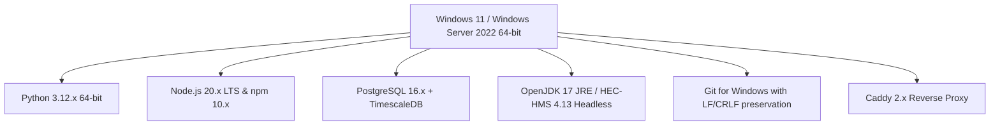
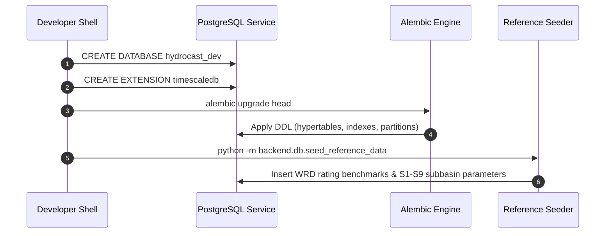
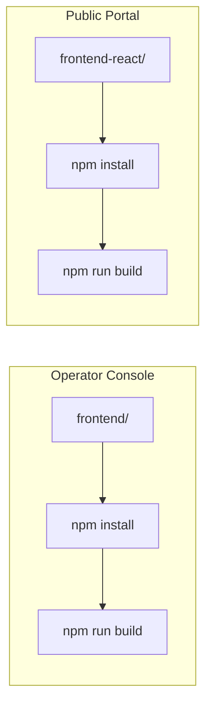

# HydroCast Developer Guide: Local Workstation Environment Setup and Engineering Toolchain

This guide provides step-by-step instructions for establishing an isolated, fully functional local development and testing environment for the HydroCast Panchganga Basin forecasting system on Windows Server or Windows 11 64-bit workstations.

---

## 1. System Requirements & Software Prerequisites

HydroCast is engineered natively for Windows Server production environments. The following core dependencies must be installed on your local development workstation:



### Required Software Packages

| Component | Minimum Version | Recommended Source / Installation Method | Purpose in HydroCast |
| :--- | :--- | :--- | :--- |
| **Python** | `3.12.3` (64-bit) | Official Python.org installer (`Add python.exe to PATH` checked) | Backend API, orchestrator, numerical twin, ML calibration |
| **Node.js** | `20.12.0 LTS` | Node.js official installer (`npm` included) | React frontends (Operator Console & Public Portal) |
| **PostgreSQL** | `16.2` (64-bit) | EnterpriseDB official installer for Windows | Primary relational store for forecasts and telemetry |
| **TimescaleDB** | `2.14.x` | TimescaleDB Windows binary release (pg16) | Time-series hypertable optimization for gauge data |
| **HEC-HMS** | `4.13` (Optional) | US Army Corps of Engineers (USACE) installer | Headless hydraulic simulation (Python Twin runs if omitted) |
| **Caddy** | `2.7.6` | Official Caddy binary for Windows | Production-grade local reverse proxy with auto HTTPS |
| **Git** | `2.43.0` | Git for Windows (configured with `core.autocrlf = true`) | Source control and Git hooks |

---

## 2. Windows Environment Configuration & Registry Tuning

Prior to installing dependencies, optimize your Windows workstation for high-throughput I/O and script execution:

1. **Enable Windows Long Path Support**:
   Windows traditionally enforces a 260-character path limit (`MAX_PATH`), which can cause deep virtual environment or npm nested module write failures.
   Run an elevated PowerShell prompt:
   ```powershell
   Set-ItemProperty -Path "HKLM:\SYSTEM\CurrentControlSet\Control\FileSystem" -Name "LongPathsEnabled" -Value 1
   ```
2. **Configure PowerShell Script Execution Policy**:
   Allow virtual environment activation scripts to execute in your developer shell:
   ```powershell
   Set-ExecutionPolicy -ExecutionPolicy RemoteSigned -Scope CurrentUser
   ```

---

## 3. Repository Cloning and Python Environment Setup

Clone the repository and initialize a clean, isolated virtual environment:

```powershell
# 1. Clone repository to your dedicated development drive
git clone https://github.com/organization/hydrocast-panchganga.git "E:\Hydrocast Windows Server"
cd "E:\Hydrocast Windows Server"

# 2. Provision isolated Python 3.12 virtual environment
python -m venv venv

# 3. Activate virtual environment
.\venv\Scripts\Activate.ps1

# 4. Upgrade core build tools
python -m pip install --upgrade pip setuptools wheel

# 5. Install all backend and testing dependencies
pip install -r requirements.txt
```

---

## 4. Local Database Setup & Migration Execution

HydroCast requires a local PostgreSQL instance with TimescaleDB enabled.



### Step-by-Step Database Initialization

1. **Create Development Database & Roles**:
   Launch `psql` using administrative credentials:
   ```powershell
   psql -U <postgres_admin> -h 127.0.0.1
   ```
   Execute the following initialization SQL:
   ```sql
   CREATE USER <db_user> WITH PASSWORD '<db_password>';
   CREATE DATABASE hydrocast_dev OWNER <db_user>;
   \c hydrocast_dev
   CREATE EXTENSION IF NOT EXISTS timescaledb;
   GRANT ALL PRIVILEGES ON DATABASE hydrocast_dev TO <db_user>;
   \q
   ```

2. **Configure Local Environment Variables (`.env`)**:
   Create a local `.env` configuration file in the project root:
   ```ini
   # Server Environment
   HYDROCAST_ENV=development
   DEBUG=True
   HOST=127.0.0.1
   PORT=8000

   # Database Connection String
   DATABASE_URL=postgresql://<db_user>:<db_password>@127.0.0.1:5432/hydrocast_dev

   # Security & Break-Glass Seeding
   JWT_SECRET_KEY=<dev_jwt_secret>
   JWT_ALGORITHM=HS256
   ACCESS_TOKEN_EXPIRE_MINUTES=480

   # Hydrology & Engine Defaults
   USE_PYTHON_TWIN_DEFAULT=True
   HEC_HMS_PATH=C:\Program Files\HEC\HEC-HMS-4.13\hec-hms.cmd
   STAGE_CALCULATION_ENGINE=PCHIP_MONOTONIC

   # Ingestion APIs (Development Mode uses Mock Fallback if unconfigured)
   OPEN_METEO_API_KEY=
   CWC_TELEMETRY_ENDPOINT=https://mock.hydrocast.local/api/cwc
   ```

3. **Apply Database Migrations (Alembic)**:
   Synchronize your database schema with the latest migration revisions:
   ```powershell
   alembic upgrade head
   ```

4. **Seed Hydrometric Reference Benchmarks**:
   Populate historical rating curve benchmarks, subbasin spatial geometries, and WRD warning levels:
   ```powershell
   python -m backend.db.seed_reference_data
   ```

---

## 5. Frontend Toolchain & Compilation Setup

HydroCast contains two specialized frontends:
1. `frontend`: The full-fidelity Operator Command Console.
2. `frontend-react`: The lightweight Public Inundation Portal.



### Building Frontends Locally

```powershell
# Build Operator Console
cd "E:\Hydrocast Windows Server\frontend"
npm install
npm run build
npx tsc --noEmit

# Build Public Inundation Portal
cd "E:\Hydrocast Windows Server\frontend-react"
npm install
npm run build
npx tsc --noEmit

# Return to root
cd "E:\Hydrocast Windows Server"
```

---

## 6. Running HydroCast in Local Development Mode

HydroCast components can be launched independently in separate terminal windows:

### Terminal 1: Launch FastAPI Backend Server
```powershell
.\venv\Scripts\Activate.ps1
uvicorn backend.api.main:app --host 127.0.0.1 --port 8000 --reload
```
The interactive OpenAPI documentation is now accessible at:
[http://127.0.0.1:8000/docs](http://127.0.0.1:8000/docs)

### Terminal 2: Launch Frontend Development Servers
```powershell
# Operator Console (Port 3000)
cd "E:\Hydrocast Windows Server\frontend"
npm run dev

# In another shell: Public Portal (Port 5173)
cd "E:\Hydrocast Windows Server\frontend-react"
npm run dev
```

### Terminal 3: Execute a Manual Simulated Pipeline Forecast
To test the entire 12-step hydrologic cascade locally without waiting for the 6-hour scheduler:
```powershell
.\venv\Scripts\Activate.ps1
python -m backend.orchestrator.pipeline_worker --run-now --override-met
```

---

## 7. Running the Automated Test Suite

HydroCast enforces comprehensive test coverage across unit math, API endpoints, database persistence, and integration pipelines.

```powershell
# 1. Run all unit and integration tests (299 test cases)
pytest tests/ -k "not TestFloodConcurrency" -v

# 2. Run only hydrologic engine and rating curve verification
pytest tests/test_hydrology_engine.py tests/test_rating_curve.py -v

# 3. Run API endpoint security and routing verification
pytest tests/test_api_endpoints.py -v

# 4. Run AST Knowledge Graph update
graphify update .
```

---

## 8. Common Windows Development Troubleshooting

### 1. `psycopg2` Binary Compilation Failure
- **Symptom**: `Error: Microsoft Visual C++ 14.0 or greater is required`.
- **Solution**: Install pre-compiled wheels using:
  ```powershell
  pip install psycopg2-binary
  ```

### 2. Port 8000 or Port 5432 Already in Use
- **Symptom**: `OSError: [WinError 10048] Only one usage of each socket address is normally permitted`.
- **Solution**: Identify and terminate the lingering process:
  ```powershell
  Get-Process -Id (Get-NetTCPConnection -LocalPort 8000).OwningProcess | Stop-Process -Force
  ```

### 3. Missing TimescaleDB Extension in PostgreSQL
- **Symptom**: `ERROR: could not open extension control file ".../timescaledb.control"`.
- **Solution**: Run the TimescaleDB Windows setup utility (`timescaledb-tune.exe`) and restart the PostgreSQL service.

