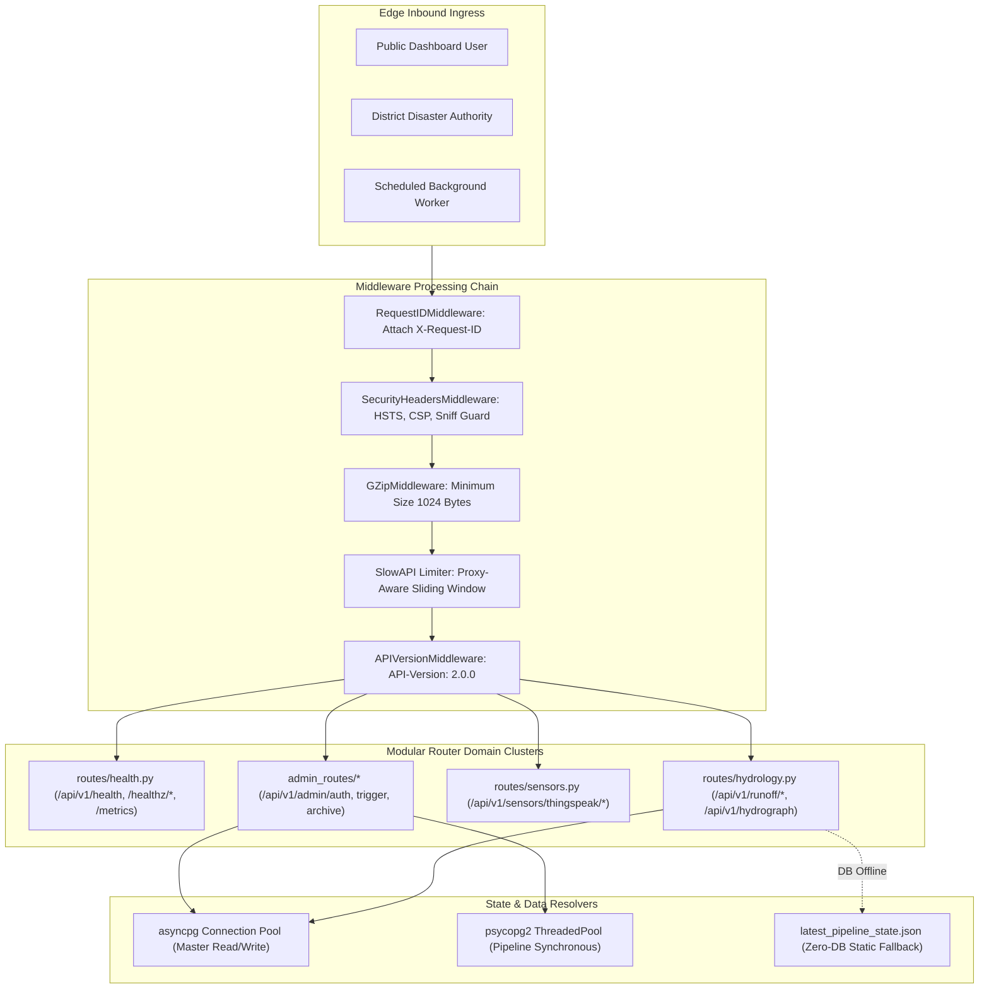

# FastAPI Gateway & Subsystem Specification
*Written by Principal Systems Architect & Lead Backend Engineer*
*Target System: HydroCast Operational Flood Intelligence Engine*

---

## Executive Architectural Summary

The backend API layer (`backend/api/`) serves as the operational central nervous system of HydroCast. It coordinates:
- High-throughput public reads during emergency river surge events.
- Administrative dispatch controls for government and municipal flood operators.
- Real-time hardware and pipeline log broadcasting via bidirectional WebSockets.
- Database connection lifecycle management and resilient disk-staged transaction fallbacks.

The backend application object (`app` in `backend/api/main.py`) is decoupled into domain-isolated routers located in `backend/api/routes/` and `backend/api/admin_routes/`.



---

## 1. Middleware Chain & Request Lifecycle

Every HTTP transaction passes through five strictly ordered middlewares before reaching route controller logic:

### 1.1. Distributed Tracing (`RequestIDMiddleware`)
- **Mechanism**: Inspects incoming headers for `X-Request-ID`. If missing, generates a unique 12-character hexadecimal token: `req_ + uuid4().hex[:12]`.
- **State Injection**: Sets `request.state.request_id = req_id`.
- **Response Injection**: Guarantees that every HTTP response header returns `X-Request-ID: <token>`.
- **Engineering Value**: When an external user or disaster official reports a 500 Internal Server Error, they report the Request-ID. The development team can grep `orchestrator.log` for that exact identifier to isolate the stack trace in seconds.

### 1.2. Response Compression (`GZipMiddleware`)
- **Threshold**: `minimum_size = 1024` bytes (1 KB).
- **Compression Efficiency**: HydroCast 90-hour hydrographs and subbasin precipitation time-series payloads average between **180 KB and 280 KB** of uncompressed JSON.
- **Production Impact**: GZip reduces the payload size to **14 KB to 22 KB** (a **92% reduction in bandwidth consumption**). In disaster situations where local 4G/5G mobile towers are congested or degraded to 2G/3G, this prevents client timeouts.

### 1.3. Proxy-Aware Rate Limiting (`SlowAPI`)
- **Quota Configuration**:
  - `RATE_LIMIT_PUBLIC`: 60 requests/minute per client IP.
  - `RATE_LIMIT_BURST`: 100 requests/minute transient allowance.
- **Trusted Upstream Proxies**: Configured via `HYDROCAST_TRUSTED_PROXIES` (default `127.0.0.1/32, ::1/128`).
- **Chain Walking Algorithm**: Walks the `X-Forwarded-For` chain from right to left to prevent client-injected spoofing headers from bypassing quota limits.

---

## 2. Public Data Endpoints Reference (`/api/v1/`)

Public endpoints are open-access, read-only routes designed for citizens, news agencies, and external hydro-meteorological dashboards.

### 2.1. Runoff & Bridge Stage Forecast (`/api/v1/runoff/summary`)
Returns peak discharge, time to peak, and projected water levels for both urban crossings.

- **HTTP Method**: `GET`
- **Rate Limit**: 60 / minute
- **Cache Policy**: `public, max-age=300` (5 minutes) in zero-key mode.
- **Response Schema**:
  ```json
  {
    "cycle_id": "CYC_20261113_1200",
    "run_date": "2026-11-13",
    "peak_discharge_m3s": 12.0,
    "lead_hours_to_peak": 0,
    "total_volume_mcm": 3.89,
    "alert_level": "NORMAL",
    "bridges": {
      "SHIVAJI_BRIDGE": {
        "site_id": "SHIVAJI_BRIDGE",
        "site_name": "Shivaji Bridge KT Weir",
        "peak_stage_m": 531.80,
        "warning_level_m": 542.70,
        "danger_level_m": 543.30,
        "alert_status": "NORMAL"
      },
      "RAJARAM_WEIR": {
        "site_id": "RAJARAM_WEIR",
        "site_name": "Rajaram Weir (Basin Sink)",
        "peak_stage_m": 532.70,
        "warning_level_m": 542.07,
        "danger_level_m": 543.30,
        "alert_status": "NORMAL"
      }
    },
    "degradation_flags": {
      "db_offline": false,
      "weather_tier": "tier1_live_api"
    }
  }
  ```

---

### 2.2. 90-Hour Outlet Hydrograph (`/api/v1/runoff/hydrograph`)
Returns the complete 90-hour hourly time-series at Rajaram Weir sink node (`J_Outlet`).

- **HTTP Method**: `GET`
- **Response Format**: Array of 90 hourly objects:
  ```json
  [
    {
      "hour": 0,
      "timestamp": "2026-11-13T12:00:00Z",
      "discharge_m3s": 12.0,
      "surface_runoff_m3s": 0.0,
      "baseflow_m3s": 12.0,
      "stage_m": 531.80,
      "is_peak": true
    },
    ...
  ]
  ```

---

## 3. Administrative Control Endpoints Reference (`/api/v1/admin/`)

All administrative endpoints require authentication via signed JWT Bearer Token (`Authorization: Bearer <token>`) or the master system key (`X-API-Key: <key>`). Every administrative state modification creates an immutable row in `admin_audit_log`.

### 3.1. Manual Forecast Cycle Trigger (`POST /api/v1/admin/trigger-run`)
Allows operators to dispatch an ad-hoc forecast cycle between scheduled 6-hourly runs.

- **Request Body**:
  ```json
  {
    "cycle_id": "CYC_20261113_1430_MANUAL",
    "force_all_steps": true
  }
  ```
- **Concurreny Protection**: Acquires `ACTIVE_RUN_LOCK`. If another simulation is in progress, responds with `HTTP 409 Conflict`.
- **Response**:
  ```json
  {
    "status": "initiated",
    "cycle_id": "CYC_20261113_1430_MANUAL",
    "started_at": "2026-11-13T14:30:00Z"
  }
  ```

---

### 3.2. Single-Step Retry (`POST /api/v1/admin/retry-step`)
Enables an operator to re-execute a single failed pipeline step without restarting from Step 01.

- **Request Body**:
  ```json
  {
    "cycle_id": "CYC_20261113_1200",
    "step_number": 9
  }
  ```
- **P0 Safety Architecture**: Invokes `_rebuild_pipeline_context()` prior to execution, restoring upstream simulation states (`hg_results`, `station_selection`) from disk checkpoint files to ensure mathematical integrity.

---

### 3.3. Database Backup Trigger (`POST /api/v1/admin/backup-db`)
Triggers an immediate binary dump of the PostgreSQL database using `pg_dump`.

- **Offloaded Execution**: Executed via `await asyncio.to_thread(subprocess.run, cmd, ...)` to ensure the async web server loop does not stall during multi-second dumps.
- **Fail-Closed Verification**:
  1. Verifies `pg_dump` binary exists on the host. If missing, raises `HTTP 500`.
  2. Inspects resulting dump file size. If zero bytes, raises `HTTP 500`.
- **Destination**: Saved to `data/backups/db_backup_YYYYMMDD_HHMM.dump`.

