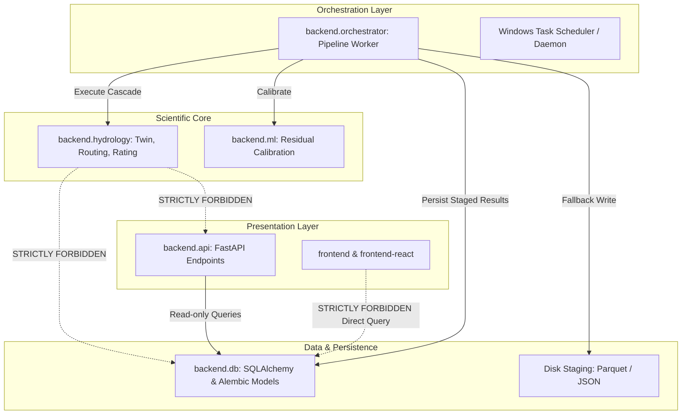
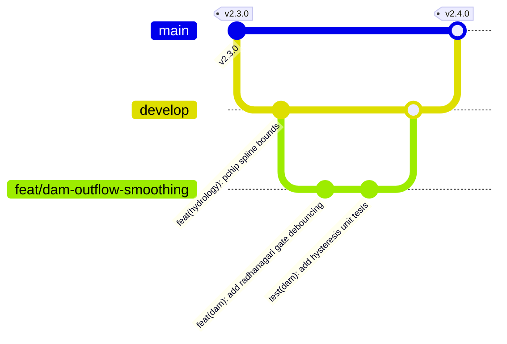

# HydroCast Engineering Guidelines: Contributing Standards, Architectural Boundaries, and Code Review Policies

This document establishes the official software craftsmanship and quality engineering standards for contributing to the HydroCast repository. All internal software engineers, scientific modelers, and external open-source contributors must comply with these protocols.

---

## 1. Architectural Invariants and Boundary Enforcement

HydroCast is built upon strict architectural separation of concerns. Violations of these boundaries will result in immediate Pull Request rejection during automated review.



### Non-Negotiable Boundary Rules
1. **The Scientific Core is Completely Pure and Stateless**:
   - Modules inside `backend/hydrology/` (SCS-CN, Muskingum routing, PCHIP splines, HEC-HMS parsers) must remain completely decoupled from databases, network sockets, or filesystem persistence.
   - All scientific functions must accept raw numerical arrays (NumPy `ndarray` or Python primitives) and return computed values. They must never import `backend.db` or `backend.api`.
2. **API Routes are Thin and Declarative**:
   - Route handlers in `backend/api/` must never contain raw mathematical simulation logic or direct raw SQL string concatenations.
   - All data fetching must be mediated by typed SQLAlchemy ORM queries or designated service repositories.
3. **Database Write Isolation**:
   - Only the pipeline worker orchestrator (`backend.orchestrator.pipeline_worker`) is authorized to perform bulk writes to the primary forecast ledger (`hyd_basin_forecast`).
   - The public API is read-only with respect to simulation records.

---

## 2. Git Commit Standards & Branching Strategy

HydroCast adheres to the **Conventional Commits 1.0.0** specification.



### Commit Message Syntax
```text
<type>(<scope>): <short imperative summary>

[optional longer explanatory body detailing motivation and architectural impact]

[optional issue reference, e.g., Closes #142]
```

### Allowed Types & Scopes
- **`feat`**: A new feature (e.g., `feat(api): add gzip compression middleware`).
- **`fix`**: A bug fix (e.g., `fix(rating): clamp stage extrapolation at high flood level`).
- **`refactor`**: Code restructuring without changing behavior (e.g., `refactor(worker): split execution steps into dedicated modules`).
- **`perf`**: A code change that improves performance (e.g., `perf(twin): vectorize Muskingum routing matrix in numpy`).
- **`test`**: Adding missing tests or correcting existing tests (e.g., `test(db): add concurrency lock tests`).
- **`docs`**: Documentation changes only (e.g., `docs(runbook): add disaster recovery cold standby procedure`).

---

## 3. Code Style, Formatting, and Linting Standards

Consistency is enforced via automated pre-commit hooks and CI linters.

### Python Backend Standards
- **Python Version**: Strictly `3.12.x`.
- **Formatting**: `black` with `--line-length 100`.
- **Linting & Import Sorting**: `ruff` with rules for flake8, isort, and pyflakes enabled.
- **Type Annotations**: Mandatory type hints (`typing`) on all public function signatures:
  ```python
  # CORRECT
  def compute_muskingum_routing(
      inflow_m3s: np.ndarray, 
      k_hours: float, 
      x_weight: float, 
      dt_hours: float = 1.0
  ) -> np.ndarray:
      ...

  # FORBIDDEN (Will be rejected by linter)
  def compute_muskingum_routing(inflow, k, x, dt=1):
      ...
  ```

### TypeScript / Frontend Standards
- **TypeScript Mode**: `strict: true` in `tsconfig.json`. No usage of `any` without explicit architectural justification and team review.
- **Linting & Formatting**: `eslint` with `@typescript-eslint/recommended` and `prettier`.

---

## 4. AST Knowledge Graph Verification (`graphify`)

Before any Pull Request is opened, the contributor must verify that their proposed changes do not introduce architectural regression, circular import cycles, or god nodes.

```powershell
# 1. Update the local knowledge graph
graphify update .

# 2. Inspect the generated report for architectural anomalies
# Check graphify-out/GRAPH_REPORT.md for god nodes or coupling warnings
```

---

## 5. Pull Request Submission & Peer Review Checklist

Every Pull Request must be accompanied by an engineering description adhering to the following template:

```markdown
### Summary of Changes
[Describe what was changed and why from an architectural perspective]

### Impact Assessment
- [ ] Breaking changes to database schema? (If yes, Alembic migration included?)
- [ ] Impacts mathematical simulation output? (If yes, hindcast verification attached?)
- [ ] Touches security or authentication boundary?

### Verification Completed
- [ ] `pytest tests/ -k "not TestFloodConcurrency"` passes (299/299 tests green)
- [ ] `npx tsc --noEmit` passes cleanly in both `frontend` and `frontend-react`
- [ ] `graphify update .` executed and graph report reviewed
- [ ] Zero-Fabrication Metrics Policy verified (no hardcoded/synthetic metrics)
```

### Review & Approval Policy
1. **Minimum Approvals**: Every PR requires at least **two approving reviews** before merge:
   - One review from a Senior Systems SDE (validating concurrency, database safety, and API contracts).
   - One review from a Lead Hydrologic Modeler (validating physical equations, conservation of mass, and hydraulic constraints).
2. **Merge Method**: Squash and merge is enforced on feature branches to maintain a clean, linear history on the `main` release branch.

