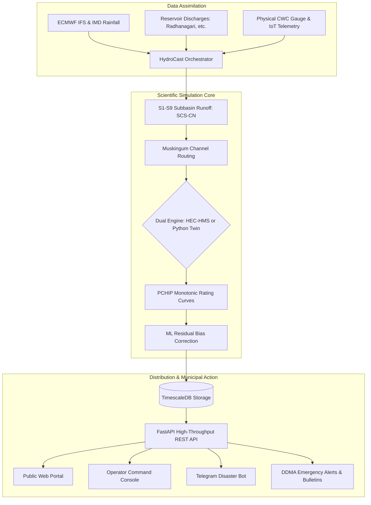
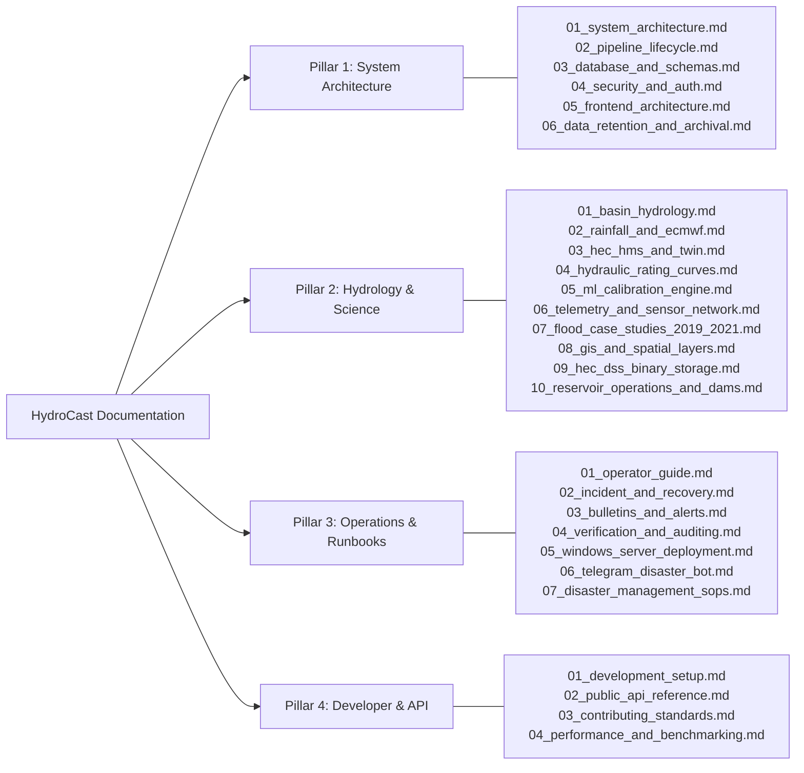
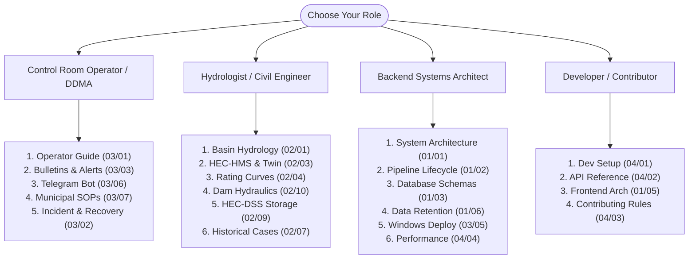

# HydroCast Documentation Hub: Technical Architecture, Hydrometeorological Science, and Operational Runbooks

Welcome to the central engineering documentation repository for **HydroCast**, the municipal flood forecasting and early warning system deployed for the Panchganga River Basin in Kolhapur, Maharashtra, India.

---

## 1. System Mission & Operational Scope

HydroCast is a mission-critical hydrologic and hydraulic forecasting platform engineered to provide municipal authorities, disaster response teams (NDRF/SDRF), and river basin operators with a **90-hour forward-looking inundation horizon**. 

Every 6 hours, the system assimilates meteorological forecasts (ECMWF IFS 0.25° grid, IMD open data), live reservoir release rates across 5 upstream dams, and physical river gauge telemetry to project water surface elevations (WSE) and discharge hydrographs across critical river crossings—most notably the historic **Shivaji Bridge** in Kolhapur City.

---

## 2. Four-Pillar Documentation Structure

The documentation suite is structured into four distinct, comprehensive engineering pillars comprising **27 specialized technical manuals**. Each document is authored with exhaustive technical rigor, complete mathematical formulations, code configurations, and operational workflows.

### [Pillar 1: System Architecture & Data Layer](01_architecture/)
Detailed architectural manuals covering infrastructure topologies, data persistence, and security controls:
- **[01. System Architecture & Topology](01_architecture/01_system_architecture.md)**: 7-tier Windows Server architecture, Caddy reverse proxy, async threading model, and offline durability.
- **[02. Pipeline Execution Lifecycle](01_architecture/02_pipeline_lifecycle.md)**: 12-step computation cascade, failover state machines, memory checkpoints, and single-step retry semantics.
- **[03. Database Models, Hypertables & Schemas](01_architecture/03_database_and_schemas.md)**: PostgreSQL 16 & TimescaleDB hypertable design, compound indexes, atomic staging, and Alembic migrations.
- **[04. Security Architecture & Authentication](01_architecture/04_security_and_auth.md)**: Dual-surface threat model, JWT HS256 tokens, environment credential seeding, and zero plain-text credential guarantees.
- **[05. Frontend Architecture & Visualization](01_architecture/05_frontend_architecture.md)**: Next.js 14 Operator Console, React Vite Public Portal, Canvas cross-sections, and Marathi localization.
- **[06. Data Retention & Archival Architecture](01_architecture/06_data_retention_and_archival.md)**: TimescaleDB chunk compression (Gorilla/Delta), cold Parquet lakehouse export, and immutable WORM audit ledgers.

### [Pillar 2: Hydrology, Science & Numerical Modeling](02_hydrology_and_science/)
Scientific and hydraulic foundations of the Panchganga River Basin model:
- **[01. Basin Hydrology & Physical Catchment](02_hydrology_and_science/01_basin_hydrology.md)**: Physical geography, S1-S9 subbasin parameters, SCS-CN infiltration, Antecedent Moisture Conditions (AMC), and Muskingum channel routing.
- **[02. Meteorology, Spatial Discretization & ECMWF](02_hydrology_and_science/02_rainfall_and_ecmwf.md)**: Western Ghats orographic regime, ECMWF IFS 0.25° grid integration, Inverse Distance Weighting (IDW), and 3-tier fallback protocols.
- **[03. HEC-HMS Automation & Python Digital Twin](02_hydrology_and_science/03_hec_hms_and_twin.md)**: Dual-core architecture, USACE HEC-HMS 4.13 headless Jython automation, vectorized Python Twin formulation, and mass conservation.
- **[04. Hydraulic Rating Curves & Stage Conversion](02_hydrology_and_science/04_hydraulic_rating_curves.md)**: PCHIP monotonic cubic Hermite splines, Gauckler-Manning compound cross-sections, and WRD physical stage benchmarks.
- **[05. ML Calibration & Residual Bias Correction](02_hydrology_and_science/05_ml_calibration_engine.md)**: Telemetry ground-truth residual analysis, hydraulic strike windows, physics bounding guardrails, and offline safety.
- **[06. IoT Sensor Network & Telemetry QA/QC](02_hydrology_and_science/06_telemetry_and_sensor_network.md)**: Ott radar sensors, ThingSpeak cellular modems, automated spike rejection, and zero-drift calibration.
- **[07. Forensic Case Studies: 2019 & 2021 Floods](02_hydrology_and_science/07_flood_case_studies_2019_2021.md)**: Forensic hydrometeorological analysis of the 2019 HFL ($545.24\text{ m}$) and 2021 flash flood benchmarks.
- **[08. GIS Topography & Spatial Vector Layers](02_hydrology_and_science/08_gis_and_spatial_layers.md)**: CartoSAT/SRTM DEM conditioning, pit-filling, stream burning, and HAND 2D inundation mapping.
- **[09. HEC-DSS Binary Storage & Synchronization](02_hydrology_and_science/09_hec_dss_binary_storage.md)**: USACE direct-access binary format, 6-part pathnames, ctypes bridge, and TimescaleDB ETL.
- **[10. Reservoir Hydraulics & Dam Rule Curves](02_hydrology_and_science/10_reservoir_operations_and_dams.md)**: Radhanagari siphon spillways, Modified Puls level-pool routing, and emergency gate override workflows.

### [Pillar 3: Operations, Runbooks & Field Management](03_operations_and_runbooks/)
Day-to-day operations, disaster response protocols, and emergency procedures:
- **[01. Operator Guide & Manual Overrides](03_operations_and_runbooks/01_operator_guide.md)**: 6-hour operational cadence, Windows Services management, manual forecast dispatch, and emergency pipeline abort.
- **[02. Incident Management, Disaster Recovery & Triage](03_operations_and_runbooks/02_incident_and_recovery.md)**: P0-P3 incident triage, database outage recovery, staging replays, process hangs, and cold standby bare-metal restore.
- **[03. Flood Warning Thresholds & Bulletins](03_operations_and_runbooks/03_bulletins_and_alerts.md)**: CWC Warning/Danger mark standards, municipal alert dispatching (DDMA webhook & Telegram), and automated PDF bulletin generation.
- **[04. Verification Standards & Zero-Fabrication Audit](03_operations_and_runbooks/04_verification_and_auditing.md)**: Senior SDE audit standards, Zero-Fabrication Metrics Policy, NSE/KGE validation, and AST Graphify synchronization.
- **[05. Windows Server Bare-Metal Deployment](03_operations_and_runbooks/05_windows_server_deployment.md)**: Windows Server 2022 setup, NSSM service registration, Caddy TLS proxy, Windows Defender exclusions, and Task Scheduler.
- **[06. Telegram Disaster Alert Bot Manual](03_operations_and_runbooks/06_telegram_disaster_bot.md)**: `@PanchgangaFloodBot` architecture, bilingual Marathi/English keyboard, rate-limited mass broadcasts, and webhook security.
- **[07. Municipal Flood SOPs & Inter-State Coordination](03_operations_and_runbooks/07_disaster_management_sops.md)**: 5-Tier municipal action matrix, Maharashtra-Karnataka Almatti Dam protocols, and urban ward evacuation.

### [Pillar 4: Developer Toolchain & API Standards](04_developer_and_api/)
Software engineering guides for extending, testing, and contributing to HydroCast:
- **[01. Local Development Setup](04_developer_and_api/01_development_setup.md)**: Windows Server/11 setup, Python 3.12, Node.js 20, PostgreSQL/TimescaleDB configuration, and Pytest execution.
- **[02. Public API Reference & Integration Guide](04_developer_and_api/02_public_api_reference.md)**: RESTful API contracts, OpenAPI schemas, GZip compression, request correlation IDs, and rate-limiting rules.
- **[03. Contributing Standards & Architectural Boundaries](04_developer_and_api/03_contributing_standards.md)**: Architecture boundary enforcement, Conventional Commits, AST knowledge graph verification, and PR review standards.
- **[04. Performance Engineering & Benchmarks](04_developer_and_api/04_performance_and_benchmarking.md)**: HEC-HMS vs Python Twin latency benchmarks ($45\text{s}$ vs $0.77\text{s}$), 2D matrix SIMD vectorization, and pool tuning.

---

## 3. Role-Based Reading Pathways

Select your operational or engineering role to navigate directly to the relevant documentation sections:

---

## 4. Key Hydrometric Benchmarks for Shivaji Bridge (Kolhapur)

| Hydrometric Parameter | Metric Value | Operational Consequence |
| :--- | :--- | :--- |
| **Zero Gauge Datum / Bed Invert** | $530.12\text{ m AMSL}$ | Baseline physical riverbed elevation. |
| **Normal High Water Level** | $538.00\text{ m AMSL}$ | Full channel capacity; no municipal inundation. |
| **Statutory Warning Mark (CWC)** | **$540.00\text{ m AMSL}$** | Low-lying agricultural inundation; automated advisory dispatched to DDMA. |
| **Statutory Danger Mark (CWC)** | **$542.50\text{ m AMSL}$** | Shivaji Bridge arch threatened; Bapat Camp residential evacuation triggered. |
| **High Flood Level (HFL - 2019/2021)** | **$545.24\text{ m AMSL}$** | Catastrophic regional flood; national emergency response mobilization. |
| **Forecast Lookahead Horizon** | **$90\text{ Hours}$** | Continuous step-wise forecast with 1-hour resolution. |
| **Pipeline Schedule Interval** | **$6\text{ Hours}$** | Cycles run at 00:00, 06:00, 12:00, and 18:00 UTC. |

---

## 5. Software License & Governance

HydroCast is developed and maintained as an open-source, safety-critical municipal technology platform. Architectural standards and code modifications are governed by the Lead Systems Architect and Chief Hydrologist in coordination with the Kolhapur District Disaster Management Authority (DDMA).
