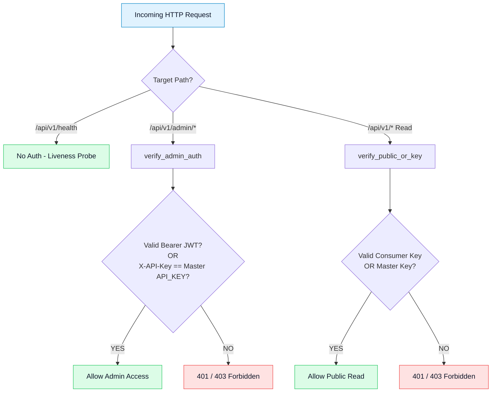

# Security, Authentication & Rate Limiting Architecture

HydroCast implements defense-in-depth API security engineered for critical flood forecasting infrastructure, featuring a **two-tier API key hierarchy**, **administrative JWT authentication**, **bcrypt password hashing**, **SlowAPI rate limiting**, and **DoS connection throttling**.

---

## Interactive diagram consoles

The consoles below provide interactive visualization of the API authentication flow and backend endpoint map.

<div class="hydrocast-diagram-card">
  <div class="hydrocast-diagram-header">
    <div class="hydrocast-diagram-title">
      <span class="hydrocast-diagram-badge">Interactive Console · Diagram 04</span>
      <strong>API Gateway & Authentication Sequence</strong>
    </div>
    <div class="hydrocast-diagram-actions">
      <a class="hydrocast-diagram-btn" href="../../diagrams/04-sequence-auth-api.html" target="_blank">Open Fullscreen ↗</a>
    </div>
  </div>
  <iframe class="hydrocast-diagram-frame" src="../../diagrams/04-sequence-auth-api.html?embed=1" title="API Gateway & Authentication Sequence Console"></iframe>
</div>

---

## 1. Two-Tier Scoped API Key Architecture (`src/api/keys.py`)

HydroCast isolates operational consumers from administrative functions by enforcing two distinct API key classes:



### 1.1 Key Tiers and Access Scopes

| Key Class | Configuration Variable | Scope of Permissions | Accepted by `/api/v1/admin/*`? |
| :--- | :--- | :--- | :---: |
| **Master API Key** | `API_KEY` | Full public read access and administrative fallback | **YES** |
| **Consumer Read-Only Keys** | `HYDROCAST_READONLY_KEY`<br>`HYDROSIM_API_KEY`<br>`CONSUMER_API_KEYS` | Read-only public endpoints (e.g. `/api/v1/water-levels`) | **NO (Strictly Forbidden)** |

### 1.2 Constant-Time Timing-Attack Defense

To prevent timing side-channel attacks from disclosing key lengths or secret prefixes, `src/api/keys.py` utilizes constant-time comparison via Python's `hmac.compare_digest`. All configured keys are evaluated in constant time without short-circuiting:

```python
def verify_consumer_key(supplied: str | None) -> bool:
    """True if supplied matches any consumer key. Always fail-closed."""
    if not supplied:
        return False
    matched = False
    for key in consumer_keys():
        matched |= hmac.compare_digest(supplied.encode("utf-8"), key.encode("utf-8"))
    return matched
```

### 1.3 Zero-Downtime Consumer Key Rotation

The `CONSUMER_API_KEYS` environment variable accepts a comma-separated list of active keys (`key_v1,key_v2`). This enables zero-downtime rotation for external consumers (such as HydroSim 2D or district authorities):
1. Append the new key to `CONSUMER_API_KEYS`.
2. Update the downstream consumer to use the new key.
3. Remove the retired key from `CONSUMER_API_KEYS`.

---

## 2. Administrative Authentication & JWT Tokens (`src/api/security.py`)

Administrative operations (`POST /api/v1/admin/*`, parameter recalibration, run archival) require authenticated credentials.

### 2.1 Cryptographic Token Standards
- **Algorithm:** Symmetric HMAC-SHA256 (`HS256`).
- **Algorithm Confinement:** Locked strictly to `_ALLOWED_JWT_ALGORITHMS = {"HS256", "HS384", "HS512"}`. Insecure algorithms like `"none"` or asymmetric confusion variants are rejected at startup.
- **Expiration:** `JWT_EXPIRATION_MINUTES = 1440` (24-hour lifetime).
- **Token Claims:** Payload contains `{sub: username, role: "admin", iat: timestamp, exp: timestamp}` with issuer `iss: "hydrocast-api"`.

### 2.2 Password Hashing (Bcrypt) & Fail-Closed Guard
- **Storage:** Administrator passwords are never stored in plaintext; passwords are hashed using `bcrypt` with per-hash salt (`hash_password`, `verify_password`).
- **Fail-Closed Guarantee:**
  ```python
  def verify_admin_credentials(username: str, password: str) -> bool:
      if not ADMIN_PASSWORD or not ADMIN_USERNAME:
          return False
      valid_user = hmac.compare_digest(username.strip().encode("utf-8"), ADMIN_USERNAME.strip().encode("utf-8"))
      valid_pass = hmac.compare_digest(password.encode("utf-8"), ADMIN_PASSWORD.encode("utf-8"))
      return valid_user and valid_pass
  ```
  If `ADMIN_PASSWORD` is unconfigured, login immediately fails closed rather than matching an empty string.

---

## 3. SlowAPI Request Rate Limiting (`src/api/limits.py`)

To prevent API scraping, denial of service, and brute-force password guessing, HydroCast integrates SlowAPI rate limiting:

| Target Endpoint Surface | Rate Limit Budget | Target Protection |
| :--- | :---: | :--- |
| **Public Read Endpoints** (`/api/v1/*`) | **`100 / minute`** | Prevents bandwidth saturation and scraping |
| **Admin Login Endpoint** (`/api/v1/admin/auth/token`) | **`5 / minute`** | Mitigates credential brute-forcing attacks |

Rate limits key off the client remote IP address (`get_remote_address`). Rate-limit headers (`X-RateLimit-Limit`, `X-RateLimit-Remaining`, `X-RateLimit-Reset`) are returned with every response.

---

## 4. Hardening & DoS Mitigations (`src/api/main.py`)

### 4.1 WebSocket Connection Throttling
To protect server memory and file descriptors from connection-exhaustion attacks, the live WebSocket manager enforces a hard connection cap:
```python
class WSManager:
    MAX_CONNECTIONS = int(os.getenv("MAX_WS_CONNECTIONS", "200"))
```
When concurrent connections reach 200, additional connections are rejected with WebSocket close code `1013` (Try Again Later).

### 4.2 Request Body Size Guard
A custom Starlette middleware intercepts all incoming HTTP requests, rejecting payloads exceeding **2 MB** with HTTP 413 (Payload Too Large).

### 4.3 Path Traversal Prevention
Historical run queries enforce strict regular expression validation on `run_id`:
```python
if not re.match(r"^[a-zA-Z0-9_-]+$", run_id):
    raise HTTPException(status_code=400, detail="Invalid run_id format")
```
This guarantees that queries containing `../` or special characters cannot traverse local storage directories.

---

## 5. Source Code Reference

### `src/api/security.py`
::: src.api.security

---

### `src/api/keys.py`
::: src.api.keys

---

### `src/api/limits.py`
::: src.api.limits
