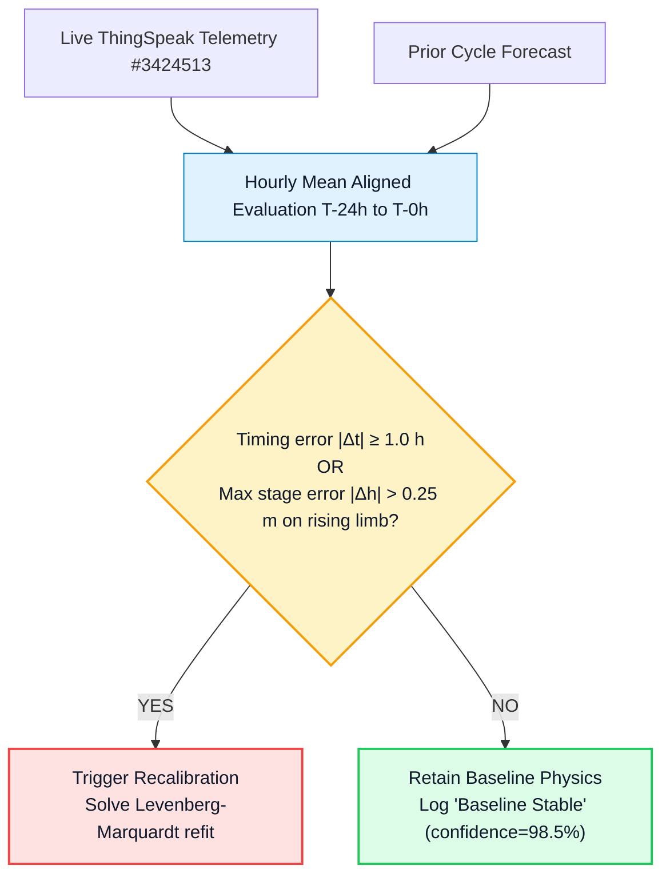
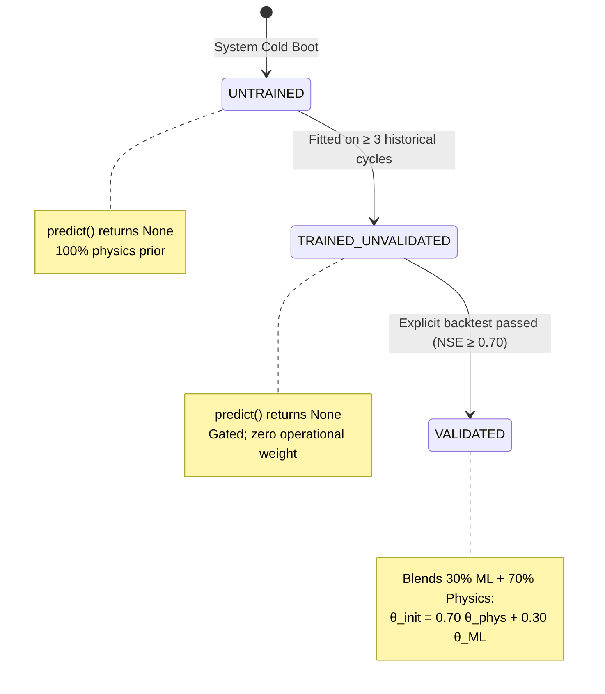

# Physics-Informed Adaptive Hydrologic Calibrator

HydroCast incorporates a real-time **Physics-Informed Adaptive Hydrologic Calibrator** (`src/hydrology/ml_calibration.py`) that operates as an automated supervisory loop on every 6-hour forecast cycle. When real-time ultrasonic water level observations diverge from simulated hydrographs, the calibrator dynamically optimizes the governing hydrologic parameters within strict physical bounds.

---

## Interactive diagram consoles

The console below is the rendered reference for this page: it carries the same structure, tier boundaries and failure branches that the prose describes.

  

    

      Interactive Console · Diagram 15
      <strong>Adaptive ML Calibration Loop</strong>
    

    

      <a class="hydrocast-diagram-btn" href="../diagrams/15-ml-calibration.html" target="_blank">Open Fullscreen ↗</a>
    

  

  <iframe class="hydrocast-diagram-frame" src="../diagrams/15-ml-calibration.html?embed=1" title="Adaptive ML Calibration Loop Console"></iframe>

  

    

      Interactive Console · Diagram 05
      <strong>Simulation Run Lifecycle</strong>
    

    

      <a class="hydrocast-diagram-btn" href="../diagrams/05-lifecycle-runs.html" target="_blank">Open Fullscreen ↗</a>
    

  

  <iframe class="hydrocast-diagram-frame" src="../diagrams/05-lifecycle-runs.html?embed=1" title="Simulation Run Lifecycle Console"></iframe>

---

## 1. Operational Philosophy & Guardrails

!!! warning "Physics-Informed Architecture vs. Black-Box ML"
    1. **Primary Operational Engine is Deterministic Optimization:** The production calibrator uses a bounded Levenberg–Marquardt non-linear least-squares solver (`scipy.optimize.least_squares`). It fits the parameters of the physical digital twin emulator against observed telemetry.
    2. **Gated and Failsafe Machine-Learning Predictor:** The machine-learning assistant (`HydrologicParameterPredictor` in `src/hydrology/ml_parameter_predictor.py`) is strictly gated. It contributes to initial parameter estimates **only** when trained on $\ge 3$ historical monsoon events and verified by an explicit backtest verdict. When unvalidated, it returns `None`, and the engine relies 100% on analytical physics priors.
    3. **Observation-Fit Score, NOT Forecast Probability:** The metric `confidence_pct` represents how closely the calibrated parameters reproduce recent observed telemetry ($\Delta t, \Delta h$). It is an **observation-fit score**, not a forecast-accuracy probability.

---

## 2. Discrepancy Detection & Trigger Thresholds

The calibrator continuously tracks live water level telemetry from ThingSpeak Channel #3424513 (ultrasonic radar on Shivaji Bridge deck, datum 549.35 m MSL) against the forward forecast from the prior cycle.

### 2.1 Wave Timing Discrepancy ($\Delta t$)

During active rising-limb flood conditions ($\Delta h_{rise} > 0.15$ m), the timing offset is calculated from the signed mean stage error $\bar{e}_{stage}$ and the empirical rate of rise:

$$\Delta t = -\frac{\bar{e}_{stage}}{\text{Rate of Rise}} \quad (\text{hours})$$

- **Early Arrival ($\Delta t < 0$):** River stage rises faster than modeled. Wave celerity in upstream reaches is higher than simulated. Reach travel time $K$ and subbasin lag times must be scaled downward ($\alpha_K < 1.0, \alpha_{lag} < 1.0$).
- **Delayed Arrival ($\Delta t > 0$):** Flood wave is retarded by heavy channel storage, backwater, or overbank vegetation. Reach travel time $K$ and subbasin lag times must be scaled upward ($\alpha_K > 1.0, \alpha_{lag} > 1.0$).

### 2.2 Trigger Criteria

Recalibration is triggered in `src/hydrology/ml_calibration.py::detect_timing_and_stage_discrepancy` if and only if:

$$\left|\Delta t\right| \ge 1.0\text{ hr} \quad \text{OR} \quad \left(\max |e_{stage}| > 0.25\text{ m} \;\land\; \Delta h_{rise} > 0.15\text{ m}\right)$$

If tolerances are satisfied, the system logs `Baseline Stable`, retains baseline parameters $[\alpha_K=1.0, \alpha_{lag}=1.0, \Delta CN=0.0, X=0.250]$, and skips optimization.

---

## 3. Mathematical Optimization Formulation

The non-linear least-squares problem solves for the optimal parameter vector:

$$\boldsymbol{\theta} = \begin{bmatrix} \alpha_K \\ \alpha_{lag} \\ \Delta CN \\ X \end{bmatrix} \in \mathbb{R}^4$$

Using `scipy.optimize.least_squares(method='lm', max_nfev=25, ftol=1e-8)`.

### 3.1 Parameter Bounds & Physical Meanings

| Parameter | Symbol | Baseline | Permissible Range | Physical Governance in Panchganga Basin |
| :--- | :---: | :---: | :---: | :--- |
| **Reach Travel Time Multiplier** | $\alpha_K$ | $1.000$ | $[0.500, 1.800]$ | Scales travel time $K$ across reaches R1–R5 (see [Reaches](basin-hydrology.md#muskingum-reaches)) |
| **Subbasin Lag Time Multiplier** | $\alpha_{lag}$ | $1.000$ | $[0.500, 1.800]$ | Scales Kirpich lag times $t_{lag}$ across subbasins S1–S9 (see [Subbasins](basin-hydrology.md#subbasin-parameters)) |
| **SCS Curve Number Shift** | $\Delta CN$ | $0.00$ | $[-8.00, +8.00]$ | Additive shift to soil retention capacity across catchment |
| **Muskingum Wedge Weight** | $X$ | $0.250$ | $[0.150, 0.400]$ | Governs wave diffusion and peak attenuation in river reaches |

### 3.2 Residual Vector $r(\boldsymbol{\theta})$

The Levenberg-Marquardt optimizer minimizes the sum of squared residuals $\sum_j r_j(\boldsymbol{\theta})^2$. The residual components are:

#### 1. Target Hydrograph Residual with Asymmetric 3× Flood Penalty
When real rainfall hyetographs are present, the simulated hydrograph $Q_{sim}(t; \boldsymbol{\theta})$ is compared against an observation-anchored target hydrograph $Q_{target}(t)$:

$$r_{hg}(t) = \frac{Q_{sim}(t; \boldsymbol{\theta}) - Q_{target}(t)}{\sigma_{resid}}$$

Where $Q_{target}(t)$ is constructed by shifting the baseline hydrograph by $-\Delta t$ hours and rescaling peak discharge by observed stage error.

!!! danger "Asymmetric Life-Safety Loss Function"
    Under-predicting flood crests exposes vulnerable civil infrastructure and evacuation routes in Kolhapur to unannounced inundation. To penalize under-prediction, an asymmetric multiplier is enforced:

    $$r_{hg}(t) \leftarrow 3.0 \cdot r_{hg}(t) \quad \text{whenever } Q_{sim}(t) < Q_{target}(t)$$

    Over-prediction is penalized at standard $1.0\times$ weight, guaranteeing that the optimizer strictly avoids dangerously low flood crest solutions.

#### 2. Kinematic Timing Residual ($r_{time}$)
Relates parameter scaling to expected timing shifts (55% reach travel time, 45% subbasin lag):

$$\Delta t_{model} = 0.55 \left(\frac{\alpha_K - 1.0}{0.075}\right) + 0.45 \left(\frac{\alpha_{lag} - 1.0}{0.060}\right)$$

$$r_{time} = \frac{\Delta t_{model} - \Delta t_{obs}}{2.0}$$

#### 3. Stage Volume Residual ($r_{stage}$)
Relates Curve Number shifts to stage elevation changes ($\Delta CN = 4.5 \approx 1.0$ m stage):

$$r_{stage} = \frac{-\Delta CN / 4.5 - \Delta h_{obs}}{0.25}$$

#### 4. Wedge Storage Residual ($r_X$)
Regularizes $X$ toward the kinematic wave target:

$$X_{expected} = \text{clip}(0.25 - 0.02 \cdot \Delta t_{obs}, \; 0.16, \; 0.36)$$

$$r_X = \frac{X - X_{expected}}{0.05}$$

#### 5. Regularization Priors ($r_K, r_{lag}$)
Prevents parameter drift away from analytical kinematic priors:

$$r_K = \frac{\alpha_K - k_{shift}}{0.20}, \qquad r_{lag} = \frac{\alpha_{lag} - lag_{shift}}{0.20}$$

---

## 4. Deterministic Analytical Kinematic Fallback

If numerical optimization does not converge within 25 iterations or numerical singularities occur, the engine falls back to an analytical kinematic-wave formulation:

$$k_{shift} = \text{clip}(1.0 + \Delta t \cdot 0.075, \; 0.60, \; 1.60)$$

$$lag_{shift} = \text{clip}(1.0 + \Delta t \cdot 0.060, \; 0.60, \; 1.60)$$

$$\Delta CN_{shift} = \text{clip}(-\Delta h \cdot 4.5, \; -6.0, \; 6.0)$$

$$X_{shift} = \text{clip}(0.25 - \Delta t \cdot 0.02, \; 0.16, \; 0.36)$$

This ensures **100% fail-safe execution**; the forecast pipeline never aborts due to optimization failure.

---

## 5. Gated Machine-Learning Predictor Lifecycle

In `src/hydrology/ml_parameter_predictor.py`, the `HydrologicParameterPredictor` incorporates an explicit four-state lifecycle gate to prevent unvalidated ML weights from entering the life-safety path:

### 5.1 Gating Implementation
If state is not `VALIDATED`, `predict()` returns `None`. The calibrator initializes the Levenberg-Marquardt solver with 100% analytical physics priors. When `VALIDATED`, the ML prediction acts solely as a **warm-start initial guess** ($\boldsymbol{\theta}_{init} = 0.70 \boldsymbol{\theta}_{physics} + 0.30 \boldsymbol{\theta}_{ML}$), which is then rigorously verified by the bounded optimizer.

### 5.2 Feature Engineering (25+ Hydrologic Descriptors)
The predictor extracts features from 90-hour stage curves:
- **Central Tendency & Dispersion:** Mean, median, standard deviation, variance, interquartile range.
- **Extrema & Boundary Levels:** Minimum stage, maximum stage, initial stage $h(0)$, final stage $h(89)$.
- **Kinematic Dynamics:** Maximum rate of rise ($\max \Delta h$), maximum rate of fall ($\min \Delta h$), mean rising rate, mean falling rate.
- **Hydrograph Geometry:** Time-to-peak $t_p$, centroid lag, duration above alert stage ($542.10$ m), duration above danger stage ($543.30$ m).

### 5.3 Model Architecture
- **Regressor:** `ExtraTreesRegressor` (ensemble of randomized decision trees) with `StandardScaler` normalization on feature matrix $X$ and label vector $y$.
- **Model Persistence:** Serialized using `joblib` in `data/telemetry/ml_parameter_predictor.joblib`. State metadata is preserved in `data/telemetry/ml_parameter_validation.json`.

---

## 6. Observation-Fit Score (`confidence_pct`)

The calibrator computes an honest metric evaluating how well the fitted parameter set explains observed telemetry:

$$\chi^2 = \left(\frac{\Delta t_{model} - \Delta t_{obs}}{1.0}\right)^2 + \left(\frac{-\Delta CN / 4.5 - \Delta h_{obs}}{0.25}\right)^2$$

$$Score = 100 \cdot \exp\left(-0.5 \chi^2\right) \cdot \left(0.70 + 0.30 \cdot \min\left(1.0, \; \frac{N_{aligned}}{12}\right)\right)$$

### Penalties & Hard Bounding
- **Bound Penalty ($\times 0.70$):** Multiplied by $0.70$ if any parameter ($\alpha_K, \alpha_{lag}, \Delta CN, X$) is pinned against its physical boundary.
- **Convergence Penalty ($\times 0.60$):** Multiplied by $0.60$ if the Levenberg-Marquardt solver fails to converge within iteration limits.
- **Reporting Range:** Strictly clamped to $[50.0\%, \; 99.9\%]$.

---

## 7. Closed-Loop Atomic Write-Back to HEC-HMS Basin File

When recalibration completes, HydroCast synchronizes the updated parameters across both engines:

1. **In-Memory Injection:** Directly injected into `runner.py::execute_hec_hms` via `parameter_overrides` for immediate execution in the active cycle.
2. **Atomic Disk Synchronization (`sync_to_hec_hms_basin`):**
   - Creates a timestamped backup: `data/hms/HMS_Automation_RJKT/Basin_1.basin.bak_YYYYMMDD_HHMMSS`.
   - Modifies `Curve Number:` and `Lag:` entries using regular expressions.
   - Writes to a temporary file (`Basin_1.basin.tmp`) in the same directory.
   - Atomically replaces the production file via `os.replace()`, guaranteeing that crashes cannot leave a corrupted basin configuration.
3. **State Ledger:** Serialized to `data/telemetry/ml_calibration_state.json`.

During test suite execution (`PYTEST_CURRENT_TEST`), disk writes are automatically intercepted and safely bypassed, protecting production configuration files from test pollution.
